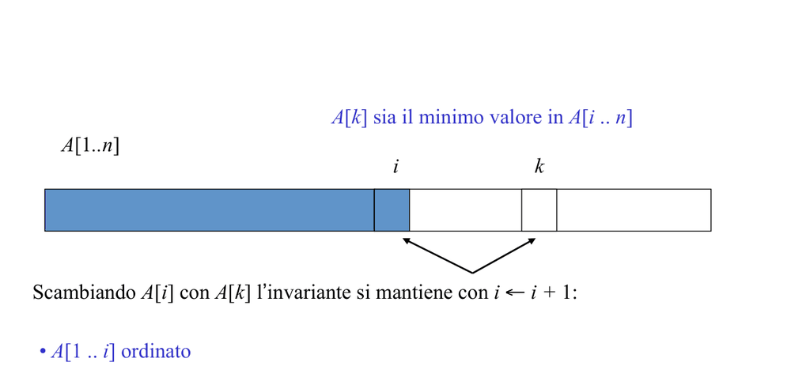
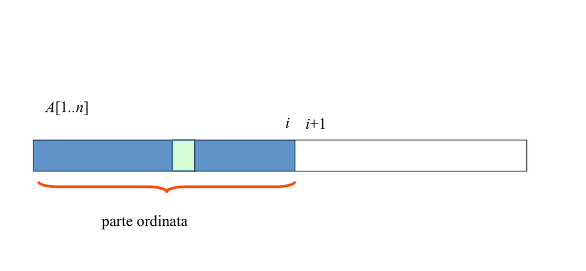

# 01 - Problemi, algoritmi, correttezza, terminazione, iterazione, ricerche e ordinamenti elementari

Fonte: doc Drive "Algoritmi e Strutture Dati - Appunti" (sezioni: Problemi e Algoritmi, Correttezza e terminazione, Iterazione, Esercitazione, Ordinamento).

## Mappa

Il file parte da che cosa sia un problema computazionale e un algoritmo (con Euclide e Kadane come primi esempi e con i limiti dell'insolubile e dell'intrattabile), passa agli strumenti per dimostrare che un algoritmo fa ciò che promette (specifica, induzione, invarianti, terminazione), mostra come l'invariante si possa usare per *progettare* i cicli (ricerca binaria, moltiplicazione alla russa) e chiude con gli ordinamenti elementari (Selection e Insertion sort) e il confronto fra ricerca lineare e binaria.

- [Problemi e algoritmi](#problemi-e-algoritmi)
- [Correttezza e terminazione](#correttezza-e-terminazione)
- [Iterazione e accumulatori](#iterazione-e-accumulatori)
- [Ordinamenti elementari: costi](#ordinamenti-elementari-costi)
- [Ricerca lineare vs binaria](#ricerca-lineare-vs-binaria)
- [Cose da saper fare all'esame](#cose-da-saper-fare-allesame)
- [Dubbi](#dubbi)

## Problemi e algoritmi

Un **problema** computazionale è, in sostanza, una relazione $R = \lbrace(\text{istanza}, \text{risposta}) \mid \text{soddisfano un criterio}\rbrace$: a ogni istanza possono corrispondere una o più risposte accettabili. Un **algoritmo** è un metodo meccanico per passare dall'istanza a una risposta, e perché meriti il nome deve avere quattro proprietà:
- **finito** (termina sempre);
- **deterministico**;
- **non ambiguo**;
- **generale** (funziona per tutte le istanze, non solo per alcune).

È proprio la proprietà di finitezza che costringe, più avanti, a occuparsi di terminazione oltre che di correttezza.

L'esempio classico è l'algoritmo di **Euclide**, che poggia sull'identità $\text{MCD}(a,b) = \text{MCD}(b,\ a \bmod b)$ con $\text{MCD}(a,0)=a$: a ogni passo la coppia si riduce senza cambiare il suo massimo comun divisore, finché il secondo numero si annulla. Ad esempio $\text{MCD}(345,150)$: $345=150\cdot 2+45$, $150=45\cdot 3+15$, $45=15\cdot 3+0$, quindi il risultato è 15. Il costo è $\boldsymbol{O(\log m)}$, a fronte dell'approccio per fattorizzazione che costa $O(\sqrt{m})$: qui l'astuzia matematica vale un salto di ordine di grandezza.

```
EUCLIDE(m,n)   // m>0, n>=0
 a,b := m,n
 while b>0 do   // inv: MCD(a,b)=MCD(m,n)
    r := a mod b ; a,b := b,r
 return a
```

Un secondo esempio, che ritorna in tutto il corso come esempio di salto di complessità, è il **segmento di somma massima** (Kadane). La forza bruta controlla tutte le coppie di estremi ed è $O(n^3)$; con un po' di attenzione si scende a $O(n^2)$; l'algoritmo di Kadane arriva a $\boldsymbol{O(n)}$, che è ottimo perché ogni elemento va letto almeno una volta. L'idea è di programmazione dinamica: la soluzione "migliore segmento che termina in $i$" si ricava da quella per $i-1$, perché o si estende il segmento precedente con $A[i]$ oppure si riparte da $A[i]$ da solo.

```
KADANE(A[0..n-1])
 maxSeg := A[0]; maxSegLoc := maxSeg
 for i := 1 to n-1 do      // (nel doc: "0 to n-1", innocuo)
    // inv: maxSeg = max_{0<=k<=j<i} Σ A[k..j];  maxSegLoc = max_{0<=j<i} Σ A[j..i-1]
    maxSegLoc := max(A[i], maxSegLoc + A[i])
    maxSeg    := max(maxSeg, maxSegLoc)
 return maxSeg
```

Esempio: per $A=[2,3,-8,7,-1,2,3]$ il valore di maxSegLoc evolve come $2,5,-3,7,6,8,11$ e il risultato è **11**.

Non tutti i problemi ammettono un algoritmo, e fra quelli che lo ammettono non tutti sono trattabili. Un problema è **insolubile** se nessun algoritmo lo risolve; l'esempio fondamentale è l'**halting problem** (Turing): non esiste un algoritmo $\text{Halt}(P,I)$ che decida se il programma $P$ termina sull'input $I$. La dimostrazione è per assurdo ed è un argomento diagonale: dato Halt, si costruisce $\text{Diag}(P)$ = "se $\text{Halt}(P,P)$ allora cicla all'infinito, altrimenti termina (return)". Ora $\text{Diag}(\text{Diag})$ termina se e solo se $\text{Halt}(\text{Diag},\text{Diag})=\text{false}$, cioè se e solo se $\text{Diag}(\text{Diag})$ non termina: contraddizione. Un problema è invece **intrattabile** quando un algoritmo esiste ma ha costo esponenziale: le Torri di Hanoi richiedono $2^n - 1$ mosse (e non si può fare di meglio, perché la risposta stessa è così lunga), mentre i problemi NP-completi (Cook), come il Ciclo di Hamilton, non hanno nessun algoritmo polinomiale noto.

## Correttezza e terminazione

Dire che un algoritmo è corretto ha senso solo rispetto a una **specifica**, che funziona come un contratto: una **pre-condizione** (ipotesi sull'input) e una **post-condizione** (proprietà che l'output deve soddisfare). Per la divisione intera $\text{Div}(a,b)$ la pre-condizione è $a\ge 0,\ b\gt 0$ e la post-condizione è $a=bq+r \land 0\le r\lt b$. Si distingue poi la **correttezza parziale** (se l'algoritmo termina, l'output è corretto) dalla **correttezza totale**, che è la parziale più la terminazione: separare i due aspetti permette di dimostrarli con strumenti diversi.

Per gli algoritmi ricorsivi lo strumento naturale è l'**induzione completa**, $((\forall k\lt m.\ P(k)) \Rightarrow P(m))$: si assume che le chiamate ricorsive siano corrette (ipotesi induttiva, IH) e si mostra che da questo discende la correttezza della chiamata corrente. Su DIV-REC si vede bene il meccanismo: nel caso base $a\lt b$ si restituisce $q=0,\ r=a$, che soddisfa la post-condizione; nel passo si ha $bq+r = b(q'+1)+r = (a-b)+b = a$, e il vincolo $0\le r\lt b$ è ereditato direttamente dall'IH.

```
DIV-REC(a,b)            // pre a>=0, b>0
 if a<b then q,r := 0,a
 else q',r := DIV-REC(a-b,b)   // IH: a-b = bq'+r ∧ 0<=r<b
      q := q'+1
 return q,r             // post a=bq+r ∧ 0<=r<b
```

Per gli algoritmi iterativi l'analogo dell'induzione è l'**invariante di ciclo**: una proprietà vera prima del ciclo e conservata da ogni iterazione, in modo che alla fine, sommata alla negazione della guardia, implichi la post-condizione. La dimostrazione ha sempre tre fasi:
1. **Inizializzazione**: l'invariante vale all'ingresso;
2. **Mantenimento**: se vale all'inizio di un'iterazione, vale alla fine;
3. **Terminazione**: $\text{Inv} \land \lnot\text{Guardia} \Rightarrow \text{Post}$.

Sulla divisione iterativa, il mantenimento si riduce a osservare che $b(q+1)+(r-b)=bq+r=a$ e che $r\ge b$ garantisce $r-b\ge 0$.

```
DIV-IT(a,b): r:=a; q:=0
  while r>=b do   // inv: a=bq+r ∧ 0<=r
     r:=r-b; q:=q+1
  // Inv ∧ r<b => post
```

Gli errori tipici sugli invarianti sono tre, e conviene averli bene in mente perché ricorrono agli esami:
- l'invariante **non è la guardia** (la guardia è falsa all'uscita, l'invariante no);
- l'invariante **non è un'operazione** ("r diminuisce di m" descrive un'azione, non una proprietà dello stato);
- deve essere **abbastanza forte** da implicare la post-condizione una volta negata la guardia.

Resta la **terminazione**, che si dimostra esibendo una **misura che decresce strettamente** in un **ordine ben fondato**, cioè un ordine senza catene discendenti infinite (per esempio i naturali). Per fact($n-1$) la misura è $n$; per la ricerca binaria è l'ampiezza intera $j-i+1$ dell'intervallo. Non sempre è facile: il caso di **Collatz ($3n+1$)** è un esempio in cui la terminazione non è dimostrata. Quando la misura è composita si usa l'**ordine lessicografico** sulle tuple: nell'esempio "Biscotti infiniti", BISCUIT(gold,silver), se $\text{silver}\gt 0$ si passa a $(\text{gold},\ \text{silver}-1,\ 2\cdot\text{biscuit})$ e decresce silver; se $\text{silver}=0$ decresce $\text{gold}-1$; nel complesso la coppia decresce lessicograficamente. Il codice completo di BISCUIT non è nel doc, solo l'argomento di terminazione: è nelle slide del corso. Un esempio classico e verificabile della stessa tecnica è la funzione di Ackermann, la cui terminazione in Dafny si dimostra con `decreases m, n` (tupla confrontata lessicograficamente).

Il doc cita anche strumenti che automatizzano questi ragionamenti: **Dafny** (annotazioni requires/ensures/invariant), **T2** (analisi di terminazione), e il caso storico di **Timsort**, il cui bug rimase presente per anni. Fu scoperto da de Gouw et al. verificando Timsort con KeY: `mergeCollapse` controllava solo le ultime 3 run e non preservava l'invariante `runLen[i] > runLen[i+1]+runLen[i+2]`, così su array molto grandi (decine di milioni di elementi, con molte run corte) la pila delle run, dimensionata a 40, poteva sforare e dare un `ArrayIndexOutOfBoundsException`; il fix controlla le ultime 4 run (JDK-8072909). Una soglia minima esatta di lunghezza non è stata verificata.

## Iterazione e accumulatori

Un ciclo è composto da inizializzazioni, da parametri di sola lettura $z$ e da **accumulatori** $x$, cioè variabili che portano lo stato e il cui nuovo valore dipende dal valore precedente. Le variabili temporanee, che vengono ricalcolate da zero a ogni iterazione, non sono accumulatori. In fact gli accumulatori sono fact e $i$; in Div sono $q$ e $r$; nella bisezione del coseno sono $a, b, c, \delta$ (mentre $p$ è temporanea).

Da qui discende il metodo di **progettazione invariant-first**, che rovescia l'ordine in cui si scrive il codice: si pensa prima a *cosa* accumulare e quale proprietà deve restare vera, e solo dopo si scrive il ciclo. L'ordine di progetto è:
1. l'idea di cosa accumulare;
2. l'invariante;
3. il corpo, che preserva l'invariante e avvicina alla soluzione;
4. la guardia;
5. l'inizializzazione che rende vero l'invariante.

Applicato alla **ricerca binaria**, l'invariante è "se $n$ è nel vettore, allora è in v[i..j]"; il corpo prende $m=(i+j)/2$ e distingue tra trovato, v[i..m-1] e v[m+1..j]; la guardia è $i\le j$ e l'inizializzazione $i=0,\ j=\text{dim}-1$.

Un esempio ancora più illuminante è la **moltiplicazione alla russa**, dove l'invariante $\boldsymbol{n\cdot m = z + a\cdot b}$ conserva il prodotto cercato mentre $a$ e $b$ si trasformano: $a$ dimezza e $b$ raddoppia, e quando $a$ è dispari la parte "perduta" nel dimezzamento viene accumulata in $z$. Si inizializza $a=n,\ b=m,\ z=0$; a ogni passo, se $a$ è dispari si somma $b$ a $z$; poi si dimezza $a$ e si raddoppia $b$ ($b = b + b$); la guardia è $a\gt 0$ e all'uscita ($a=0$) l'invariante dà $z=n\cdot m$. Poiché $a$ dimezza a ogni passo, le iterazioni sono circa $\log_2 n$ (deduzione mia, non esplicita nel doc).

```
int MoltRussa(int m,int n){ int a=n,b=m,z=0;
  while(a>0){ // inv: n*m = z + a*b
     if(a%2==1) z+=b;  a/=2;  b+=b; }
  return z; }
```

Anche gli ordinamenti elementari si leggono come due diverse scelte di invariante. Nel **Selection sort** l'invariante è: v[0..i-1] è ordinato *e* ogni elemento di v[i..n-1] è $\ge$ ogni elemento di v[0..i-1], cioè il prefisso è già nella sua posizione definitiva; il passo cerca l'indice $k$ del minimo in v[i..n-1] e scambia v[i] con v[k]; si inizializza $i=0$ e la guardia è $i\lt n-1$. Nell'**Insertion sort** l'invariante è più debole, solo v[0..i-1] ordinato senza alcuna ipotesi sul resto: il passo fa scorrere v[i] all'indietro, con scambi, finché il precedente è $\le$; si inizializza $i=1$ e la guardia è $i\lt n$.

## Ordinamenti elementari: costi

La differenza di invariante si traduce in un diverso comportamento al variare dell'input. Selection sort deve sempre cercare il minimo nell'intero suffisso e quindi fa un numero di confronti che non dipende dai dati; Insertion sort invece si ferma appena trova la posizione giusta, e quindi sull'input già ordinato (ogni $t_i=1$) fa solo $O(n)$ confronti, mentre sull'input inverso ($t_i=i$) arriva a $O(n^2)$. Sul numero di scambi la situazione è opposta: Selection ne fa sempre esattamente $n-1$, Insertion da 0 a $O(n^2)$.

<p align="center">
<br>
<sub><i>Figura: invariante del Selection Sort (slide 23).</i></sub>
</p>


<p align="center">
<br>
<sub><i>Figura: invariante dell'Insertion Sort (slide 12).</i></sub>
</p>


| | Insertion | Selection |
|---|---|---|
| Confronti migliore | $O(n)$ (già ordinato, $t_i=1$) | $O(n^2)$ |
| Confronti peggiore | $O(n^2)$ (inverso, $t_i=i$) | $O(n^2)$ |
| Scambi migliore/peggiore | $0$ / $O(n^2)$ | $\boldsymbol{n-1}$ **sempre** |

Le formule esatte sono $T_{ins}(n)=an^2+bn+c$ nel caso peggiore e $T_{sel}(n)=\frac{n^2}{2} + \frac{7n}{2} - 3$, che non dipende dall'input. In pratica Insertion è molto buono su input quasi ordinati, mentre Selection si sceglie quando le scritture costano (Flash/EEPROM), proprio perché fa pochissimi scambi. Fuori concorso, TRIVIAL-SORT (prova le $n!$ permutazioni finché ne trova una ordinata) è impraticabile e serve solo da riferimento negativo.

## Ricerca lineare vs binaria

La **ricerca lineare** (LinSearch) non fa alcuna ipotesi sull'ordine: scorre con `while i<n ∧ A[i]≠x` mantenendo l'invariante $\boldsymbol{x \notin A[0..i-1]}$; esce con $i\lt n$ (trovato) oppure con $i=n$ (assente, ritorna $-1$). Costo $O(n)$.

La **ricerca binaria** (BinSearch) richiede invece $A$ ordinato non decrescente e in cambio scarta metà dell'intervallo a ogni passo. Il suo invariante è $\boldsymbol{x \notin A[0..i-1] \land x \notin A[j+1..n-1]}$, con $m=\lfloor(i+j)/2\rfloor$: se $A[m]\lt x$ si pone $i=m+1$, se $A[m]\gt x$ si pone $j=m-1$; si esce con $i\gt j$, il che significa che l'intervallo candidato è vuoto e dunque $x$ è assente ($-1$). Costo $O(\log n)$. L'ordinamento ha però un prezzo, e la ricerca binaria conviene solo se questo viene ammortizzato su molte ricerche.

## Esercizi svolti collegati

Le tecniche di questo file hanno il loro banco di prova nel [§1 Correttezza e invarianti](12-esercizi-svolti.md#1-correttezza-e-invarianti): l'invariante $y = x^2 \land x \le z$ di Square mostra come si dimostrano inizializzazione, mantenimento e uscita; la ricerca lineare e quella dicotomica (ricorsive per induzione completa, iterative per invariante) sono la versione d'esame della sezione sulla ricerca; il Bubble-Sort richiede due invarianti annidati (cicli interno ed esterno) ed è l'esercizio che va saputo fare da zero; Horner serve per esercitarsi sugli invarianti con sommatorie. I costi di Insertion e Selection (confronti e spostamenti, casi migliore e peggiore) sono tabulati nel [§3 Ordinamento quadratico](12-esercizi-svolti.md#3-ordinamento-quadratico).

## Cose da saper fare all'esame

**Scritto**
- Dato un ciclo, scrivere l'invariante e dimostrare i tre passi (init/mantenimento/terminazione) verso la post.
- Dimostrare per induzione la correttezza di un ricorsivo (base + IH + passo) e la terminazione (misura ben fondata).
- Progettare un ciclo dall'invariante (stile alla russa / binaria).
- Confrontare Insertion/Selection (confronti, scambi, casi).

**Orale**
- Definizione di algoritmo e 4 proprietà; halting problem (dimostrazione); correttezza parziale vs totale; perché l'invariante non è la guardia.

## Dubbi
- Codice completo di BISCUIT e soglia Timsort non presenti nel doc.
