# 04 - Array statici/dinamici, liste, pile, code

Fonte: doc Drive "Appunti" (Array statici e dinamici, Liste, Pile e code).

## Mappa

Il file confronta le due strutture di base con cui si realizza un insieme dinamico (operazioni insert/search/delete, più min, max, successor, predecessor se le chiavi sono ordinate): gli array, statici e ridimensionabili con la relativa analisi ammortizzata, e le liste semplici con le loro operazioni ricorsive e iterative (cons/head/tail, lunghezza, insert/delete, clone, reverse, liste ordinate, union, mergesort). Chiude con pile (LIFO) e code (FIFO) realizzate sia su array sia su liste.

- [Array](#array)
- [Liste semplici (nodo: info, next)](#liste-semplici-nodo-info-next)
- [Pile (LIFO) e code (FIFO)](#pile-lifo-e-code-fifo)
- [Cose da saper fare all'esame](#cose-da-saper-fare-allesame)
- [Dubbi](#dubbi)

## Array

L'array ha un grande vantaggio, l'accesso per indice in O(1), e un limite, la capacità fissa M. Quanto costano le operazioni dipende da se si mantiene l'ordine. In un array non ordinato l'inserimento è banale (si scrive in posizione N+1 e si incrementa N), mentre cercare o cancellare costa O(N) perché bisogna scorrere. In un array ordinato la ricerca diventa logaritmica grazie alla ricerca binaria, ma si paga l'inserimento, perché il nuovo elemento va portato al suo posto con scambi successivi all'indietro, e anche la cancellazione, perché dopo aver trovato l'elemento in log N occorre compattare l'array in tempo lineare.

<p align="center">
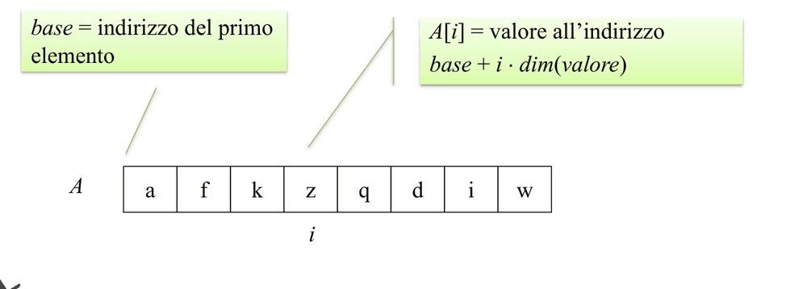<br>
<sub><i>Figura: accesso diretto agli elementi di un array (slide 8).</i></sub>
</p>


<p align="center">
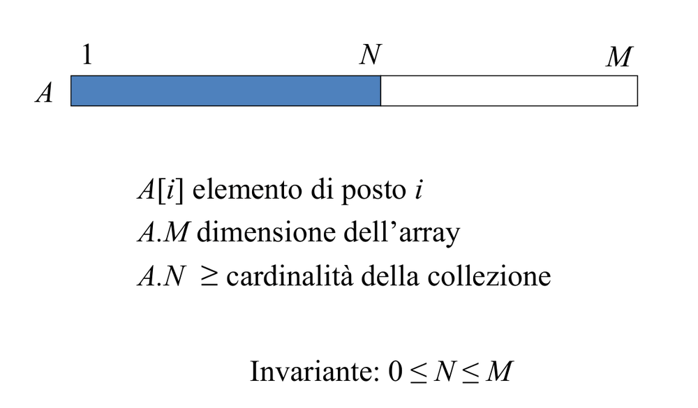<br>
<sub><i>Figura: array statico, N elementi su M celle (slide 9).</i></sub>
</p>


| | non ordinato | ordinato |
|---|---|---|
| insert | O(1) (scrivi in posizione N+1, N++) | O(N) (aggiungi in coda e fai "scendere" con scambi) |
| search | O(N) | **O(log N)** (binary search) |
| delete | O(N) (un passaggio: sposta A[i] in A[i-deleted]) | O(N) (trovi in log N ma il compattamento è lineare) |

Il limite di capacità si supera con un **array ridimensionabile**: quando è pieno si alloca un nuovo blocco e si copiano gli N elementi (costo O(N)). La politica con cui si sceglie la nuova dimensione è decisiva. Con un incremento unitario (+1) ogni inserimento su array pieno copia tutto, quindi il costo ammortizzato è O(m) per inserimento: non scala. Con il **raddoppio** (M -> 2M) la i-esima insert costa i solo se i-1 è una potenza di 2 e 1 altrimenti, cosicché il costo totale di m inserimenti è **< 3m**, cioè **O(1) ammortizzato**. Il risparmio viene dal fatto che le copie costose sono rare e sempre più distanziate. Per non sprecare memoria anche in discesa, si contrae (dimezza) quando gli elementi scendono a **1/4** della capacità: scegliere 1/4 e non 1/2 evita che una sequenza di insert e delete a cavallo della soglia faccia copiare continuamente.

L'**analisi ammortizzata** usata qui è il metodo dell'aggregazione: costo totale di m operazioni diviso m. Non va confusa con il caso medio probabilistico, perché è una garanzia sul caso peggiore di una *sequenza* di operazioni, senza alcuna ipotesi sulla distribuzione dell'input.

## Liste semplici (nodo: info, next)

La lista è la struttura complementare all'array: niente accesso diretto, ma inserimenti e cancellazioni locali senza spostare altro. Il modello funzionale ha tre primitive, tutte O(1): **cons(x,L)** crea un nuovo nodo in testa, **head(L)** restituisce l'info del primo nodo e **tail(L)** il suo next (head e tail sono definite solo per liste non vuote). Sopra queste primitive si scrivono con naturalezza algoritmi ricorsivi, e il resto del capitolo è un esercizio su quando conviene la forma ricorsiva e quando quella iterativa.

<p align="center">
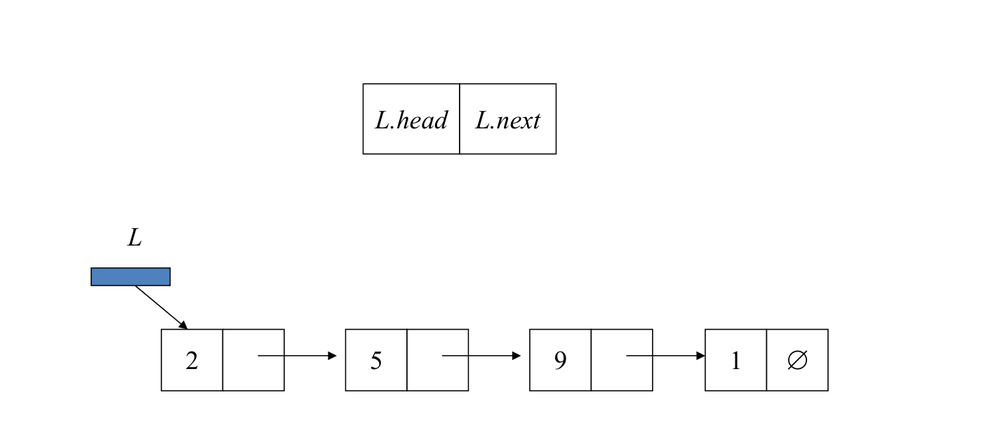<br>
<sub><i>Figura: una lista semplice (slide 10).</i></sub>
</p>


La **lunghezza** ne è il primo esempio e mostra tre stili:
- LENGTH-REC: `0` se vuota, altrimenti `1+LENGTH-REC(Tail(L))`, con spazio O(n) per lo stack;
- LENGTH-TAIL-REC(L,n): con accumulatore;
- LENGTH-ITER: while not IsEmpty: L<-Tail(L); n++.

Il tempo è sempre O(n); le ultime due versioni usano spazio O(1).

Per le modifiche si ragiona sempre in termini di "ricucire" i puntatori. L'**inserimento in posizione i** è ricorsivo: `if i=1 return CONS(x,L) else L.next <- INSERT(x,i-1,Tail(L)); return L`, costo O(i). La **cancellazione dopo un nodo P**, se si dispone del puntatore, è O(1): `temp<-Tail(P); P.next<-Tail(Tail(P))`. DELETEALL(x,L) elimina tutte le occorrenze: se la lista è vuota restituisce nil; se x=Head(L) restituisce DELETEALL(x,Tail(L)); altrimenti `L.next <- DELETEALL(x,Tail(L)); return L`.

<p align="center">
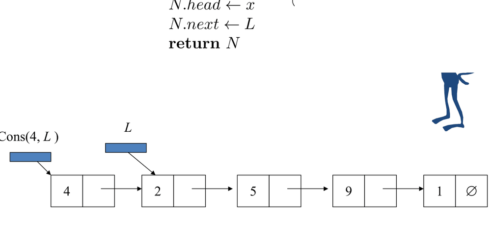<br>
<sub><i>Figura: l'operazione Cons (slide 12).</i></sub>
</p>


<p align="center">
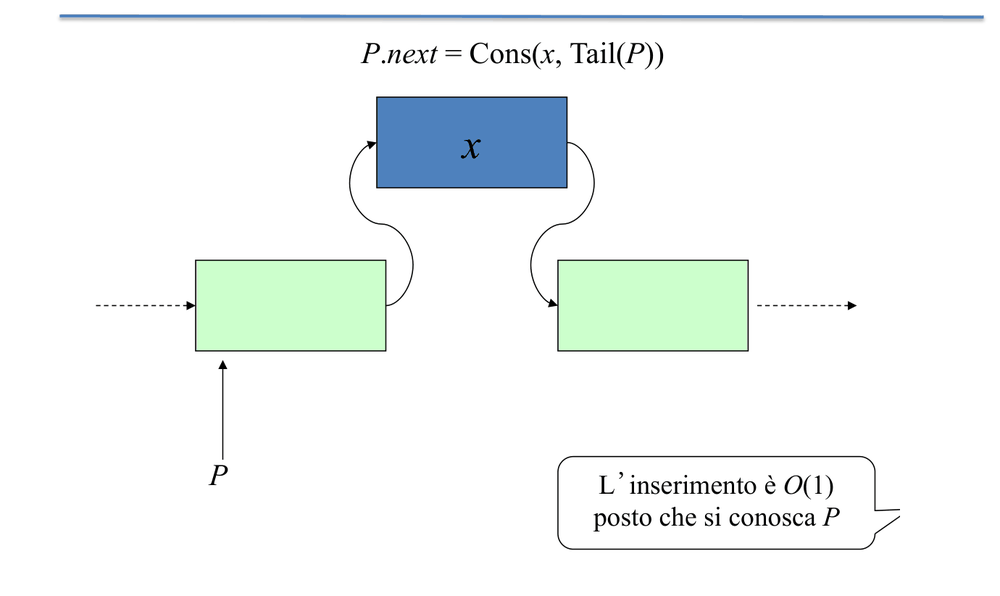<br>
<sub><i>Figura: inserimento in una lista (slide 20).</i></sub>
</p>


<p align="center">
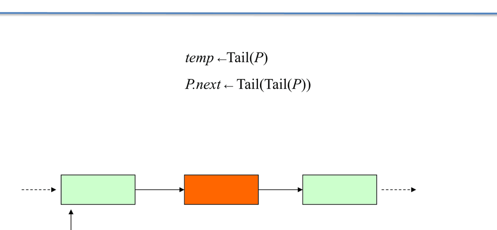<br>
<sub><i>Figura: cancellazione da una lista (slide 22).</i></sub>
</p>


Per il **clone** esistono due versioni, entrambe O(n). CLONE-ITER usa un **record fittizio** (dummy header) per evitare di trattare separatamente il primo nodo: R<-CONS(-,nil), C<-R; per ogni nodo `C.next<-CONS(Head(L),nil); C<-C.next`; infine return Tail(R). CLONE-REC è la forma più diretta: `CONS(Head(L), CLONE-REC(Tail(L)))`.

<p align="center">
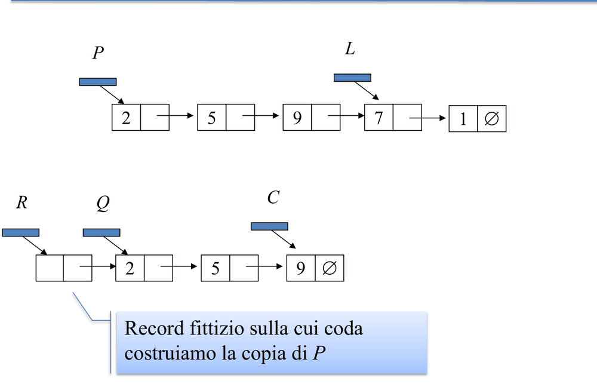<br>
<sub><i>Figura: copia di una lista con un record fittizio (slide 29).</i></sub>
</p>


Sul **reverse** il confronto è istruttivo, perché la stessa funzione ha realizzazioni con costi molto diversi. SLOW-REVERSE è quadratico perché APPEND è O(n) e viene chiamata n volte; le altre versioni sono lineari, e l'iterativa e quella di coda hanno spazio O(1).

| Versione | Idea | Costo |
|---|---|---|
| REVERSE-ITER | gira i puntatori con 3 riferimenti (T salva Tail(L); L.next<-M; M<-L; L<-T) | O(n), spazio O(1) |
| SLOW-REVERSE | `APPEND(SLOW-REVERSE(TAIL(L)), testa)` | **O(n^2)** (APPEND è O(n)) |
| REVERSE-TAIL-REC(L,M) | `REVERSE-TAIL-REC(TAIL(L), CONS(HEAD(L),M))` con accumulatore M | O(n), O(1) |
| REVERSE-REC | `R<-REVERSE-REC(TAIL(L)); L.next.next<-L; L.next<-nil; return R` | O(n) |

(Nell'ultima versione `L.next<-nil` serve a evitare un ciclo.)

<p align="center">
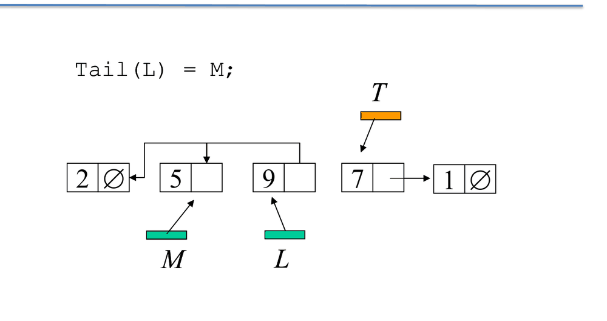<br>
<sub><i>Figura: inversione iterativa di una lista (slide 34).</i></sub>
</p>


Se la lista è **ordinata** si può terminare in anticipo, appena si supera il punto in cui l'elemento sarebbe dovuto comparire. Il valore restituito dalla chiamata ricorsiva "ricuce" la lista:

```
INORD(x,L): if IsEmpty(L) or x<Head(L) return false; elif x=Head(L) return true; else INORD(x,Tail(L))
INSERT(x,L): if IsEmpty(L) or x<Head(L) return CONS(x,L); elif x=Head(L) return L; else L.next<-INSERT(x,Tail(L)); return L
DELETE(x,L): if IsEmpty(L) or x<Head(L) return L; elif x=Head(L) return Tail(L); else L.next<-DELETE(x,Tail(L)); return L
```

L'ordinamento permette anche di fondere due liste in tempo lineare. **UNION(L,M)** è non distruttiva (usa CLONE nei casi base): confronta le teste e, se sono uguali, ne inserisce una sola; costo **O(n+m)**.

Un'applicazione più ambiziosa è il **MERGESORT su liste**, dove la lista rende naturale ciò che sull'array richiede memoria extra. Caso base: lista vuota o con un elemento; altrimenti `M<-SPLIT(L); L<-MERGESORT(L); M<-MERGESORT(M); return MERGE(L,M)`. Per lo SPLIT ci sono tre strategie:
- **puntatori lento/veloce** (il veloce avanza di 2, il lento di 1), che trova la metà in una sola passata O(n): è la soluzione migliore;
- calcolare la lunghezza e poi percorrere metà lista ("una scansione e mezza");
- distribuire i nodi in pari e dispari.

MERGE si fa **in-place**, ricucendo i next, in O(n). La ricorrenza è **T(n)=2T(n/2)+O(n)** (nel doc stimata come +2n), quindi **O(n log n)** (Master theorem, caso 2 [INT], vedi file 02).

## Pile (LIFO) e code (FIFO)

Pile e code sono insiemi dinamici con accesso vincolato, e per questo si prestano a implementazioni molto semplici, tutte con operazioni O(1).

La **pila** ha Push(e,S), Pop(S), Empty(S) (e Top). Fare Pop o Top su una pila vuota è un **underflow**; fare Push su una pila piena (nel caso dell'array, S.top = dim) è un **overflow**. Gli usi tipici sono la pila delle chiamate e il parsing. Su array tutto è O(1) con il minimo overhead ma capacità fissa; su lista (push e pop in testa) tutto è O(1), non c'è overflow e il prezzo è un puntatore per elemento.

<p align="center">
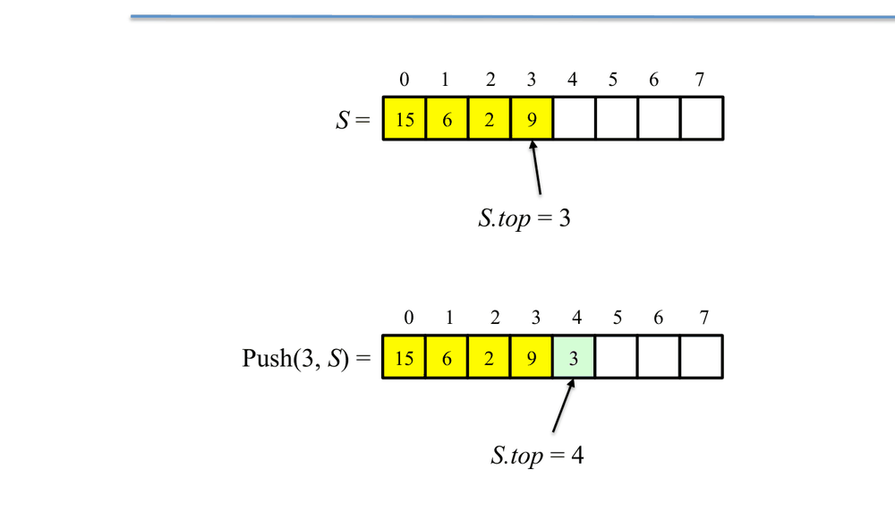<br>
<sub><i>Figura: pila con un vettore (slide 4).</i></sub>
</p>


<p align="center">
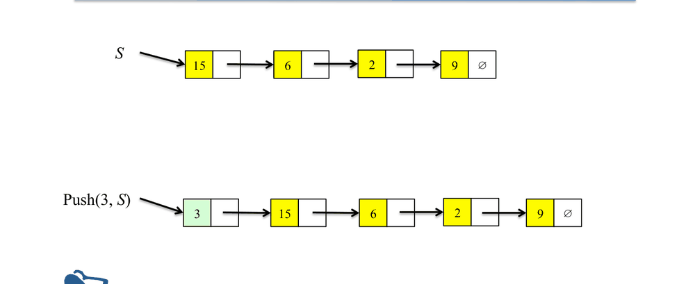<br>
<sub><i>Figura: pila con una lista (slide 7).</i></sub>
</p>


La **coda** ha Enqueue(e,Q) in fondo (rear), Dequeue(Q) dalla testa (front) e Empty(Q). Sull'array lineare il Dequeue costerebbe O(n) (bisognerebbe far scorrere gli elementi), perciò si usa un **array circolare** con indici Q.front e Q.rear e aritmetica modulare ((i+1) mod dim). Una cella resta inutilizzata per poter distinguere coda piena da coda vuota, quindi la **capacità massima è dim(Q)-1**; Enqueue e Dequeue sono O(1). Sulla lista si mantengono puntatori a **front e rear**: senza rear, Enqueue sarebbe O(n). Tutto è O(1) e non c'è overflow.

<p align="center">
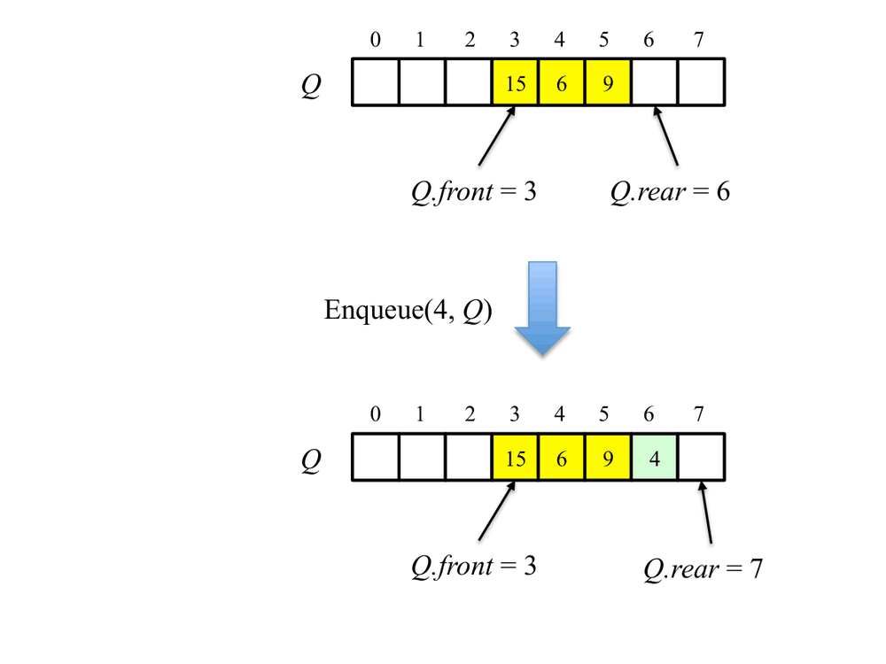<br>
<sub><i>Figura: coda con un vettore (slide 12).</i></sub>
</p>


<p align="center">
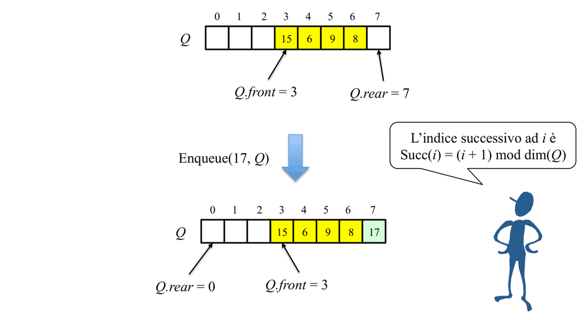<br>
<sub><i>Figura: coda circolare su un vettore (slide 13).</i></sub>
</p>


<p align="center">
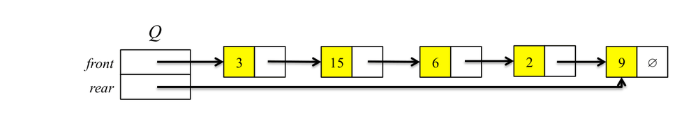<br>
<sub><i>Figura: coda con una lista (slide 16).</i></sub>
</p>


Come regola di scelta, l'array vale se la dimensione massima è nota e la memoria stretta; la lista se la dimensione è imprevedibile.

## Esercizi svolti collegati

Gli esercizi su liste (Multiples, Rank, Reverse, Palindrome, OddEven, operazioni su insiemi come liste ordinate, Foo/Goo) sono nel [§6 Liste](12-esercizi-svolti.md#6-liste) e usano esattamente Head, Tail e Cons visti qui: Reverse è l'idea della lista usata come pila, le operazioni insiemistiche sono varianti del merge di liste ordinate.

## Cose da saper fare all'esame

**Scritto**
- Scrivere (ricorsivo e iterativo) operazioni su liste: lunghezza, insert/delete in lista ordinata, deleteall, reverse, clone, fusione di due liste ordinate; indicare costo.
- Analisi ammortizzata del raddoppio (costo totale < 3m).
- Implementare pila/coda su array circolare (condizioni piena/vuota con modulo).

**Orale**
- Confronto array/lista per ogni operazione; perché la contrazione a 1/4 e non a 1/2; perché SLOW-REVERSE è quadratico; split lento/veloce.

## Dubbi
- Nel doc l'inserimento in array ordinato è chiamato "bubble down/risalire" in modo ambiguo (idea: scambi successivi all'indietro).
- Dimostrazione completa del "< 3m" non riportata dal doc (solo enunciato).
