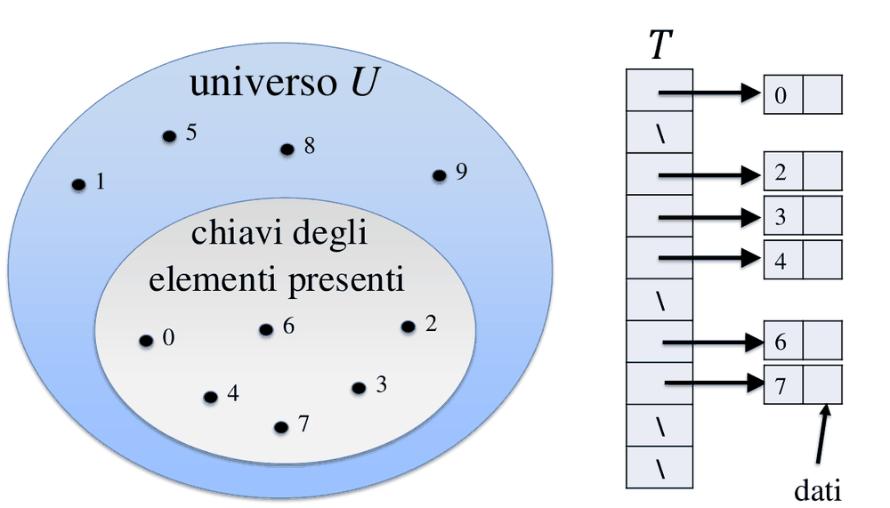
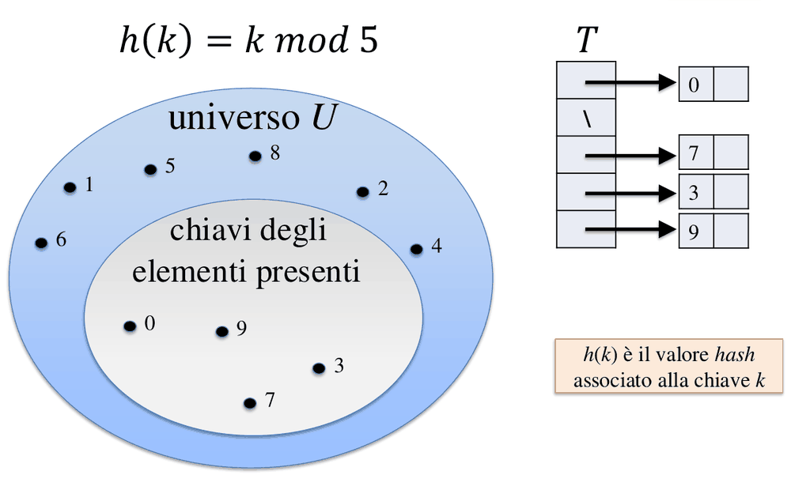
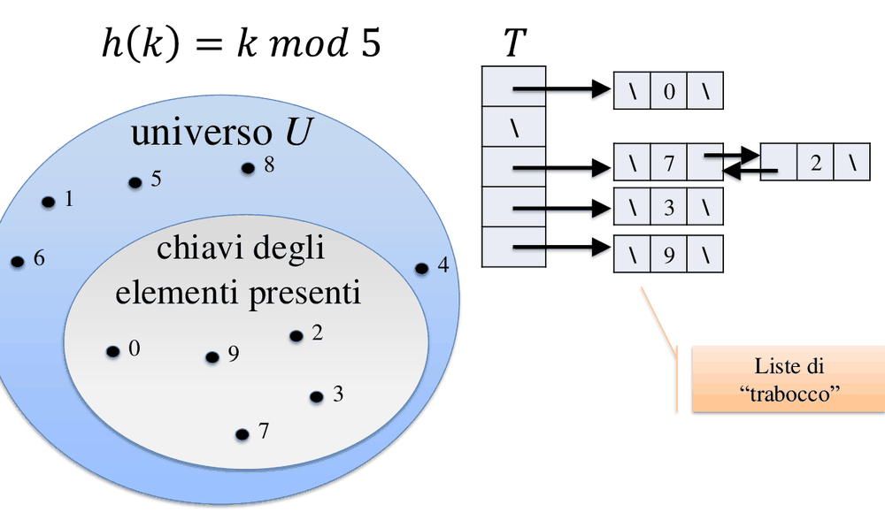

# 05 - Tabelle hash

Fonte: doc Drive "Appunti" (Tabelle hash). Gli esercizi svolti (11.2) e il Lab 05 sono da integrare dai PDF [DA VERIFICARE se già coperti: vedi README].

## Mappa

Il file introduce il dizionario (Insert, Search, Delete) e la sua realizzazione più veloce ma costosa in spazio, l'indirizzamento diretto; spiega poi come l'hashing risolva il problema dello spazio al prezzo delle collisioni (funzione hash, metodi di divisione e moltiplicazione), le due strategie per gestirle (concatenamento e indirizzamento aperto con ispezione lineare, quadratica e doppio hashing), l'analisi del concatenamento e un confronto finale.

- [Dizionario e indirizzamento diretto](#dizionario-e-indirizzamento-diretto)
- [Hashing](#hashing)
- [Concatenamento (liste di trabocco)](#concatenamento-liste-di-trabocco)
- [Indirizzamento aperto](#indirizzamento-aperto)
- [Analisi del concatenamento (slide 11)](#analisi-del-concatenamento-slide-11)
- [Confronto](#confronto)
- [Cose da saper fare all'esame](#cose-da-saper-fare-allesame)
- [Dubbi](#dubbi)

## Dizionario e indirizzamento diretto

Un dizionario è un insieme dinamico con le sole operazioni Insert, Search e Delete. Con array o liste queste costano O(n). L'**indirizzamento diretto** le porta a O(1) con un'idea semplicissima: una tabella T con una cella per *ogni* chiave possibile dell'universo U, così che Insert sia T[x.key]=x, Search sia T[k] e Delete sia T[x.key]=nil. Il difetto è lo spazio, proporzionale a |U| anziché al numero di chiavi effettivamente presenti.

Un esempio mostra quanto sia grave: con 20.000 studenti e matricola a 6 cifre (|U|=10^6) lo spreco è del 0.4% se ogni studente occupa 100 KB, ma sale al 28% con 1 KB per studente e al 95.6% con 1 KB e soli 200 studenti. L'hashing nasce da qui: tenere O(1) senza pagare |U|.

 
<i>Figura: tavola a indirizzamento diretto (slide 6).</i>

## Hashing

Si introduce una funzione **h: U -> {0,...,m-1}** con m << |U|, che assegna a ogni chiave una cella (valore hash). Perdendo la corrispondenza uno-a-uno tra chiave e posizione, due chiavi diverse possono finire nella stessa cella: sono le **collisioni** (k1≠k2, h(k1)=h(k2)), inevitabili per il principio dei cassetti. Solo con un insieme di chiavi statico e noto si può avere un hash perfetto. Per questo una buona h deve ripartire le chiavi in modo uniforme: con U={00..99} e m=10, k mod 10 mette 10 chiavi in ogni cella, mentre (somma delle cifre) mod 10 è sbilanciata (la cella 0 contiene solo 00, la cella 9 ne contiene 10). Formalmente l'**uniformità semplice** richiede |h^-1(i)| = |h^-1(j)| per ogni i,j, cioè ogni cella ugualmente probabile.

 
<i>Figura: tavola hash con h(k) = k mod 5 (slide 13).</i>

Due metodi standard per costruire h:
- **Divisione**: h(k)=k mod m. Va evitato m=2^p, perché userebbe solo i p bit bassi della chiave; la buona euristica è scegliere m **primo** e non vicino a una potenza di 2.
- **Moltiplicazione**: h(k)=⌊m·(kA mod 1)⌋ con 0<A<1, consigliato A=(√5-1)/2; qui la scelta di m non è critica.

## Concatenamento (liste di trabocco)

La prima strategia per gestire le collisioni è tenere in ogni cella una lista: T[i] punta alla lista degli elementi con hash i. Insert in testa è **O(1)**; Search scorre la lista della cella; Delete cerca e rimuove (con liste doppie la rimozione è O(1)). L'indicatore chiave è il **fattore di carico α = n/m**, la lunghezza media di una lista.

 
<i>Figura: concatenamento con liste di trabocco (slide 21).</i>

Nel caso peggiore tutte le chiavi finiscono nella stessa lista e le operazioni costano **Θ(n)**. Nel caso medio, sotto l'ipotesi di uniformità semplice, una ricerca senza successo costa **Θ(1+α)** e una con successo circa 1 + α/2 - α/(2n), ancora Θ(1+α). Se si dimensiona la tabella proporzionalmente al numero di elementi (m ∝ n), allora α=Θ(1) e tutto è **O(1) atteso**.

## Indirizzamento aperto

La seconda strategia non usa puntatori: gli elementi stanno dentro T, e se la cella è occupata se ne prova un'altra secondo una **sequenza di ispezione h(k,i)**, i=0..m-1. Necessariamente α ≤ 1. HASHINSERT prova h(k,0), h(k,1),... finché trova una cella nil; HASHSEARCH percorre la stessa sequenza e conclude che la chiave è assente quando incontra una cella vuota. La qualità del metodo dipende da come si genera la sequenza:
- **Lineare**, h(k,i)=(h'(k)+i) mod m: semplice, ma soffre di **addensamento primario** (lunghe sequenze contigue di celle occupate che si autoalimentano).
- **Quadratica**, h(k,i)=(h'(k)+c1·i+c2·i^2) mod m: riduce il primario ma resta l'**addensamento secondario**, perché chiavi con lo stesso hash iniziale seguono la stessa sequenza.
- **Doppio hashing**, h(k,i)=(h1(k)+i·h2(k)) mod m: elimina entrambi i problemi.

Nell'ipotesi di hashing uniforme, le ispezioni attese sono **≤ 1/(1-α)** per una ricerca senza successo (α=0.5 -> 2; α=0.9 -> 10) e **≤ (1/α)·ln(1/(1-α))** per una con successo (α=0.5 -> <1.387; α=0.9 -> <2.559). Il costo esplode quando α si avvicina a 1. La cancellazione è delicata: se si svuota semplicemente una cella si interrompono le sequenze di ispezione delle altre chiavi. Una soluzione è marcare la cella come "deleted" invece di svuotarla, così la ricerca prosegue oltre il marcatore; il prezzo è che le celle marcate restano occupate e prima o poi serve ricostruire la tabella (fonte: Wikipedia, "Open addressing", https://en.wikipedia.org/wiki/Open_addressing; livello 3, la slide 11 letta su Drive non copre la cancellazione nella parte accessibile). [ASSUNZIONE: da verificare: che l'inserimento possa riusare le celle "deleted", come si fa di solito, non è confermato da nessuna fonte consultata]

## Analisi del concatenamento (slide 11)

Il caso peggiore si realizza, per esempio, con m=200 e h(k)=k mod 200 se le chiavi 000123, 100323, 123723, 343123, 333123... cadono tutte nella stessa cella: Θ(n).

Per la **ricerca senza successo** si paga Θ(1) per calcolare h e poi si percorre una lista di lunghezza media n̄ = (n0+...+n_{m-1})/m = n/m = α, in totale Θ(1+α).

Per la **ricerca con successo** si ragiona sull'elemento x_i, supponendo inserimento in testa: si esaminano x_i e gli elementi inseriti *dopo* di lui nella stessa lista. Dopo x_i ne arrivano n-i, ciascuno dei quali finisce nella stessa lista con probabilità 1/m, cioè (n-i)/m in media. Mediando su i:

(1/n) Σ_{i=1}^n [1 + (n-i)/m] = 1 + (n-1)/(2m) = **1 + α/2 - α/(2n)**, quindi Θ(1+α).

Se m=Θ(n) allora α=Θ(1) e tutte le operazioni sono Θ(1) (con liste doppie). Le chiavi non intere, come le stringhe, si trattano con i codici ASCII e operazioni aritmetiche ('o'=111, 'c'=99, 'a'=97).

Per l'indirizzamento aperto servono alcune precisazioni formali. La sequenza h(k,0..m-1) deve essere una **permutazione** di {0..m-1}, così da visitare tutte le celle; Insert ritorna l'indice j (nil/overflow se la tabella è piena); nell'ispezione quadratica la scelta di c1 e c2 deve garantire la permutazione. L'**hashing uniforme** assume che le m! sequenze di ispezione siano equiprobabili, e con questa ipotesi il costo medio di un inserimento è circa quello di una ricerca senza successo. Gli esercizi "11.2 Esercizi svolti" citati nel programma **non sono presenti** come file in cartella [DA VERIFICARE].

## Confronto

| | Diretto | Concatenamento | Indirizzamento aperto |
|---|---|---|---|
| Medio | O(1) | Θ(1+α) | O(1/(1-α)) |
| Peggiore | O(1) | Θ(n) | O(n) |
| Criticità | spazio ∝ \|U\| | puntatori, cache | degrada per α->1, delete complessa |

Come raccomandazioni pratiche, nel concatenamento si tiene α circa costante (per esempio ~1), mentre nell'indirizzamento aperto non conviene superare **α=0.8**.

## Esercizi svolti collegati

Gli esercizi sono nel [§7 Tabelle hash](12-esercizi-svolti.md#7-tabelle-hash): inserimento con indirizzamento aperto lineare e quadratico (con h(k,i) = (k mod m + 2i + i²) mod m) e il caso in cui la sequenza di ispezione non copre tutta la tabella, per cui un inserimento fallisce con la tabella quasi vuota.

## Cose da saper fare all'esame

**Scritto**
- Inserire una sequenza di chiavi in una tabella (concatenamento e/o aperto lineare/quadratico/doppio) con h data e disegnare lo stato finale.
- Scegliere m e h e giustificare (primo, no 2^p); calcolare α.
- Calcolare ispezioni attese per α dato.

**Orale**
- Perché hashing invece di indirizzamento diretto; ipotesi di uniformità semplice; differenza addensamento primario/secondario; costo caso medio/peggiore.

## Dubbi
- Esercizi svolti (11.2) e Lab 05 (libreria hash generica): vedere il file 11-laboratorio.md per la parte di progetto.
