# 09 - Grafi, BFS/DFS, DFS temporizzata, ordinamento topologico

Fonte: doc Drive "Appunti" (Grafi; Ordinamento topologico e componenti connesse). Il titolo menziona "componenti connesse" ma il doc non sviluppa l'algoritmo [DA VERIFICARE nei PDF 17].

## Mappa

Si parte dalle definizioni (grafi orientati e non) e dalle rappresentazioni (matrice e liste di adiacenza); poi BFS e DFS, la DFS temporizzata con colori, tempi d/f, teorema delle parentesi e classificazione degli archi; infine l'ordinamento topologico con la sua dimostrazione e, dalle slide 17, aciclicità, teorema del cammino bianco e componenti fortemente connesse.

- [Definizioni](#definizioni)
- [Rappresentazioni](#rappresentazioni)
- [BFS e DFS](#bfs-e-dfs)
- [DFS temporizzata](#dfs-temporizzata)
- [Ordinamento topologico](#ordinamento-topologico)
- [Integrazioni dalle slide (17): aciclicità, cammino bianco, componenti fortemente connesse](#integrazioni-dalle-slide-17-aciclicità-cammino-bianco-componenti-fortemente-connesse)
- [Cose da saper fare all'esame](#cose-da-saper-fare-allesame)
- [Dubbi](#dubbi)

## Definizioni

Un grafo serve a modellare relazioni tra oggetti: reti stradali, trasporti, reti di computer, social network (e storicamente i ponti di Königsberg di Eulero e il problema dei 4 colori). Un **grafo orientato** è $G=(V,E)$ con $E \subseteq V\times V$, cioè coppie ordinate, e sono ammessi i **cappi** $(u,u)$. In un grafo **non orientato** $E \subseteq \lbrace\lbrace u,v\rbrace \mid u\ne v\rbrace$: non ci sono cappi e $\lbrace u,v\rbrace=\lbrace v,u\rbrace$. Un arco è incidente su $u$ e $v$; in un orientato $v$ è **adiacente** a $u$ se $(u,v)\in E$, relazione non simmetrica. L'esempio del doc ha $V=\lbrace 1..6\rbrace$ e $E=\lbrace(1,2),(2,2),(2,4),(2,5),(4,1),(4,5),(5,4),(6,3)\rbrace$, con Adj[2]=[2,4,5] e Adj[4]=[1,5].

<p align="center">
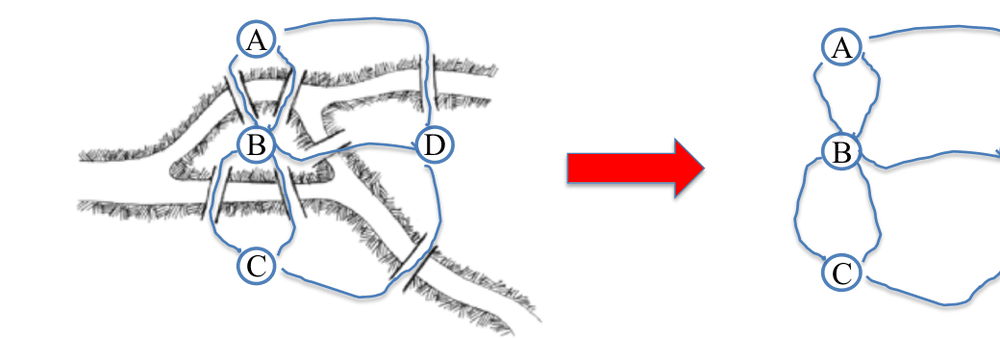<br>
<sub><i>Figura: il problema dei ponti di Koenigsberg (slide 3).</i></sub>
</p>


<p align="center">
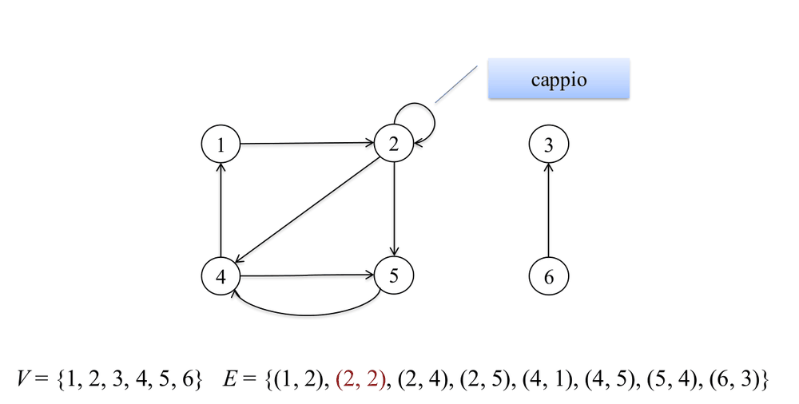<br>
<sub><i>Figura: grafo orientato (slide 11).</i></sub>
</p>


<p align="center">
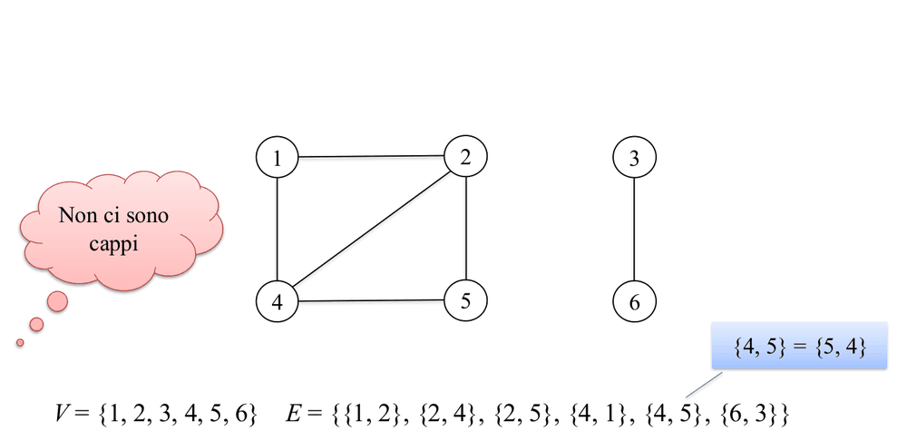<br>
<sub><i>Figura: grafo non orientato (slide 12).</i></sub>
</p>


## Rappresentazioni

La scelta della rappresentazione dipende da quanti archi ha il grafo rispetto al massimo possibile e da quali operazioni servono di più: la matrice dà accesso immediato a un singolo arco ma spreca spazio sui grafi sparsi, le liste sono compatte e rendono naturale scorrere i vicini.

| | Matrice di adiacenza | Liste di adiacenza |
|---|---|---|
| Spazio | $\Theta(\vert V\vert ^2)$ | $\Theta(\vert V\vert +\vert E\vert )$ (meglio per grafi sparsi) |
| Esiste arco (u,v)? | $O(1)$ | scorre Adj[u] |
| Iterare sui vicini di u | scansione riga, $\Theta(\vert V\vert )$ | proporzionale al grado |

Nel caso non orientato la matrice è **simmetrica** con diagonale a 0.

<p align="center">
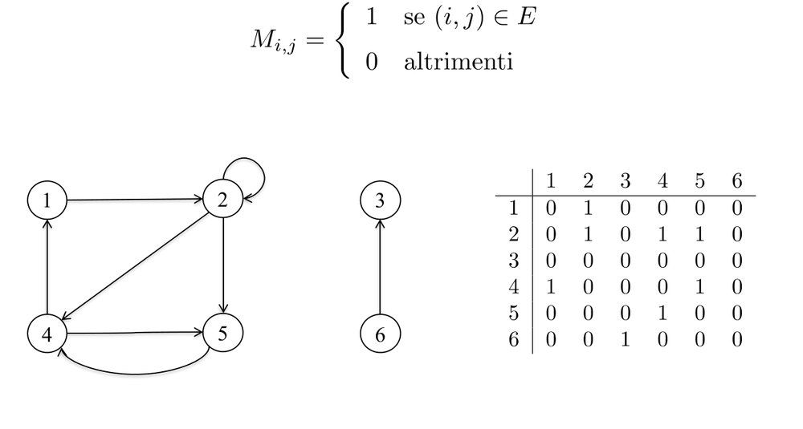<br>
<sub><i>Figura: matrice di adiacenza (slide 14).</i></sub>
</p>


<p align="center">
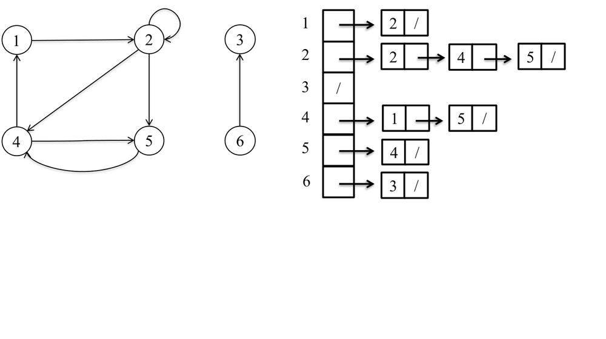<br>
<sub><i>Figura: liste di adiacenza (slide 15).</i></sub>
</p>


## BFS e DFS

Le due visite esplorano un grafo a partire da una sorgente, ma con strategie opposte. La **BFS** usa una coda FIFO e visita per livelli, a distanza crescente dalla sorgente s. Definita $\boldsymbol{\delta(u,v)}$ come il numero minimo di archi tra $u$ e $v$, la BFS trova esattamente i cammini minimi in numero di archi (grafo non pesato). I vertici hanno tre colori: bianco (non scoperto), grigio (scoperto ma non finito), nero (visitato). I layer $L_0, L_1,\dots$ sono disgiunti e coincidono con i livelli dell'albero BFS, che contiene i vertici raggiungibili da s. Costo **$O(\vert V\vert +\vert E\vert )$**, perché ogni vertice e ogni arco sono considerati un numero costante di volte.

La **DFS** usa una pila (implicita nella ricorsione, oppure esplicita): va più a fondo possibile e poi torna indietro con il backtracking. Non produce distanze minime, ma la sua struttura temporale la rende adatta a rilevare cicli e a studiare la connettività.

<div align="center">

<table>
<tr>
<td align="center">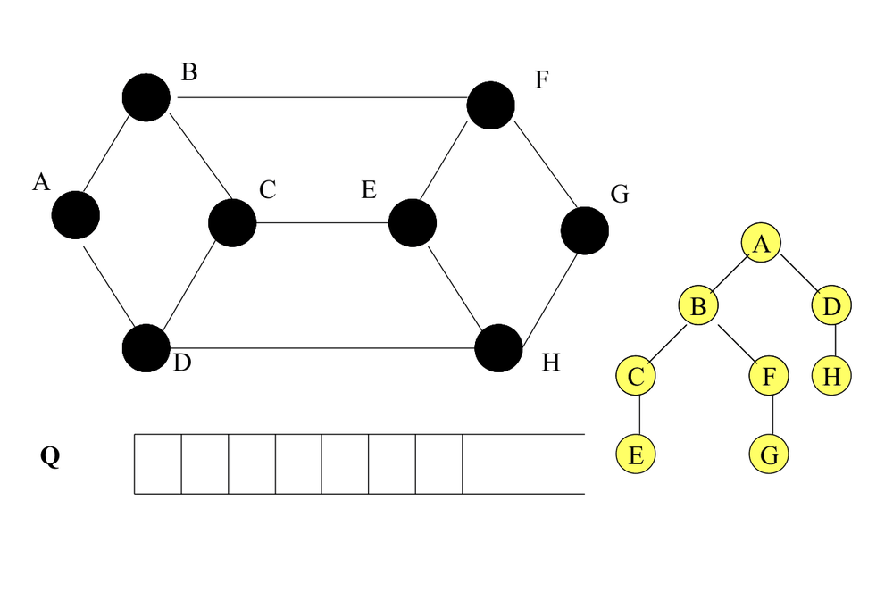<br><sub>BFS: coda e albero di visita (slide 42).</sub></td>
<td align="center">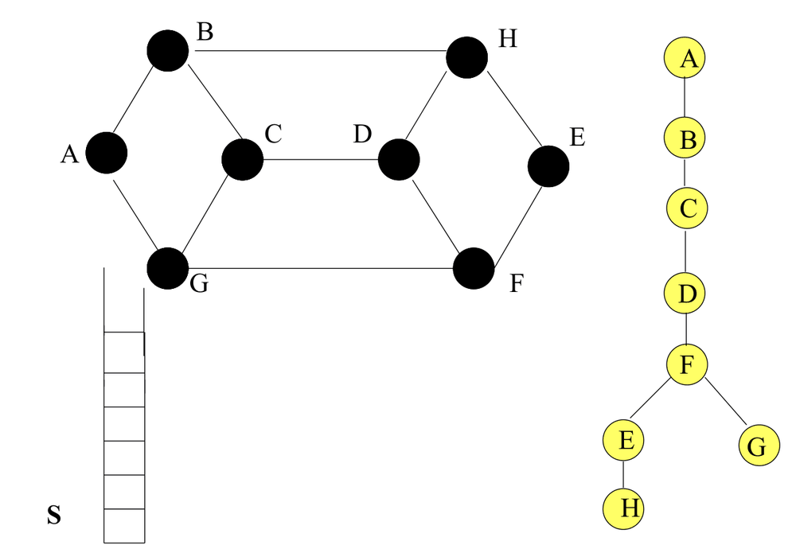<br><sub>DFS: pila e albero di visita (slide 57).</sub></td>
</tr>
</table>

</div>


## DFS temporizzata

La DFS temporizzata registra, per ogni vertice u, il momento in cui viene scoperto (**u.d**, quando diventa grigio) e il momento in cui ha finito di esplorare i suoi discendenti (**u.f**, quando diventa nero), oltre al predecessore π e a un contatore globale `time`. Il driver DFS-Graph inizializza ogni vertice (colore bianco, π=nil, time=0) e lancia la DFS su ogni vertice ancora bianco, ottenendo una **foresta DFS**.

<p align="center">
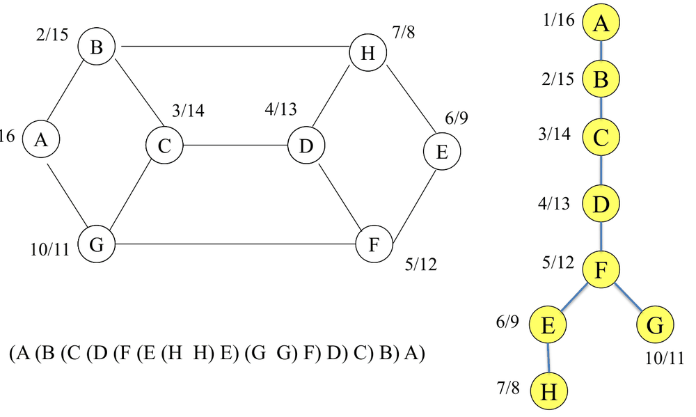<br>
<sub><i>Figura: DFS temporizzata, tempi di scoperta e di fine (slide 9).</i></sub>
</p>


```
DFS(G,u): u.color<-grigio; time++; u.d<-time
   for all v in adj[u] con v bianco: v.π<-u; DFS(G,v)
   u.color<-nero; time++; u.f<-time
```

Gli intervalli [u.d,u.f] hanno una struttura "a parentesi" ben formata, e questo è il contenuto del **teorema delle parentesi**: per ogni coppia u,v vale esattamente una di tre possibilità:
- gli intervalli $[u.d,u.f]$ e $[v.d,v.f]$ sono **disgiunti** (nessuno dei due è discendente dell'altro);
- $[u.d,u.f] \subset [v.d,v.f]$ ($u$ discendente di $v$);
- $[v.d,v.f] \subset [u.d,u.f]$ ($v$ discendente di $u$).

Non esistono sovrapposizioni parziali, perché una visita termina sempre prima di tornare al chiamante.

Gli archi (u,v) si classificano in base al colore di v nel momento in cui l'arco viene esaminato:
- **albero** ($v$ bianco): $u.d \lt  v.d \lt  v.f \lt  u.f$
- **all'indietro** ($v$ grigio, antenato di $u$): $v.d \le u.d \lt  u.f \le v.f$; **indica un ciclo**
- **in avanti** ($v$ nero, discendente di $u$): $u.d \lt  v.d \lt  v.f \lt  u.f$
- **trasversale** ($v$ nero, altrove): $v.d \lt  v.f \lt  u.d \lt  u.f$

<p align="center">
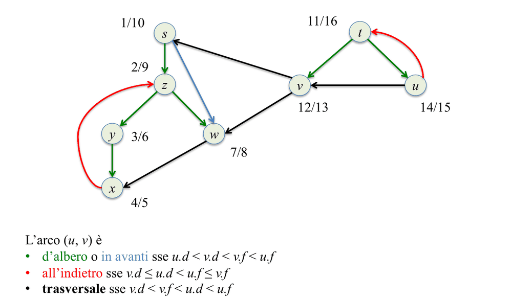<br>
<sub><i>Figura: classificazione degli archi (slide 15).</i></sub>
</p>


## Ordinamento topologico

Un ordinamento topologico è una linearizzazione dei vertici di un grafo orientato in cui ogni arco $(u,v)$ ha $u$ prima di $v$; l'esempio classico è l'ordine in cui vestirsi (le calze prima delle scarpe, ecc.). Esiste **se e solo se il grafo è un DAG**, cioè aciclico: un ciclo imporrebbe che ciascun suo vertice preceda gli altri. L'intuizione dell'algoritmo è semplice: in una DFS un vertice diventa nero solo dopo che tutti i suoi successori sono finiti, quindi basta inserire ogni vertice in testa a una lista nel momento in cui termina.

<p align="center">
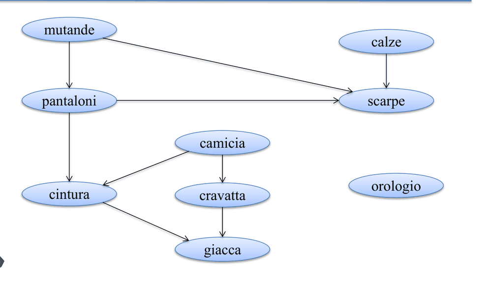<br>
<sub><i>Figura: il grafo delle dipendenze per vestirsi (slide 3).</i></sub>
</p>


```
Topological-Sort(G): L<-lista vuota; colori bianchi, π=nil, time=0
   for all u: if u bianco DFS-Visit-Topological(G,u,L)
   return L
DFS-Visit-Topological(G,u,L): come DFS, ma a fine visita (u nero, u.f assegnato) → inserisci u IN TESTA a L
```

Il costo è **$\Theta(\vert V\vert +\vert E\vert )$**, una sola DFS.

<p align="center">
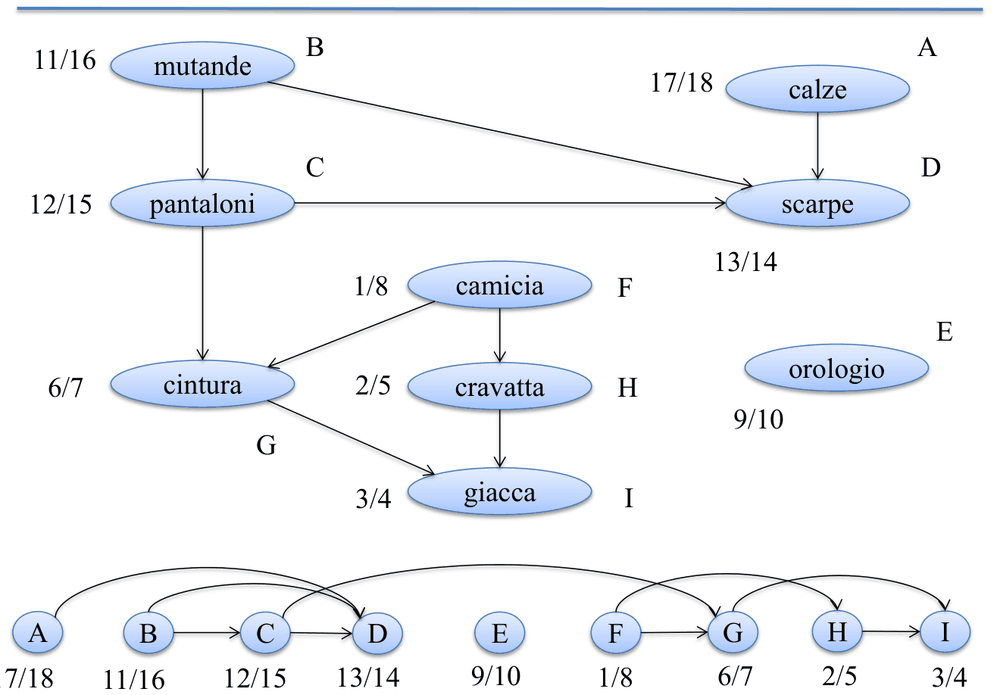<br>
<sub><i>Figura: l'ordinamento topologico con i tempi di fine (slide 19).</i></sub>
</p>


**Correttezza (teorema: su un DAG produce un ordinamento topologico).** Basta mostrare che per ogni arco $(u,v)$ vale $\boldsymbol{v.f \lt  u.f}$, perché allora u viene messo in testa dopo v e quindi sta prima. Se l'arco è d'albero, in avanti o trasversale, le condizioni temporali danno direttamente $v.f \lt  u.f$. Se fosse all'indietro si avrebbe $u.f \lt  v.f$, ma **un arco all'indietro implica un ciclo, impossibile in un DAG**. Dunque la tesi vale.

## Integrazioni dalle slide (17): aciclicità, cammino bianco, componenti fortemente connesse

Le slide formalizzano meglio alcuni punti. Un'**ordinamento topologico** $v_1..v_n$ di $G=(V,E)$ orientato è tale che $i\lt j \Rightarrow (v_j,v_i)\notin E$; ce ne possono essere più d'uno (A B C D oppure A C B D) e nessuno se G è ciclico. Dal teorema delle parentesi segue un **corollario**: in una foresta DF, $v$ è discendente di $u$ se e solo se $u.d \lt  v.d \lt  v.f \lt  u.f$. Più forte è il **teorema del cammino bianco**: $v$ è discendente di $u$ se e solo se, al tempo $u.d$, esiste un cammino **tutto bianco** da $u$ a $v$.

Con questi strumenti si dimostra il **lemma di aciclicità**: G (orientato o no) è aciclico se e solo se una DF non genera archi all'indietro. L'implicazione (⇐) si prova per assurdo: se $C$ è un ciclo e $(u,v)\in C$ è l'arco con $v.d$ minimo, per il cammino bianco si ha $v.d \lt  u.d \lt  u.f \lt  v.f$, cioè $(u,v)$ è all'indietro.

La dimostrazione dell'ordinamento topologico si può rifare con i **4 casi dei tempi** per un arco $(u,v)$:
1. $v.d\lt v.f\lt u.d\lt u.f$: va bene;
2. $u.d\lt u.f\lt v.d\lt v.f$: impossibile, perché u sarebbe nero con v ancora bianco (v sarebbe stato visitato da u);
3. $u.d\lt v.d\lt v.f\lt u.f$: va bene;
4. $v.d\lt u.d\lt u.f\lt v.f$: è un arco all'indietro, cioè un ciclo, impossibile in un DAG.

### Componenti fortemente connesse
Una **componente fortemente connessa (cfc)** è un insieme $C \subseteq V$ massimale tale che $u \leadsto v$ e $v \leadsto u$ per ogni $u,v\in C$. Si indicano con $D(u)$ i discendenti (raggiungibili da $u$) e con $A(u)$ gli antecedenti; la cfc di $u$ è $C(u)=D(u)\cap A(u)$. Una DFS su $G$ dà $D(u)$; per $A(u)$ si usa il **grafo trasposto $G^T$** ($E^T = \lbrace(v,u) \mid (u,v)\in E\rbrace$), in cui gli archi sono invertiti. L'algoritmo naive esegue DFS(G,u) e DFS($G^T$,u) per ogni u, con costo $O(\vert V\vert \cdot (\vert V\vert +\vert E\vert ))$.

<p align="center">
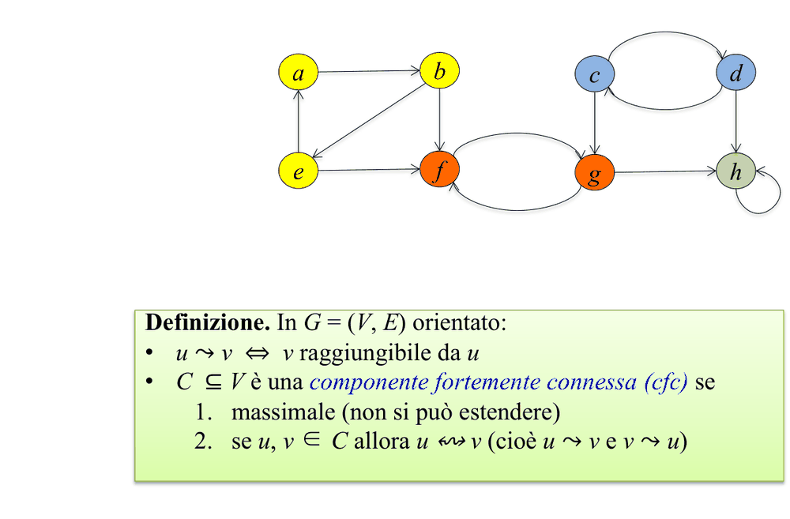<br>
<sub><i>Figura: componenti fortemente connesse (slide 23).</i></sub>
</p>


L'algoritmo **Strongly-Connected-Components(G)** (di Kosaraju) fa invece tutto in **$\Theta(\vert V\vert +\vert E\vert )$**:
1. DFS-Graph($G$), calcolando i tempi $f$.
2. Calcolo di $G^T$.
3. DFS-Graph($G^T$) scegliendo i vertici in **ordine decrescente di $f$** (quelli calcolati su $G$).
4. Ogni albero della foresta di $G^T$ è una cfc.

La correttezza si appoggia su alcuni lemmi. Lemma 1: se $C$ e $C'$ sono cfc distinte, con $u,v\in C$ e $u',v'\in C'$, e $u \leadsto u'$, allora non può essere $v' \leadsto v$. Posto $C.d = \min\lbrace u.d\rbrace$ e $C.f = \max\lbrace u.f\rbrace$, il **Lemma 2** dice che se $(u,v)\in E$ con $u\in C$ e $v\in C'$ in cfc distinte allora $C.f \gt  C'.f$; il corollario è che $(u,v)\in E^T$ implica $C.f \le C'.f$ ($\lt$ se distinte). Il teorema della \"visita giusta\" conclude: nell'ordine decrescente di $f$, la cfc con $f$ massimo $C$ ha, per ogni arco $(u,v)\in E^T$ uscente da $C$, $C.f \le C(v).f$, da cui $C = C(v)$; l'albero in $G^T$ radicato nel vertice di $f$ massimo è allora $A_G(u)=C$, e si procede per induzione sul numero di alberi.

## Esercizi svolti collegati

BFS con albero e coda dopo ogni inserimento, il test di bipartizione con BFS colorata e il test di aciclicità con DFS (un arco all'indietro è un ciclo) sono svolti nel [§10 Grafi](12-esercizi-svolti.md#10-grafi); è l'applicazione diretta della classificazione degli archi vista qui.

## Cose da saper fare all'esame
**Scritto**
- Dato un grafo, scrivere matrice e liste; eseguire BFS (distanze, albero) e DFS temporizzata (d/f, classificazione archi) con ordine dei vicini dato; produrre un ordinamento topologico.
- Dimostrare la correttezza dell'ordinamento topologico (v.f<u.f, back edge = ciclo).
- Rilevare cicli con DFS (back edge).

**Orale**
- Enunciare il teorema delle parentesi; BFS vs DFS (struttura dati, applicazioni); complessità $O(V+E)$ e perché; quando matrice vs liste.

## Dubbi
- Nel doc DFS chiama a volte "DFS-Rec" (refuso): logicamente è la stessa DFS ricorsiva.
- Componenti (fortemente) connesse: il doc "Appunti" non le sviluppa; sezione integrata dalle slide 17 (solo le prime righe della trascrizione; codice formale delle slide per SCC è in forma discorsiva).
- Esempio numerico slide 17 (DFS temporizzata A..H con tempi) non ricostruito qui.
