# 10 - Algoritmi greedy: MST (Kruskal, Prim) e cammini minimi (Dijkstra)

Fonte: doc Drive "Appunti" (Algoritmi greedy MST; Cammini minimi e algoritmo di Dijkstra).

## Mappa

Prima l'albero di copertura minimo: definizioni, arco sicuro, taglio e teorema del taglio, poi Kruskal (con Union-Find) e Prim (con coda di priorità). Poi i cammini minimi da sorgente singola: formulazione, lemmi, Relax, Dijkstra con dimostrazione di correttezza, il problema dei pesi negativi e la complessità; infine le integrazioni dalle slide 18 e 19.

- [MST](#mst)
- [Cammini minimi (sorgente singola)](#cammini-minimi-sorgente-singola)
- [Integrazioni dalle slide (18 e 19)](#integrazioni-dalle-slide-18-e-19)
- [Cose da saper fare all'esame](#cose-da-saper-fare-allesame)
- [Dubbi](#dubbi)

## MST

Dato un grafo pesato non orientato G=(V,E) con w:E→R, un **albero di copertura** è un insieme di archi T⊆E connesso, aciclico, che copre V; un **MST** è un albero di copertura di peso w(T)=Σw minimo, e non è necessariamente unico. Il problema si presta a una soluzione **greedy**, cioè basata su una scelta localmente ottima più una sottostruttura ottima: si costruisce un insieme A ⊆ MST aggiungendo un arco alla volta, purché sia un **arco sicuro**. Un arco (u,v) è sicuro per A se esiste un MST T con A∪{(u,v)}⊆T, cioè se aggiungerlo non preclude di arrivare a un MST.

<p align="center">
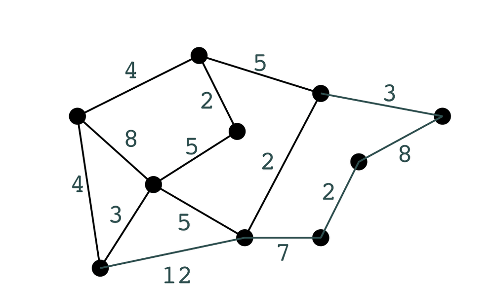<br>
<sub><i>Figura: un grafo pesato (slide 4).</i></sub>
</p>


<p align="center">
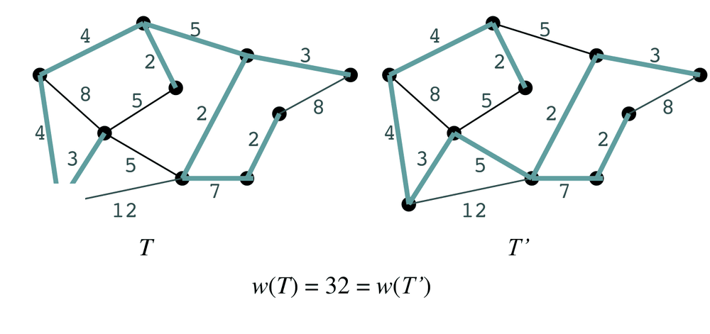<br>
<sub><i>Figura: due alberi di copertura diversi con lo stesso peso (slide 7).</i></sub>
</p>


Il problema è come riconoscere un arco sicuro, e la risposta è il concetto di taglio:
- un **taglio** è una partizione (S,V\S) dei vertici;
- un arco lo **attraversa** se ha un estremo per parte;
- il taglio **rispetta A** se nessun arco di A lo attraversa;
- un **arco leggero** è un arco di peso minimo tra quelli che attraversano il taglio.

Il **teorema del taglio** afferma che, dato un taglio che rispetta A, ogni arco leggero che lo attraversa è sicuro per A. Tutti e due gli algoritmi seguenti sono solo modi diversi di scegliere tagli che rispettano A.

<p align="center">
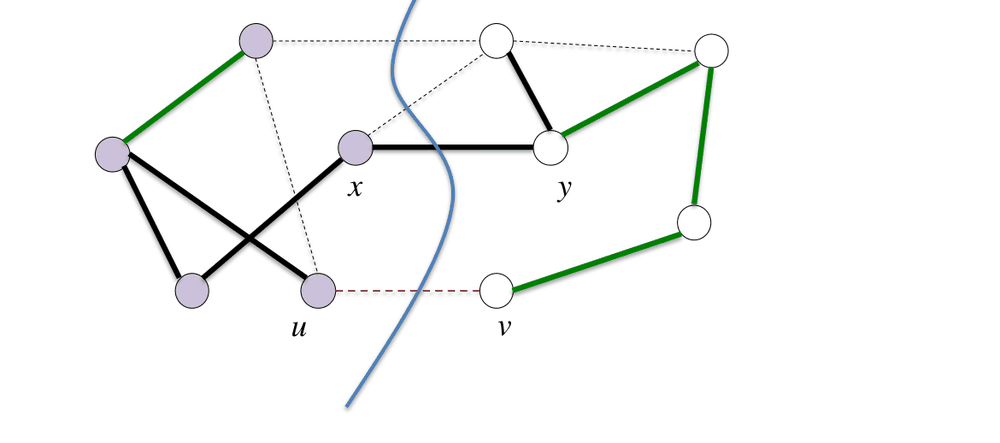<br>
<sub><i>Figura: il teorema del taglio (slide 11).</i></sub>
</p>


### Kruskal (basato sugli archi)
Kruskal ha una visione globale:
1. parte da una foresta in cui ogni vertice è un albero;
2. scorre gli archi in ordine di peso non decrescente;
3. se un arco collega due alberi distinti lo aggiunge (unione dei due alberi), altrimenti lo scarta perché chiuderebbe un ciclo.

Per sapere rapidamente se due vertici sono nello stesso albero si usa la struttura **Union-Find**, con le operazioni MakeSet(U), Find(x,P) (restituisce il rappresentante) e Union(x,y,P), ottimizzata con l'**unione per altezza/rango** e la **compressione dei cammini**.

La correttezza discende dal teorema del taglio: l'arco (u,w) tra le componenti U e W è leggero per il taglio (U,V\U), che rispetta A, ed è quindi sicuro. Il costo è un ordinamento O(m log m), più MakeSet O(n), più Find/Union ammortizzati O(m log n), in totale **O(m log n)** (poiché m ≥ n-1, log m = O(log n)).

<p align="center">
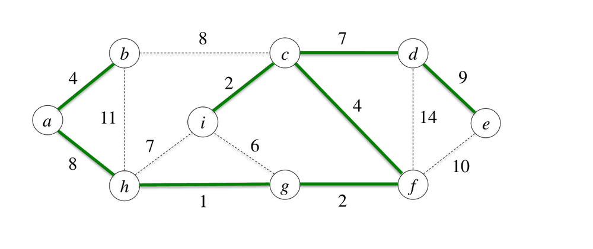<br>
<sub><i>Figura: il risultato di Kruskal sul grafo di esempio (slide 33).</i></sub>
</p>


### Prim (basato sui vertici)
Prim ha invece una visione locale: cresce un solo albero a partire da un vertice arbitrario e a ogni passo aggiunge l'arco più leggero tra l'albero e il resto del grafo. Si usa una coda di **min-priorità** (heap) in cui v.key è il peso del più leggero arco che collega v all'albero (∞ se non ce ne sono), con le operazioni **Extract-Min** e **Decrease-Key**. La correttezza è la stessa: Extract-Min seleziona l'arco leggero del taglio (A, V\A), che rispetta A, quindi sicuro.

Con un heap min il costo è: BuildHeap O(n log n) nel doc (in realtà O(n), vedi 08), n Extract-Min per O(n log n) e al più m Decrease-Key per O(m log n), cioè **O(m log n)**. In sintesi la complessità è la stessa di Kruskal; cambia l'approccio: Kruskal ordina tutti gli archi e usa Union-Find, Prim lavora sulla frontiera con una coda di priorità.

<p align="center">
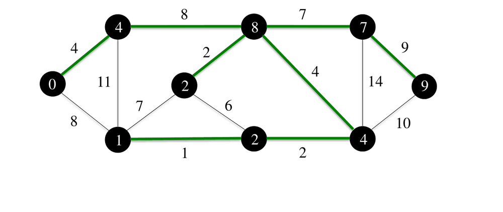<br>
<sub><i>Figura: il risultato di Prim sul grafo di esempio (slide 57).</i></sub>
</p>


## Cammini minimi (sorgente singola)

Il problema è dato da G=(V,E) orientato, w:E→R e una sorgente s, e l'output è l'albero dei cammini minimi G_π radicato in s (sui vertici raggiungibili). Per ogni vertice v si mantengono **v.d**, una stima della distanza, e **v.π**, il predecessore. Il peso di un cammino è w(p)=Σ w(v_{i-1},v_i) e **δ(u,v)** è il minimo peso dei cammini da u a v (∞ se v è irraggiungibile). Il problema è ben definito solo **senza cicli di peso negativo**, e Dijkstra richiede in più **w(u,v) ≥ 0**.

Due fatti sono alla base di tutto. Il **lemma dei sottocammini** dice che i sottocammini di un cammino minimo sono a loro volta minimi (per assurdo: se ne esistesse uno migliore lo si sostituirebbe). La **disuguaglianza triangolare** dice che δ(u,v) ≤ δ(u,z)+δ(z,v). L'operazione base è il rilassamento:

<p align="center">
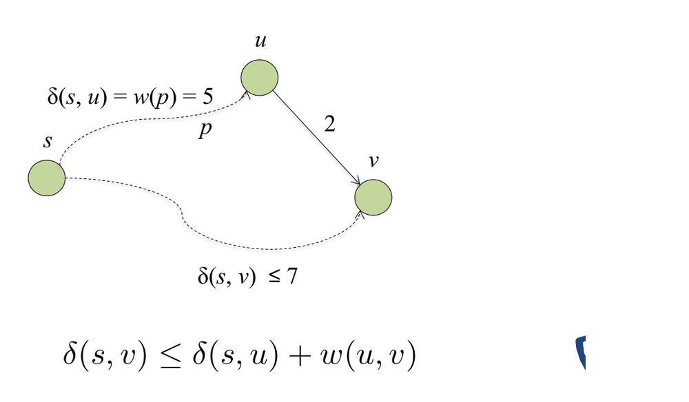<br>
<sub><i>Figura: disuguaglianza triangolare (slide 9).</i></sub>
</p>


`Relax(u,v,w): if v.d > u.d + w(u,v) then v.d <- u.d + w(u,v); v.π <- u`

Il **lemma di convergenza** assicura che se s→u→v è un cammino minimo e u.d=δ(s,u), dopo Relax(u,v,w) vale v.d=δ(s,v).

<p align="center">
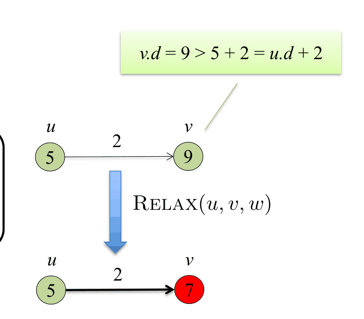<br>
<sub><i>Figura: rilassamento di un arco (slide 10).</i></sub>
</p>


### Dijkstra
L'idea di Dijkstra è quella di estrarre sempre, tra i vertici non ancora definitivi, quello con stima d più piccola, dichiararlo definitivo e rilassare i suoi archi uscenti. La coda di priorità contiene i vertici ancora da sistemare.

```
Dijkstra(G,w,s)
 for all v: v.d<-∞; v.π<-nil ; s.d<-0
 S<-∅ ; Q<-MakePriorityQueue(V)
 while Q≠∅       // inv: Q = V\S ∧ ∀v∈S. v.d = δ(s,v)
    u<-Extract-Min(Q); S<-S∪{u}
    for all v in Adj[u]: if v.d > u.d + w(u,v): v.d<-u.d+w(u,v); v.π<-u; Decrease-Key(v,v.d,Q)
```

Esempio del doc (5 vertici): le estrazioni avvengono con d = 0, 5, 7, 8, 9, con aggiornamenti 10->8, ∞->14->13, ∞->7, 8+1=9. [DA VERIFICARE: il grafo non è riportato nel testo, solo la traccia.]

<div align="center">

<table>
<tr>
<td align="center">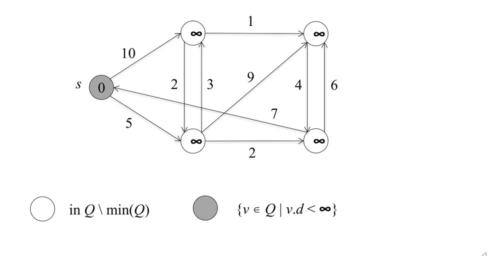<br><sub>Dijkstra: stato iniziale (slide 14).</sub></td>
<td align="center">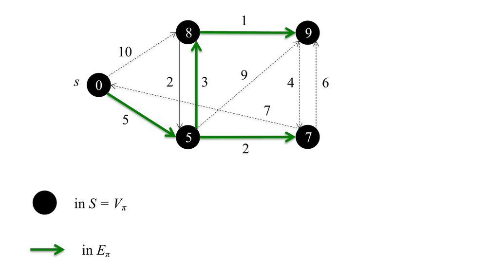<br><sub>Dijkstra: stato finale (slide 19).</sub></td>
</tr>
</table>

</div>


**Correttezza.** L'invariante è che per ogni v∈S vale v.d=δ(s,v). Per assurdo, sia u il primo vertice inserito in S con u.d>δ(s,u). Sul cammino minimo p da s a u esiste un arco (x,y) con x∈S e y∉S (y è il primo vertice fuori da S). Per la minimalità di u, x.d=δ(s,x); rilassando (x,y), per convergenza y.d=δ(s,y). Poiché i pesi sono ≥ 0, δ(s,y) ≤ δ(s,u) < u.d. Quindi y.d < u.d, ma Extract-Min avrebbe scelto y prima di u: contraddizione.

<p align="center">
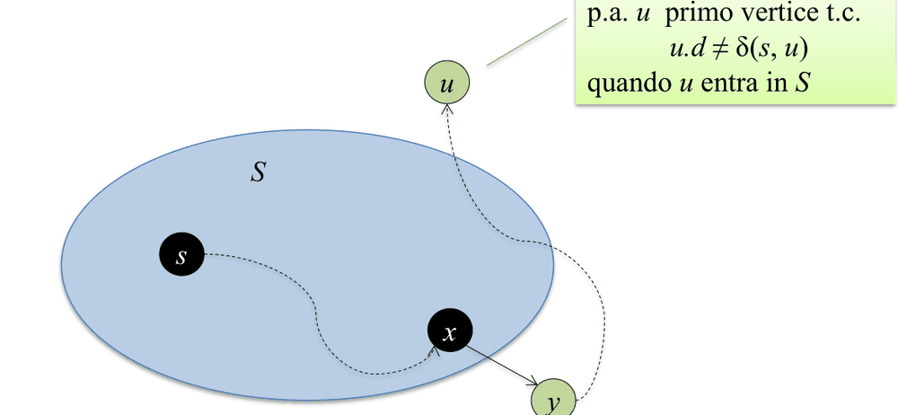<br>
<sub><i>Figura: la dimostrazione di correttezza di Dijkstra (slide 21).</i></sub>
</p>


**Pesi negativi.** Il controesempio è s→u (3), s→v (5), v→u (-4): u viene estratto con 3 e dichiarato definitivo, poi v permetterebbe di arrivare a u con 5-4=1, ma u è già in S, quindi il risultato (3 invece di 1) è sbagliato. Con pesi negativi (e senza cicli negativi) serve **Bellman-Ford**.

**Complessità.** Con heap binario si hanno |V| Extract-Min da O(log V) e al più |E| Decrease-Key da O(log V), cioè O(V log V + E log V) = **O(E log V)** per un grafo connesso. La struttura è analoga a quella di Prim.

## Integrazioni dalle slide (18 e 19)

### Teorema del taglio e greedy
La **dimostrazione del teorema del taglio** è questa. Sia T un MST con A⊆T e (u,v) un arco leggero non in T. Aggiungere (u,v) a T crea un ciclo, che attraversa il taglio con un altro arco (x,y). Il nuovo albero T' = T \ {(x,y)} ∪ {(u,v)} ha w(T') = w(T) - w(x,y) + w(u,v) ≤ w(T) ≤ w(T'), quindi T' è un MST e contiene A∪{(u,v)}. Il **corollario** è che se C è una componente (un albero) della foresta G_A=(V,A) e (u,v) è leggero per (V_C, V\V_C), allora (u,v) è sicuro.

Per quanto riguarda il greedy in generale, servono una scelta greedy (un criterio di appetibilità tale che ogni soluzione ottima si possa modificare in un'altra ottima che lo rispetta) e una sottostruttura ottima. L'esempio didattico è il resto. Per 72 centesimi con monete da 50, 10, 1 il greedy dà 50+10+10+1+1 ed è ottimo. Introducendo una moneta da 11c, la slide 18 (livello 1) mostra per 15 centesimi il greedy 11+4×1 (5 monete), ma nel testo estratto non riporta alcuna soluzione migliore: e infatti con tagli 50, 10, 11, 1 quella soluzione è ottima (l'alternativa 10+5×1 ne usa 6), quindi l'esempio del 15 non è un controesempio (possibile errore della slide, o parte grafica non estraibile). Un vero controesempio, verificato a mano da me (livello 4), è 20 centesimi: il greedy dà 11+9×1 (10 monete) mentre 10+10 ne usa 2. [ASSUNZIONE: da verificare: la scelta del 20 come controesempio non proviene dalla slide] In ogni caso il greedy non è sempre ottimo.

### Kruskal e Union-Find
Lo pseudocodice di **MST-Kruskal** usa A (lista degli archi scelti), L (archi ordinati per peso) e P (partizione, cioè Union-Find): `while L≠nil: (u,w)=Head(L); if Find(u,P)≠Find(w,P) then A:=A∪{(u,w)}; Union(u,w,P)`; L:=Tail(L). L'**invariante** ha quattro punti:
1. ∃T MST con A⊆T;
2. gli archi di A collegano vertici nella stessa parte;
3. ogni parte U∈P con A[U] è un albero di G_A;
4. gli archi scartati non sono in T\A.

Se U=W l'arco chiuderebbe un ciclo, quindi non è in T; se U≠W attraversa il taglio (U,V\U), che rispetta A, ed è leggero, quindi è sicuro.

L'ADT **Union-Find** ha MakeSet(U) (partizione discreta), Union(x,y,P) e Find(x,P), che restituisce il rappresentante r(X). Si realizza con una **foresta di alberi pozzo** (vettore dei padri) la cui radice è il rappresentante; u e w stanno nella stessa parte se e solo se Find(u)=Find(w). Con l'**unione per rango** (l'albero più basso diventa figlio dell'altro) e la **compressione del cammino** (Find appiattisce il cammino percorso) si ha MakeSet O(n) e Find/Union **O(m log n) ammortizzato su m operazioni** (rif. Cormen §21.3).

<p align="center">
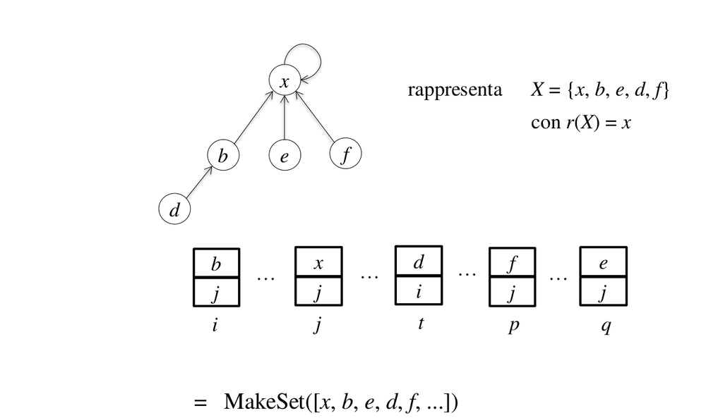<br>
<sub><i>Figura: Union-Find con una foresta di alberi (slide 36).</i></sub>
</p>


<p align="center">
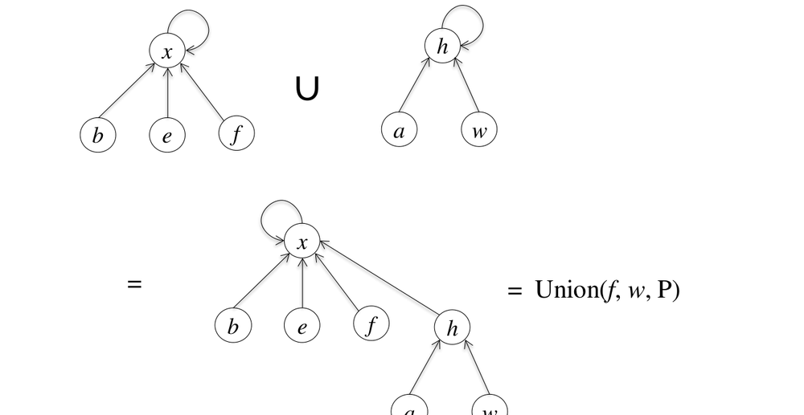<br>
<sub><i>Figura: unione per rango (slide 38).</i></sub>
</p>


<p align="center">
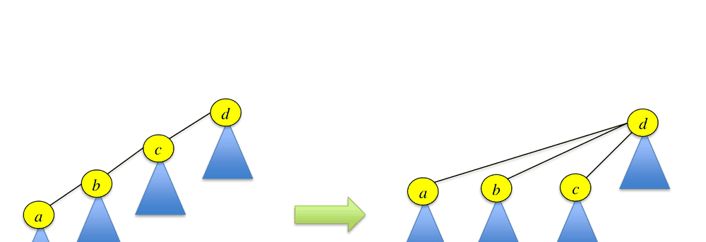<br>
<sub><i>Figura: compressione del cammino (slide 39).</i></sub>
</p>


### Prim
Per **MST-Prim** l'invariante è:
1. ∃T MST con A⊆T;
2. V[A] sono i vertici neri o grigi, cioè V\{v∈Q | v.key=∞};
3. se v∈Q e v.key<∞ allora v.key=w(u,v) per qualche u∈V[A]\Q, per cui l'arco minimo tra V[A]\Q e la frontiera è leggero per A.

I colori hanno questo significato: bianchi (key=∞), grigi (frontiera, key<∞), neri (già nell'albero). I costi sono MakePriorityQueue (BuildHeap) O(n log n) secondo le slide (ma in realtà O(n)), Extract-Min O(log n), Decrease-Key O(log n) (per risalita), quindi O(m log n); poiché G è connesso, n=O(m).

### Altri algoritmi per i cammini minimi
**Bellman-Ford** (1957) gestisce i pesi negativi e costa **O(|V|·|E|)**; **Pape-D'Esopo** (1974) è superpolinomiale nel caso peggiore ma quasi lineare su grafi planari o stradali con |E|=O(|V|). La dimostrazione del lemma dei sottocammini procede per assurdo: δ(u,z)=w(pqr)=w(p)+w(q)+w(r) > w(p)+w(q')+w(r) se q' fosse migliore di q. La condizione di Bellman è δ(s,v) ≤ δ(s,u)+w(u,v), e va ricordato che **v.d è sempre una stima in eccesso: v.d ≥ δ(s,v)**.

In **Dijkstra** la coda Q è uno heap minimo con v.key = v.d. Esempio delle slide (s con archi 10 e 5, pesi 2,3,1,9,4,6,2,7): i d finali dopo le estrazioni sono s=0, 5, 7, 8, 9 (ordine di estrazione), con aggiornamenti 10->8, 14->13, 9. [DA VERIFICARE: topologia del grafo non ricostruibile dal testo della slide.]

## Esercizi svolti collegati

Due esecuzioni a mano di Dijkstra (con stato della coda e cammini minimi) e la dimostrazione di esistenza dell'MST in un grafo connesso pesato sono nel [§10 Grafi](12-esercizi-svolti.md#10-grafi); lì si spiega a parole anche il ruolo della coda di priorità (nodi con cammino minimo ancora ignoto, priorità = stima).

## Cose da saper fare all'esame
**Scritto**
- Eseguire Kruskal (ordine archi, Union-Find) e Prim (da un vertice dato) e Dijkstra su un grafo dato con tabella di d, π, ordine di estrazione.
- Dimostrare la correttezza di Dijkstra (invariante + assurdo); mostrare un controesempio con peso negativo.
- Enunciare/usare il teorema del taglio per giustificare Kruskal/Prim.

**Orale**
- Differenza Kruskal/Prim; cosa sono arco sicuro, taglio, arco leggero; perché Dijkstra non funziona con pesi negativi; complessità con heap vs altre code.

## Dubbi
- Implementazioni di Union-Find (array/alberi con rango) e pseudocodice completo di Kruskal/Prim non nel doc (solo descrizione).
- Dijkstra con array non ordinato (O(V^2)) non menzionato nella slide 19 (che dà solo O(E log V) con heap): costa Θ(V^2) perché l'estrazione del minimo è una ricerca lineare, ed è preferibile allo heap sui grafi densi (fonte: Wikipedia, "Dijkstra's algorithm", https://en.wikipedia.org/wiki/Dijkstra%27s_algorithm).
