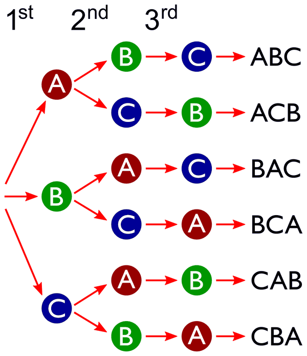

# 02 - Cardinalità e combinatorica (Matematica Discreta)

**Fonte**: A. Mori, *Lezioni di Matematica Discreta*, cap. 3 (letto per intero). Gli esercizi svolti in fondo sono gli Es. 3.4-3.14 del libro (soluzioni calcolate qui e ricontrollate numericamente).

## Mappa degli argomenti

---

- [1. Insiemi finiti e cardinalità](#1-insiemi-finiti-e-cardinalità)
- [2. Principio di inclusione-esclusione](#2-principio-di-inclusione-esclusione)
- [3. Metodo delle scelte successive](#3-metodo-delle-scelte-successive)
- [4. Ordinamenti, anagrammi, disposizioni](#4-ordinamenti-anagrammi-disposizioni)
- [5. Combinazioni e coefficienti binomiali](#5-combinazioni-e-coefficienti-binomiali)
- [6. Combinazioni con ripetizione](#6-combinazioni-con-ripetizione)
- [Esercizi tipo (soluzioni controllate)](#esercizi-tipo-soluzioni-controllate)
- [Cose da saper fare all'esame](#cose-da-saper-fare-allesame)
- [Dubbi](#dubbi)

## 1. Insiemi finiti e cardinalità

Contare significa, in fondo, confrontare insiemi tramite funzioni. Due insiemi sono **equipollenti** (hanno la stessa cardinalità) se esiste una biezione $A\to B$; si scopre così, un po' controintuitivamente, che $\mathbb{N} \approx 2\mathbb{N}$ (con $f(n)=2n$), $\mathbb{N}\times\mathbb{N} \approx \mathbb{N}$ (si elencano le coppie per somma $a+b$ crescente), $\mathbb{Z} \approx \mathbb{N}$ ($0,1,-1,2,-2,\dots$) e $\mathbb{Q} \approx \mathbb{N}$. Si scrive $\lvert A\rvert \le \lvert B\rvert$ se esiste una funzione **iniettiva** $A\to B$ (equivalentemente una suriettiva $B\to A$). Valgono il teorema di confrontabilità ($\lvert A\rvert\le\lvert B\rvert$ oppure $\lvert B\rvert\le\lvert A\rvert$) e il teorema di **Schröder-Bernstein**: $\lvert A\rvert\le\lvert B\rvert$ e $\lvert B\rvert\le\lvert A\rvert$ implicano $\lvert A\rvert=\lvert B\rvert$; entrambi sono enunciati senza dimostrazione.

La distinzione fra finito e infinito si dà senza nominare i numeri: $A$ è **infinito** se è equipollente a un suo sottoinsieme proprio (cioè esiste $f: A\to A$ iniettiva non suriettiva), **finito** se ogni $f: A\to A$ iniettiva è biettiva. Per un $A$ finito, quindi, $f: A\to A$ è iniettiva $\iff$ suriettiva $\iff$ biettiva (Prop 3.6, estesa a dominio e codominio equipollenti). I prototipi dei finiti sono gli insiemi $I_n = \lbrace 1,\dots,n\rbrace$: $I_m \approx I_n \iff m=n$, ogni finito non vuoto è equipollente a un $I_n$ (e si pone $\lvert A\rvert=n$), mentre ogni infinito $X$ ha $\lvert\mathbb{N}\rvert \le \lvert X\rvert$.

Da qui discende il **principio dei cassetti (o dei piccioni)**: se $\lvert A\rvert>\lvert B\rvert$ non esiste alcuna $f: A\to B$ iniettiva, cioè con più piccioni che gabbie una gabbia ne contiene almeno due. Esempio: 10001 smartphone con PIN a 4 cifre ($10^4$ PIN possibili) implicano che due abbiano lo stesso PIN.

Un insieme è **numerabile** se è equipollente a $\mathbb{N}$, cioè si può elencare come successione. Di Cantor si ricordano solo gli enunciati: esistono infiniti non numerabili, $\mathbb{R}$ non è numerabile e $\lvert\mathcal{P}(X)\rvert > \lvert X\rvert$.

## 2. Principio di inclusione-esclusione

Quando si uniscono insiemi che si sovrappongono, sommare le cardinalità conta due volte gli elementi comuni, e il principio di inclusione-esclusione corregge il conteggio. Per due insiemi $\boldsymbol{\lvert A\cup B\rvert = \lvert A\rvert + \lvert B\rvert - \lvert A\cap B\rvert}$, formula che si può anche usare al contrario per ricavare una qualunque delle quattro quantità. Per tre insiemi:

$$
\lvert A\cup B\cup C\rvert = \lvert A\rvert+\lvert B\rvert+\lvert C\rvert - \lvert A\cap B\rvert - \lvert A\cap C\rvert - \lvert B\cap C\rvert + \lvert A\cap B\cap C\rvert
$$

Se gli insiemi sono a due a due disgiunti, $\lvert A_1\cup\dots\cup A_n\rvert = \sum\lvert A_i\rvert$. Con quattro insiemi i termini sono 16; se tutte le intersezioni triple sono vuote, $\lvert A\cup B\cup C\cup D\rvert = \sum\lvert X\rvert - \sum\lvert X\cap Y\rvert$.

Nelle applicazioni aritmetiche i numeri $\le N$ divisibili per $k$ sono $\lfloor N/k\rfloor$, e quelli divisibili sia per $a$ sia per $b$ sono i divisibili per $\text{mcm}(a,b)$ (che è $ab$ se $a,b$ sono coprimi).

**Esempio svolto** (Mori): quanti $n \le 180$ non sono divisibili né per 3 né per 5? $\lvert D_3\rvert=60$, $\lvert D_5\rvert=36$, $\lvert D_{15}\rvert=12 \Rightarrow \lvert D_3\cup D_5\rvert=84 \Rightarrow 180-84 = \mathbf{96}$.
**Esempio** (3 insiemi): quanti $n$ in $[1,660]$ sono divisibili per 5, 6 o 11? $132+110+60-22-12-10+2 = \mathbf{260}$ (intersezioni: $D_{30}=22$, $D_{55}=12$, $D_{66}=10$, $D_{330}=2$).
**Esempio** (ricavare l'incognita): 129 biglietti, spettatori 109, 76, 55; film1∩2 = 52, film2∩3 = 44, film1∩3 = 28 $\Rightarrow 129 = 109+76+55-52-44-28+x \Rightarrow 129 = 116 + x \Rightarrow x = \mathbf{13}$ persone hanno visto tutti e tre (calcolo verificato; il testo di Mori, cap. 3, Esercizi es. 1, conclude invece 23, ma con i suoi stessi dati il conto dà 13: incoerenza nel testo di Mori (fonte: Mori, cap. 3, Esercizi); una versione precedente degli appunti riportava 23 ricopiando Mori).

## 3. Metodo delle scelte successive

Il principio base del conteggio è la **Prop 3.16**: $\lvert A_1\times\dots\times A_k\rvert = n_1\cdot n_2\cdot\ldots\cdot n_k$. Tradotto in regola pratica: una situazione che si ottiene con $k$ scelte successive, con $n_i$ possibilità alla scelta $i$, ha $n_1\cdot\ldots\cdot n_k$ esiti, anche se gli insiemi di scelta dipendono dalle scelte precedenti, purché ne dipenda solo l'insieme e non il NUMERO di possibilità. Se invece le alternative sono **in alternativa** (casi che si escludono a vicenda) si **sommano**, non si moltiplicano. Esempio dei gelati con 1, 2, 3 o 4 gusti su 14: $\binom{n}{1}+\binom{n}{2}+\binom{n}{3}+\binom{n}{4}$; Mori calcola con $n=14$ ($14+91+364+1001 = 1470$) ma il testo dice 16 tipi e riporta 1460: dati incoerenti nel testo di Mori (fonte: Mori, cap. 3, Esercizi es. 3; calcolo verificato: con $n=14$ la somma è 1470, con 16 tipi sarebbe 2516); la regola somma-per-casi resta valida.

Applicata alle funzioni, la regola dà $\boldsymbol{\lvert F_{A,B}\rvert = n^m}$ se $\lvert A\rvert=m$ e $\lvert B\rvert=n$, perché per ogni elemento di $A$ si sceglie l'immagine fra $n$ possibilità. Esempi: PIN a 4 cifre $= 10^4$; targhe con 3 lettere e 4 cifre $= 26^3\cdot 10^4 = 175.760.000$; menù $8\cdot 10\cdot 12\cdot 6 = 5760$.

## 4. Ordinamenti, anagrammi, disposizioni

<table>
<tr>
<td valign="top">

Quanti modi ci sono di mettere in fila degli oggetti? Un **ordinamento** di $A$ ($\lvert A\rvert=n$) è una biezione $I_n\to A$, e il loro numero è $\boldsymbol{n!}$ ($n\cdot(n-1)\cdot\ldots\cdot 1$, con $0!=1$). Se la lista ha elementi ripetuti, gli ordinamenti che differiscono solo per lo scambio di simboli uguali vanno identificati: il numero di **anagrammi** di una lista di lunghezza $n$ in cui il simbolo $i$ compare $r_i$ volte è $\boldsymbol{n!/(r_1!\cdot r_2!\cdot\ldots\cdot r_k!)}$. MATEMATICA: $10!/(3!\cdot 2!\cdot 2!) = 151.200$ (M×2, A×3, T×2). ORO: $3!/2! = 3$.

Se si scelgono $k$ elementi di $A$ ($\lvert A\rvert=n$) tenendo conto dell'ordine, i casi sono due:
- la **disposizione con ripetizione** di ordine $k$ è una $k$-pla di $A^k$, ovvero una funzione $I_k\to A$, e ce ne sono $\boldsymbol{n^k}$;
- la **disposizione semplice** (senza ripetizioni, cioè una funzione iniettiva $I_k\to A$) si conta con $\boldsymbol{D_{n,k} = n(n-1)\cdots(n-k+1) = n!/(n-k)!}$; vale 0 se $k>n$ e coincide con gli ordinamenti se $k=n$.

</td>
<td valign="top" align="center">

 Figura: i 3! = 6 ordinamenti di A, B, C. Da Wikimedia Commons (crediti in <code>img/CREDITI.md</code>).

</td>
</tr>
</table>

Esempi: podio con 12 atleti $= D_{12,3} = 12\cdot 11\cdot 10 = 1320$ (Mori riporta "101.320" per refuso di estrazione: il valore corretto è 1320); password di 8 simboli distinti su 36 $= 36\cdot 35\cdots 29$.

## 5. Combinazioni e coefficienti binomiali

Quando l'ordine non conta si parla di **combinazioni**: una combinazione semplice di ordine $k$ è un sottoinsieme $C\subseteq A$ con $\lvert C\rvert=k$. Ogni sottoinsieme proviene da $k!$ disposizioni (i suoi riordinamenti), quindi $\boldsymbol{C_{n,k} = D_{n,k}/k! = n(n-1)\cdots(n-k+1)/k!}$. Questo numero si scrive con il **coefficiente binomiale** $\binom{n}{k} = \dfrac{n!}{k!\,(n-k)!}$ per $0\le k\le n$, e $\binom{n}{k} = C_{n,k}$.

I coefficienti binomiali hanno proprietà che si dimostrano con argomenti di conteggio, più che con calcoli:
- **casi banali**: $\binom{n}{0}=\binom{n}{n}=1$;
- **simmetria** $\binom{n}{k}=\binom{n}{n-k}$: nasce dal fatto che passare al complementare, $S\mapsto C_A(S)$, è una biezione fra sottoinsiemi di cardinalità $k$ e $n-k$; è utile per semplificare i calcoli, ad esempio $\binom{100}{96}=\binom{100}{4}=3.921.225$;
- **formula di Stiefel** $\binom{n}{k} = \binom{n-1}{k} + \binom{n-1}{k-1}$: si dimostra fissando $a\in A$, perché i sottoinsiemi di $k$ elementi o contengono $a$ ($\binom{n-1}{k-1}$ modi) oppure non lo contengono ($\binom{n-1}{k}$ modi).

Stiefel genera il **triangolo di Pascal-Tartaglia** (riga $n$: $1, n, \dots, n, 1$).

Il **binomio di Newton** $(x+y)^n = \sum_{k=0}^{n}\binom{n}{k}\,x^{n-k}\,y^k$ spiega il nome "coefficiente binomiale": nell'espansione del prodotto di $n$ fattori, il termine in $y^k$ si ottiene scegliendo la $y$ in $k$ dei $n$ fattori, e questo si può fare in $\binom{n}{k}$ modi. Lo si può dimostrare anche per induzione usando Stiefel. Ponendo $x=y=1$ si ottiene $\boldsymbol{\sum_{k=0}^{n}\binom{n}{k} = 2^n}$, che è anche il conteggio $\lvert\mathcal{P}(A)\rvert = \sum_k \lvert\mathcal{P}_k(A)\rvert$ con $\mathcal{P}_k$ = sottoinsiemi di cardinalità $k$. Es. 3.19: per $n$ dispari $\sum_{k\ \text{pari}}\binom{n}{k} = \sum_{k\ \text{dispari}}\binom{n}{k} = 2^{n-1}$; per $x=1,\ y=-1$ Newton dà 0 se $n\ge 1$, quindi $\sum$ pari $=$ $\sum$ dispari anche per $n$ pari.

Nei problemi misti le scelte indipendenti si moltiplicano. Es. (Mori) scegliere 5 ballerini su 9 e 3 ballerine su 11: $\binom{9}{5}\binom{11}{3} = 126\cdot 165 = 20790$ (calcolo verificato; Mori, cap. 3, Esercizi es. 1, scrive $\binom{9}{5}=\binom{9}{4}=84$ e riporta $13860 = 84\cdot 165$, ma $\binom{9}{5}=\binom{9}{4}=126$ mentre 84 è $\binom{9}{3}$: errore nel testo di Mori) (fonte: Mori, cap. 3, Esercizi). Formazione calcio: $3\cdot 126\cdot 35\cdot 6 = 79.380$.

## 6. Combinazioni con ripetizione

Se si scelgono $k$ elementi di $A$ ($\lvert A\rvert=n$) potendo ripetere, senza badare all'ordine, il numero è $\boldsymbol{C'_{n,k} = \binom{k+n-1}{n-1} = \binom{k+n-1}{k}}$. La dimostrazione è il metodo delle "stelle e barre": si dispongono $k$ caselle e $(n-1)$ separatori in $k+n-1$ posizioni, e basta scegliere quali $n-1$ posizioni occupano i separatori.

Esempi: monomi di grado 9 in 4 variabili: $\binom{12}{3} = 220$; scatola di 24 cioccolatini di 8 tipi: $\binom{31}{7} = 2.629.575$; esiti non ordinati di 10 lanci di moneta: $\binom{11}{1} = 11$. Se si impone "almeno uno per tipo" si assegna prima 1 a ciascuno e si distribuiscono i $k-n$ rimanenti (es. 12 rose in 5 colori, tutti presenti: $\binom{7+5-1}{7}=\binom{11}{7}=330$).

### Tabella decisionale
La scelta della formula dipende da due domande, se l'ordine conta e se sono ammesse ripetizioni.

| Ordine conta? | Ripetizioni? | Formula |
|---|---|---|
| sì (tutti gli $n$) | no | $n!$ |
| sì ($k$ su $n$) | no | $n!/(n-k)!$ |
| sì | sì | $n^k$ |
| no | no | $\binom{n}{k}$ |
| no | sì | $\binom{n+k-1}{k}$ |
| anagrammi con elementi ripetuti | | $n!/(r_1!\cdots r_k!)$ |

---

## Esercizi tipo (soluzioni controllate)
1. (Es. 3.4a) Da 1 a 1680, quanti divisibili per almeno uno tra 2, 6, 7? Poiché 6 è multiplo di 2: $\lvert D_2\cup D_7\rvert = 840+240-120 = \mathbf{960}$.
2. (Es. 3.4b) Da 1 a 2160 né per 5, né 9, né 12: $\lvert D_5\rvert=432$, $\lvert D_9\rvert=240$, $\lvert D_{12}\rvert=180$, $\lvert D_{45}\rvert=48$, $\lvert D_{60}\rvert=36$, $\lvert D_{36}\rvert=60$, $\lvert D_{180}\rvert=12 \Rightarrow$ unione $= 432+240+180-48-36-60+12 = 720 \Rightarrow \mathbf{1440}$.
3. (Es. 3.5) Monete: A=argento 25, E=europee 170, T=tonde 415, $A\cap T=22$, $E\cap T=152$, $A\cap E\subseteq T$. Unione $= 25+170+415-\lvert A\cap E\rvert-22-152+\lvert A\cap E\rvert = \mathbf{436}$ ($\lvert A\cap E\rvert$ si semplifica perché $A\cap E=A\cap E\cap T$).
4. (Es. 3.6) Biondi 20, neri 18 (disgiunti), occhi azzurri 15, verdi 12 (disgiunti); $B\cap Az=12$, $B\cap V=4$, $N\cap Az=1$, $N\cap V=7$, triple vuote: totale $= 20+18+15+12 - (12+4+1+7) = \mathbf{41}$.
5. (Es. 3.9) Sei amici in fila: a) $6!=720$; b) Carlo e Franco al centro: $2\cdot 4! = 48$; c) Bruno e Daniele vicini: $2\cdot 5! = 240$.
6. (Es. 3.10) 11 uomini, 9 donne: a) coppie uomo-donna: $11\cdot 9=99$; b) 5 uomini e 5 donne: $\binom{11}{5}\binom{9}{5} = 462\cdot 126 = 58.212$.
7. (Es. 3.11) b) 16 informatici in 4 nazionalità con $\ge 1$ per nazione: 1 per nazione + 12 liberi: $\binom{12+4-1}{3}=\binom{15}{3}=455$; c) 7 al sottoprogetto 1, 6 al 2, 3 ruoli distinti ai 3 rimasti: $\binom{16}{7}\binom{9}{6}\cdot 3! = 11440\cdot 84\cdot 6 = 5.765.760$.
8. (Es. 3.12) a) mazzi bicolore: $\binom{5}{2}=10$; b) per avere $\ge 5$ rose uguali (principio dei piccioni): $5\cdot 4+1 = 21$; c) 12 rose con tutti i 5 colori: $\binom{11}{4}=330$.
9. (Es. 3.14) Anagrammi: ALGORITMO (O×2) $9!/2! = 181.440$; INFORMATICA (I×2, A×2) $11!/(2!\cdot 2!) = 9.979.200$; TORINO (O×2) $6!/2! = 360$; DISPOSIZIONI (I×4, S×2, O×2) $12!/(4!\cdot 2!\cdot 2!) = 4.989.600$; COROLLARIO (O×3, R×2, L×2) $10!/(3!\cdot 2!\cdot 2!) = 151.200$.
10. (Es. 3.18) $\binom{n}{k} = \binom{n-2}{k}+2\binom{n-2}{k-1}+\binom{n-2}{k-2}$: applicare due volte Stiefel.

## Esercizi svolti collegati

La combinatoria è quasi sempre il Problema 2 dell'esame di Discreta: stringhe con vincoli, sequenze su alfabeto unione, combinazioni con ripetizione (kit di asciugamani), sottoinsiemi con intersezione non vuota. Esempi svolti con la teoria usata in [16-esami-md-2024-2025.md](16-esami-md-2024-2025.md#combinatoria).

## Cose da saper fare all'esame
- Riconoscere il tipo di problema (tabella decisionale) e calcolare; distinguere "e" (prodotto) da "oppure" (somma di casi esclusivi).
- Usare inclusione-esclusione per contare numeri divisibili / insiemi con attributi; ricavare un'intersezione incognita.
- Dimostrare: Stiefel, Newton, $\sum\binom{n}{k}=2^n$, $\binom{n}{k}=\binom{n}{n-k}$, formula degli anagrammi, $\lvert F_{A,B}\rvert=n^m$, $\lvert\mathcal{P}(A)\rvert=2^n$.
- Applicare il principio dei piccioni (trovare il numero minimo che garantisce una coincidenza).
- Definizioni di finito/infinito, numerabile, equipollente; saper mostrare $\mathbb{Z}$, $\mathbb{Q}$, $\mathbb{N}\times\mathbb{N}$ numerabili.

## Dubbi
- Alcune cifre degli esempi di Mori sono state alterate dall'estrazione del PDF (ballerini, gelati, podio); le formule sono corrette ma conviene confrontare con il libro cartaceo.
- Le soluzioni ufficiali degli esercizi di Mori non sono nelle fonti: i risultati sopra sono calcolati e verificati qui.