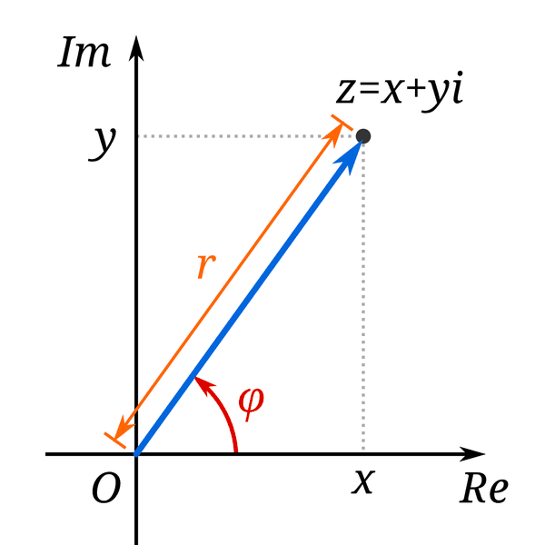

# 05 - Numeri reali, complessi e polinomi (Algebra e Geometria)

**Fonte**: Buzano-Radeschi, *MDAG Parte II: Algebra Lineare e Geometria*, Lezioni 1-4 (PDF `Lezioni_01-04.pdf`, Drive, letto per intero). Gli esercizi 2.4-3.8 sono del PDF; le soluzioni sono calcolate qui.
Nota: nell'estrazione del PDF molti segni "-" e simboli sono andati persi; quando un esercizio è ambiguo è segnalato.

## Mappa

---

- [1. Insiemi numerici e R](#1-insiemi-numerici-e-r)
- [2. Numeri complessi](#2-numeri-complessi)
- [3. Forma polare e radici](#3-forma-polare-e-radici)
- [4. Polinomi](#4-polinomi)
- [Cose da saper fare all'esame](#cose-da-saper-fare-allesame)
- [Dubbi](#dubbi)

## 1. Insiemi numerici e R

La scala dei numeri parte da $\mathbb{N} = \lbrace 0,1,2,\dots\rbrace$, si completa con gli interi $\mathbb{Z}$ e con i razionali $\mathbb{Q} = \lbrace a/b \mid a,b\in\mathbb{Z},\ b\ne 0\rbrace$, e arriva ai reali $\mathbb{R}$. Le inclusioni sono strette: $\mathbb{N}\subsetneq\mathbb{Z}\subsetneq\mathbb{Q}\subsetneq\mathbb{R}$. Il motivo per cui $\mathbb{Q}$ non basta è la mancanza di "completezza": $\mathbb{R}$ si costruisce come insieme delle classi di equivalenza di **successioni di Cauchy** razionali (due successioni sono equivalenti se la loro differenza tende a 0) ed è **completo**, cioè ogni successione di Cauchy converge, cosa che in $\mathbb{Q}$ non accade ($a_n=(1+1/n)^n$ è di Cauchy in $\mathbb{Q}$ ma il limite $e$ è irrazionale).

Un esempio classico di numero non razionale è dato dalla **Prop 1.4**: $\sqrt{2} \notin \mathbb{Q}$. Dimostrazione per assurdo: se $\sqrt{2}=a/b$ con la frazione ridotta ai minimi termini, allora $a^2=2b^2$, quindi $a$ è pari, $a=2k$, da cui $b^2=2k^2$ e anche $b$ è pari: contraddizione, perché la frazione non sarebbe ridotta.

$\mathbb{R}$ è un **campo** (Prop 1.5, nove proprietà): addizione e moltiplicazione sono commutative e associative con neutri 0 e 1, ogni elemento ha l'opposto, ogni $a\ne 0$ ha l'inverso, e vale la distributività; inoltre $\mathbb{R}$ (come $\mathbb{Q}$) è **ordinato**. Una nota di notazione: $\lbrace 1,2\rbrace$ è un insieme, $(1,2)$ è un intervallo aperto oppure un punto di $\mathbb{R}^2$, $[1,2]$ un intervallo chiuso; per i vettori non si usano le graffe.

## 2. Numeri complessi

Poiché $x^2+1=0$ non ha soluzioni reali, si ampliano i reali introducendo un numero $i$ con la sola relazione $\boldsymbol{i^2 = -1}$: i numeri complessi sono $z = a+bi$ con $a,b\in\mathbb{R}$, dove $\text{Re}\,z = a$ e $\text{Im}\,z = b$. La somma è $(a+bi)+(c+di) = (a+c)+(b+d)i$ e il prodotto $(a+bi)(c+di) = (ac-bd)+(ad+bc)i$; ad esempio $(7+i)(4-i) = 29-3i$. $\mathbb{C}$ è un **campo** (le stesse nove proprietà di $\mathbb{R}$) ma **non è ordinato**: in un campo ordinato $i^2$ dovrebbe essere $\ge 0$, mentre $i^2=-1$.

Due operazioni caratteristiche sono il coniugio e il modulo. Il **coniugato** $\bar z = a-bi$ è la riflessione rispetto all'asse reale, e $z$ è reale $\iff z = \bar z$. Il **modulo** è $\lvert z\rvert = \sqrt{a^2+b^2}$ e vale $\boldsymbol{z\bar z = \lvert z\rvert^2}$; da questa identità segue il metodo per invertire: per $z\ne 0$, $\boldsymbol{z^{-1} = \bar z/\lvert z\rvert^2}$ (moltiplicare numeratore e denominatore per il coniugato). Esempi: $(2+i)^{-1} = (2-i)/5$; $i^{-1} = -i$. Valgono le proprietà (Es. 2.5):
- $\lvert z\rvert=\lvert\bar z\rvert$;
- $\overline{z+w}=\bar z+\bar w$;
- $\overline{zw}=\bar z\bar w$;
- $\lvert z+w\rvert \le \lvert z\rvert+\lvert w\rvert$ (triangolare);
- $\lvert zw\rvert=\lvert z\rvert\lvert w\rvert$;
- $\lvert z^{-1}\rvert = 1/\lvert z\rvert$.

Geometricamente $a+bi$ corrisponde al punto $(a,b)$ del **piano complesso**: la somma è la regola del parallelogramma, l'asse reale è $\mathbb{R}$ e l'asse immaginario è $\lbrace bi\rbrace$.

**Insiemi nel piano** (Es. 2.6):
- $A=\lbrace \text{Re}\,z>\text{Im}\,z\rbrace$ è il semipiano sotto la bisettrice $y=x$ (cioè $x>y$);
- $C=\lbrace \lvert z-2\rvert\le 2\rbrace$ è il disco chiuso di centro 2 e raggio 2;
- $B=\lbrace z+\bar z=i\rbrace$: poiché $z+\bar z = 2\,\text{Re}\,z$ è reale, non può valere $i$ $\Rightarrow$ insieme vuoto [enunciato da ricontrollare];
- $z-\bar z\in\mathbb{R} \iff \text{Im}\,z = 0 \iff z$ reale.

## 3. Forma polare e radici

<table>
<tr>
<td valign="top">

Le coordinate polari $(r,\theta)$ (con $x=r\cos\theta$, $y=r\sin\theta$, $r=\sqrt{x^2+y^2}$) danno una scrittura molto più comoda per moltiplicare: $z = r(\cos\theta + i\sin\theta) = \boldsymbol{r\,e^{i\theta}}$, dove $e^{i\theta} := \cos\theta + i\sin\theta$ è un simbolo che obbedisce alle proprietà dell'esponenziale, $e^{i(\theta+\varphi)} = e^{i\theta}e^{i\varphi}$, per le formule di addizione di seno e coseno. Qui $r=\lvert z\rvert$ è il modulo e $\theta=\arg z$ l'argomento, definito a meno di $2k\pi$: due numeri in forma polare sono uguali $\iff$ stesso $r$ e $\theta_1 = \theta_0 + 2k\pi$.

La moltiplicazione diventa trasparente: $\boldsymbol{z_1z_2 = r_1r_2\,e^{i(\theta_1+\theta_2)}}$, cioè i moduli si moltiplicano e gli argomenti si sommano. Di conseguenza $z^{-1} = r^{-1}e^{-i\theta}$ e il coniugio corrisponde a $\theta\mapsto-\theta$. I numeri $e^{i\theta}$ formano la circonferenza unitaria; si ritrova l'**identità di Eulero** $e^{i\pi} = -1$, $e^{2\pi i}=1$.

</td>
<td valign="top" align="center">

 Figura: modulo r e argomento φ. Da Wikimedia Commons (crediti in <code>img/CREDITI.md</code>).

</td>
</tr>
</table>

La stessa idea risolve le equazioni $z^n = z_0$. Se $z_0 = r_0e^{i\theta_0} \ne 0$, l'equazione ha **esattamente $n$ soluzioni**,

$$
z_k = \sqrt[n]{r_0}\; e^{\,i\left(\theta_0/n + 2k\pi/n\right)}, \qquad k=0,\dots,n-1
$$

stesso modulo e argomenti a passo $2\pi/n$, quindi i vertici di un $n$-gono regolare di raggio $\sqrt[n]{r_0}$ centrato nell'origine. Il caso $z_0=1$ dà le **radici dell'unità**, $z = e^{2k\pi i/n}$.

**Esempi svolti**
1. $z^3 = -8$: $r=2$, argomenti $\pi/3$, $\pi$, $5\pi/3$ $\Rightarrow$ $z = 1+\sqrt{3}\,i$, $-2$, $1-\sqrt{3}\,i$ (triangolo equilatero).
2. $(1-i)^3$ in polare: $1-i = \sqrt{2}\,e^{-i\pi/4} \Rightarrow (1-i)^3 = 2\sqrt{2}\,e^{-3i\pi/4} = -2-2i$. Verifica cartesiana: $(1-i)^2 = -2i$, $\times(1-i) = -2i+2i^2 = -2-2i$ ✓ (Es. 3.8).
3. $z^4 = i$ (Es. 3.5): $\lvert i\rvert=1$, $\arg=\pi/2 \Rightarrow z_k = e^{i(\pi/8 + k\pi/2)}$, $k=0..3$: 4 vertici di un quadrato inscritto nella circonferenza unitaria.
4. Coordinate polari (Es. 3.6): $-3 = 3e^{i\pi}$; $1-i\sqrt{3} = 2e^{-i\pi/3}$; $(1+i)/\sqrt{2} = e^{i\pi/4}$.

## 4. Polinomi

Un polinomio è somma di monomi; ne interessano il grado e la forma normale. Si indica con $K[x]$ l'insieme dei polinomi in una variabile a coefficienti in $K$, e con $K_k[x]$ quelli di grado $\le k$. Come per gli interi, c'è una divisione con resto: se $K$ è un campo, per ogni $p$ e $d\ne 0$ esistono unici $q,r$ tali che $p = q\cdot d + r$ con $\deg r < \deg d$. Per esempio $x^3+1 = x\cdot(x^2-1) + (x+1)$. Si dice che $d$ divide $p$ se $r=0$ (ad esempio $(x+1) \mid x^3+1$, perché $x^3+1 = (x^2-x+1)(x+1)$).

La divisione lega radici e fattori. Una **radice** di $p$ è un $a$ con $p(a)=0$, e la **Prop 4.2 (Ruffini)** afferma che $a$ è radice di $p \iff (x-a) \mid p(x)$. Dimostrazione: $p = q(x-a)+r_0$, e sostituendo $x=a$ si ottiene $p(a)=r_0$. La **molteplicità** di $a$ è il massimo $k$ con $(x-a)^k \mid p$; per esempio $x^3-2x^2+x = x(x-1)^2$ ha la radice 0 di molteplicità 1 e la radice 1 di molteplicità 2. Da Ruffini, per induzione sul grado, segue il **Teo 4.6**: un polinomio di grado $n\ge 1$ ha al più $n$ radici contate con molteplicità.

Nel grado 2 con $\Delta=b^2-4ac$:
- se $\Delta>0$ ci sono due radici reali;
- se $\Delta=0$ una radice doppia $-b/2a$;
- se $\Delta<0$ nessuna radice reale.

Proprio questa mancanza giustifica l'introduzione dei complessi, sancita dal **teorema fondamentale dell'algebra (Teo 4.8)**: un polinomio a coefficienti complessi di grado $n$ ha **esattamente $n$ radici in $\mathbb{C}$** contate con molteplicità (dimostrazione omessa). Esempi: $x^2+1 = 0 \Rightarrow \pm i$; $x^2+(1-i)x-i$: $\Delta = (1-i)^2+4i = 2i$, $\sqrt{2i} = \pm(1+i) \Rightarrow x = i,\ -1$.

Quando i coefficienti sono reali le radici complesse vengono a coppie (**Prop 4.11**): se $p\in\mathbb{R}[x]$ e $z\in\mathbb{C}$ è radice allora anche $\bar z$ lo è. Dimostrazione: coniugando $p(z)=0$ e usando che i coefficienti sono reali si ottiene $p(\bar z)=0$. Conseguenza: un polinomio reale di grado dispari ha almeno una radice reale.

Un'applicazione sono i codici correttori (Reed-Solomon): si inviano i coefficienti di un polinomio che si annulla in punti fissati, il che permette di rilevare e correggere errori. Esempio: parole $(2,-7,8,-2,a,b)$ con $s(1)=s(2)=0 \Rightarrow a+b=-1,\ 2a+b=-8 \Rightarrow a=-7,\ b=6$.

---

## Esercizi svolti collegati

Potenze e radici $n$-esime di numeri complessi e radici di polinomi di grado 4 sono la prima domanda del quiz di Algebra Lineare in quasi ogni appello; vedi [17-esami-ag-2024-2025.md](17-esami-ag-2024-2025.md#quiz-le-domande-che-tornano).

## Cose da saper fare all'esame
- Operazioni, coniugio, modulo, inverso in $\mathbb{C}$; parte reale e immaginaria di espressioni razionali in $z$ (moltiplicare per il coniugato del denominatore).
- Passare da forma cartesiana a polare e viceversa; calcolare potenze (formula di De Moivre $r^n e^{in\theta}$) e **tutte** le radici $n$-esime, disegnarle.
- Disegnare sottoinsiemi del piano complesso definiti da disuguaglianze/equazioni su $\text{Re}$, $\text{Im}$, $\lvert\cdot\rvert$, $\arg$.
- Dimostrare $\sqrt{2}$ irrazionale, Prop 4.2, Teo 4.6, Prop 4.11 e le proprietà di coniugio/modulo dell'Es. 2.5.
- Dividere polinomi, trovare radici (anche complesse) e molteplicità; fattorizzare in $\mathbb{C}[x]$ e in $\mathbb{R}[x]$ (fattori di grado $\le 2$).

## Dubbi
- La costruzione di $\mathbb{R}$ con le successioni di Cauchy è presentata in modo intuitivo: [DA VERIFICARE] se serve saperla all'esame o basta saper dire che $\mathbb{R}$ è completo.
- Alcuni esercizi (2.4 su parte reale/immaginaria, 2.7 verifica di radici) hanno segni persi nell'estrazione e non ho potuto riscriverli con certezza.