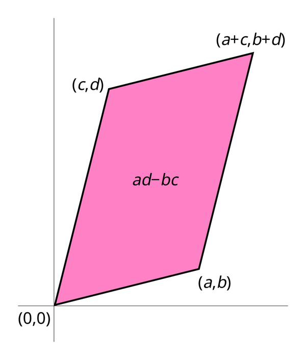

# 07 - Matrici e determinante (Algebra e Geometria)

**Fonte**: Buzano-Radeschi, Lezioni 8-10 (`Lezioni_08-10.pdf`), Lezione 6 (matrici) e compiti d'esame. Esercizi 8.15-10.11 del PDF; soluzioni calcolate e verificate al computer.

## Mappa

---

- [1. Operazioni](#1-operazioni)
- [2. Determinante](#2-determinante)
- [3. Cofattori e matrice inversa](#3-cofattori-e-matrice-inversa)
- [Cose da saper fare all'esame](#cose-da-saper-fare-allesame)
- [Dubbi](#dubbi)

## 1. Operazioni

Le matrici m×n su K formano lo spazio M(m,n,K), con somma e prodotto per scalare termine a termine, e come visto nel file 06 hanno dimensione mn. La novità di questo capitolo è che le matrici si possono anche moltiplicare fra loro, e questo le trasforma da semplici tabelle di numeri in veri oggetti algebrici (e, più avanti, in applicazioni lineari).

La **trasposta** ᵗA ∈ M(n,m) scambia righe e colonne: (ᵗA)_ij = $A_{ji}$. Rispetta somma e scalare, t(A+B)=ᵗA+ᵗB e t(λA)=λᵗA, e si annulla se applicata due volte, ᵗ(ᵗA)=A, ma sul prodotto inverte l'ordine: **t(AB)=ᵗB ᵗA**. Una matrice è simmetrica se ᵗA=A e antisimmetrica se ᵗA=-A.

Il **rango** rk(A) è la dimensione dello span delle colonne, cioè il massimo numero di colonne indipendenti. Un fatto fondamentale (Prop 8.6) è che coincide con il rango per righe, quindi **rk(ᵗA)=rk(A)**: righe e colonne contengono la stessa quantità di informazione indipendente. In pratica si calcola con Gauss contando i pivot (v. file 08). Dai compiti emerge anche che per A reale m×n di rango massimo vale rk(A·ᵗA) = rk(A) (per esempio A 3×2 di rango 2 dà rk(AᵗA)=2, A 4×3 dà 3, A 5×3 dà 3); è un fatto usato nei quiz la cui dimostrazione non compare nelle lezioni estratte [ASSUNZIONE: da verificare] (nessuna fonte trovata nelle Lezioni Buzano 1-26 né nelle slide Manno; ragionamento proprio: su R se A·ᵗA·x=0 allora ‖ᵗAx‖^{2}=ᵗx·A·ᵗA·x=0, quindi Ker(A·ᵗA)=Ker(ᵗA) e rk(A·ᵗA)=rk(ᵗA)=rk(A); gli esempi numerici sono calcolo verificato).

Il **prodotto riga per colonna** si può fare solo se il numero di colonne di A coincide con il numero di righe di B: se A è m×n e B è n×p, allora AB è m×p con (AB)_ij = $\sum _k$ $A_{ik}$ $B_{kj}$. L'intuizione migliore è guardare il caso Ax con x vettore colonna: il risultato è la combinazione lineare delle colonne di A con coefficienti le componenti $x_i$, ed è proprio questo il motivo per cui il prodotto matriciale descrive le applicazioni lineari. Il prodotto è associativo, distributivo, compatibile con gli scalari (λ(AB)=(λA)B=A(λB)) e ha come neutro l'**identità** $I_n$ (diagonale di 1), ma **non è commutativo**: con A=[[1,0],[0,0]] e B=[[0,1],[0,0]] si ha AB=B e BA=0.

La **traccia** tr A = Σ $A_{ii}$ è la somma degli elementi diagonali; è lineare e soddisfa **tr(AB)=tr(BA)**. La dimostrazione è un semplice scambio di somme: tr(AB) = $\sum _i$ $\sum _j$ $A_{ij}$ $B_{ji}$, espressione simmetrica fra i due fattori. Notare che la proprietà vale anche quando AB e BA hanno taglie diverse.

**Esempio** (Es. 8.16): A=[[1,2],[3,4],[5,6]] (3×2), B=[[1,2,3],[4,5,6]] (2×3): AB=[[9,12,15],[19,26,33],[29,40,51]], BA=[[22,28],[49,64]]; tr(AB)=9+26+51=86=tr(BA)=22+64 ✓ (matrici di taglia diversa ma stessa traccia).

## 2. Determinante

<table>
<tr>
<td valign="top">

Il determinante associa a una matrice quadrata un numero che dice, in sostanza, se le sue colonne sono indipendenti (e, geometricamente, di quanto viene scalato il volume). La definizione (9.1) è combinatoria: det A = $\sum _{\sigma \in S_n}$ sgn(σ) $a_{1\sigma (1)}$ ... $a_{n\sigma (n)}$, una somma su tutte le n! permutazioni in cui da ogni riga e ogni colonna si prende esattamente un elemento, con segno sgn(σ)=(-1)^{#trasposizioni}. Per n=1 si ha det(a)=a; per n=2 il ben noto **ad-bc**; per n=3 si ottiene la regola di Sarrus: a11a22a33 - a11a23a32 - a13a22a31 - a12a21a33 + a12a23a31 + a13a21a32.

Per le matrici **triangolari** (e quindi diagonali) il determinante è il prodotto degli elementi sulla diagonale (Prop 9.3): l'unica permutazione che non passa per uno zero è l'identità. In particolare det $I_n$=1. Vale inoltre det ᵗA = det A (Prop 9.5), perciò ogni proprietà enunciata per le righe vale anche per le colonne.

</td>
<td valign="top" align="center">

 Figura: il determinante 2×2 come area con segno del parallelogramma. Da Wikimedia Commons (crediti in <code>img/CREDITI.md</code>).

</td>
</tr>
</table>

Per il calcolo concreto si usa lo **sviluppo di Laplace** (Teo 9.6) lungo la riga i: det A = $\sum _j$ (-1)^{i+j} $a_{ij}$ det $C_{ij}$, dove $C_{ij}$ è la sottomatrice (n-1)×(n-1) ottenuta eliminando la riga i e la colonna j; i segni seguono una scacchiera (+ - + / - + - / ...). Lo stesso vale per le colonne, e conviene sempre scegliere la riga o colonna con più zeri.

Lo strumento più efficiente, però, è capire come il determinante reagisce alle mosse di Gauss (9.10-9.12, 10.1):
- moltiplicare una riga per c moltiplica il determinante per c, da cui **det(cA)=c^{n}det A** e det(-A)=(-1)^{n}det A;
- **scambiare due righe cambia il segno**;
- **sommare a una riga un multiplo di un'altra non cambia nulla**.

Una riga (o colonna) nulla, o due righe uguali, forzano det=0, e più in generale **det A = 0 ⇔ una riga (colonna) è combinazione lineare delle altre** (Prop 10.3), che è il legame con l'indipendenza lineare del file 06. Altro risultato chiave è il **teorema di Binet**, det(AB)=det A · det B (senza dimostrazione), da cui segue il Cor 10.5: det($A^{-1}$)=1/det A.

Il **metodo pratico** è dunque ridurre a scalini con Gauss tenendo il conto di come cambia il determinante (scambio ⇒ ×(-1), moltiplicazione di una riga per c ⇒ ×c) e infine moltiplicare i pivot.

**Esempio svolto** (Es. 10.2): A=[[1,2,3],[4,5,6],[7,8,9]]; si toglie la riga 1 dalle righe 2 e 3 (mossa del 3° tipo, det invariato): [[1,2,3],[3,3,3],[6,6,6]]; poi R3→R3-2R2 ⇒ riga nulla ⇒ **det A=0** (rango 2: nullspace generato da (1,-2,1)).

**Esempio**: M=[[1,2,3],[4,5,6],[7,8,10]]: det = **-3** (Gauss: pivot 1, -3, e dopo l'ultima riduzione 1: 1·(-3)·1 = -3), rango 3.

**Esempio Laplace**: det [[2,0,1],[3,1,4],[0,0,5]] sviluppando lungo la terza riga: 5·(+1)·det[[2,0],[3,1]] = 5·2=10.

## 3. Cofattori e matrice inversa

Il **cofattore** cof_ij = (-1)^{i+j} det $C_{ij}$ è il termine che compare nello sviluppo di Laplace, e cof(A) è la matrice dei cofattori: il teorema si riscrive come det A = $\sum _j$ $a_{ij}$ cof_ij lungo la riga i. Se invece si moltiplicano gli elementi di una riga per i cofattori di un'**altra** riga si ottiene 0, perché è lo sviluppo di una matrice con due righe uguali. Mettendo insieme i due fatti si ottiene la **Prop 10.7**: **A · ᵗcof(A) = ᵗcof(A) · A = det(A)·$I_n^{*}$*, cioè sulla diagonale compare det A e fuori diagonale zero.

Ne discende il criterio di invertibilità (**Prop 10.8**): una matrice A (n≥2) è **invertibile ⇔ det A ≠ 0**, e in tal caso **$A^{-1}$ = (1/det A) · ᵗcof(A)**. La dimostrazione ha due versi: se esiste B con AB=I, Binet dà det A · det B = 1, quindi det A ≠ 0; viceversa si pone B=det(A)^{-1} ᵗcof(A) e si applica la Prop 10.7. Nel caso 2×2, A=[[a,b],[c,d]] dà $A^{-1}$ = 1/(ad-bc) · [[d,-b],[-c,a]]; per esempio [[2,1],[5,3]] ha det 1 e inversa [[3,-1],[-5,2]].

Per n≥3 la formula dei cofattori è lenta e il metodo di Gauss-Jordan su (A | I) ⇒ (I | $A^{-1}$) è di norma più veloce (v. file 08). Altre regole utili: (AB)^{-1} = B^{-1}$A^{-1}$ e (ᵗA)^{-1} = ᵗ($A^{-1}$); inoltre il sistema Ax=b con det A≠0 ha l'unica soluzione x=A^{-1}b.

**Esempio svolto** (inversa con cofattori) per M=[[1,2,3],[4,5,6],[7,8,10]]: cof(M) = [[2,2,-3],[4,-11,6],[-3,6,-3]]; det=-3 ⇒ $M^{-1}$ = -1/3 · ᵗcof(M) = [[-2/3,-4/3,1],[-2/3,11/3,-2],[1,-2,1]] (verificato M·$M^{-1}$=I).

**Esempio con parametro** (stile Es. 10.9): $A_k$=[[k,2],[3,k-1]]: det = k(k-1)-6 = $k^{2}$-k-6 = (k-3)(k+2) ⇒ invertibile ⇔ k≠3 e k≠-2; allora $A_k^{-1}$ = 1/((k-3)(k+2)) · [[k-1,-2],[-3,k]].

---

## Esercizi svolti collegati

Determinante (anche di potenze), rango con Gauss, traccia di prodotti e identità fra matrici sono due o tre domande di ogni quiz: [17-esami-ag-2024-2025.md](17-esami-ag-2024-2025.md#quiz-le-domande-che-tornano).

## Cose da saper fare all'esame
- Prodotti, trasposte, tracce; verificare t(AB)=ᵗBᵗA (Es. 8.15), tr(AB)=tr(BA); stabilire taglia e possibilità di un prodotto.
- Calcolare determinanti 2×2, 3×3 (Sarrus/Laplace), 4×4 (Gauss + Laplace), anche con parametro (es. determinante di Vandermonde-like: det[[1,1,1],[1,x,$x^{2}$],[1,$x^{2}$,$x^{4}$]] = x(x-1)^{3}(x+1)).
- Decidere invertibilità e calcolare l'inversa (cofattori o Gauss-Jordan), anche con parametro e su C.
- Dimostrare: det triangolare, comportamento sotto mosse di Gauss, det(cA)=c^{n}det A, tr(AB)=tr(BA), Prop 10.7-10.8, det($A^{-1}$)=1/det A, det tA=det A.
- Collegare: det=0 ⇔ colonne dipendenti ⇔ rk<n ⇔ sistema omogeneo ha soluzioni non banali ⇔ 0 è autovalore (v. file 08, 10).

## Dubbi
- Es. 8.17 (A,B,C 3×3), 9.13, 9.14 (determinante 4×4 con radici e unità immaginaria) hanno entrate illeggibili nell'estrazione: non risolti qui.
- Per Es. 10.9 e 10.10 le entrate esatte sono ambigue (segni persi): ho sostituito con esempi analoghi verificati.
