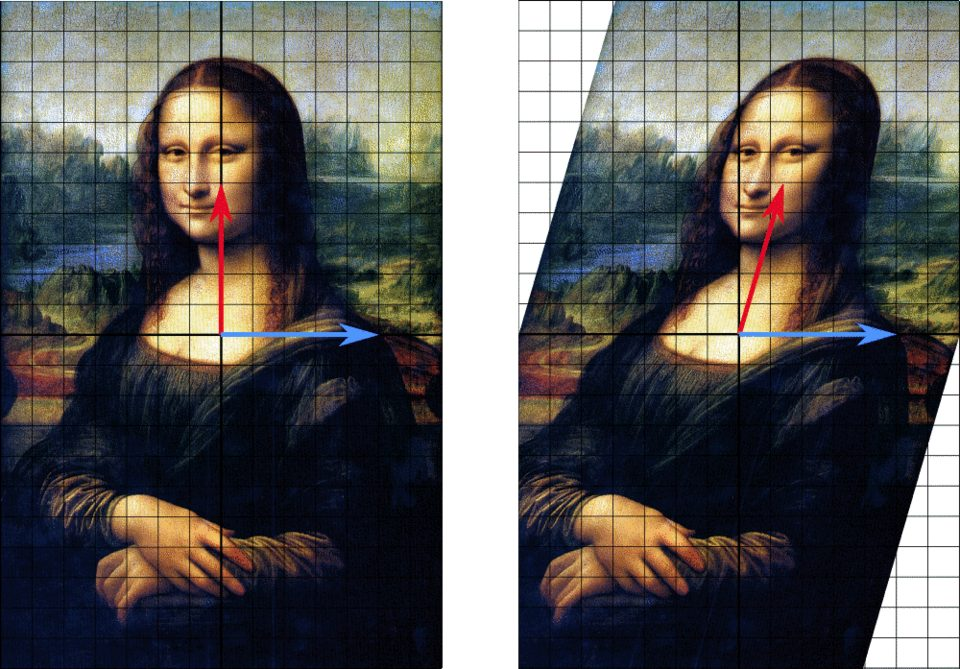

# 10 - Autovalori, autovettori, diagonalizzazione (Algebra e Geometria)

**Fonte**: Buzano-Radeschi, Lezioni 17-18 (`Lezioni_17-18.pdf`), con le Lezioni 27 e 33 di Manno (slide manoscritte 2024, in OCR) per il criterio e la matrice diagonalizzante. Tutti gli esempi numerici verificati al computer; i segni persi nell'estrazione sono stati ricostruiti (indicato).

## Mappa

---

- [1. Definizioni](#1-definizioni)
- [2. Diagonalizzabilità](#2-diagonalizzabilità)
- [3. Polinomio caratteristico](#3-polinomio-caratteristico)
- [4. Autospazi e molteplicità](#4-autospazi-e-molteplicità)
- [5. Teorema di diagonalizzabilità](#5-teorema-di-diagonalizzabilità)
- [Cose da saper fare all'esame](#cose-da-saper-fare-allesame)
- [Dubbi](#dubbi)

## 1. Definizioni

Un endomorfismo $T: V\to V$ può comportarsi in modo complicato, ma in certe direzioni agisce in modo semplicissimo: si limita ad allungare o accorciare il vettore. Un **autovettore** è un $v\ne 0$ con $\boldsymbol{T(v)=\lambda v}$, e lo scalare $\lambda\in K$ è il corrispondente **autovalore**. Il vettore $v$ non può essere nullo, mentre $\lambda$ può essere 0. Se $v$ è autovettore con autovalore $\lambda$, lo è anche ogni multiplo $\mu v$ ($\mu\ne 0$), con lo stesso $\lambda$: dunque a ogni autovalore corrisponde tutta una retta $\text{Span}(v)$ privata dell'origine.

 
<i>Figura: una trasformazione lineare lascia fisso l'autovettore blu e inclina quello rosso. Da Wikimedia Commons (crediti in img/CREDITI.md).</i>

Rispetto a una base $B$, con $A=[T]_B^B$ e $x=[v]_B$, la condizione $T(v)=\lambda v$ diventa $Ax=\lambda x$, quindi si può studiare direttamente la matrice $A$ ($T = L_A$).

Esempi: per $A=\begin{pmatrix}3&-4\\0&2\end{pmatrix}$ si ha $Ae_1=3e_1$ (autovalore 3) e $A(4,1)=(8,2)=2(4,1)$ (autovalore 2), mentre $e_2$ non è autovettore ($Ae_2=(-4,2)$) [segno ricostruito]. La rotazione $\text{Rot}_\theta$ di angolo $\theta\ne 0,\pi$ non ha alcun autovettore reale, perché ruota ogni vettore; per $\theta=0,\pi$ è $\pm\text{id}$ e tutti i vettori sono autovettori.

## 2. Diagonalizzabilità

L'obiettivo è trovare una base in cui $T$ abbia la forma più semplice possibile. **$T$ è diagonalizzabile** $\iff V$ ha una **base di autovettori** $B=\lbrace v_1..v_n\rbrace$; in tale base $[T]_B^B=\text{diag}(\lambda_1,\dots,\lambda_n)$ (Prop 17.6: la matrice è diagonale $\iff$ i vettori della base sono autovettori, e sulla diagonale compaiono gli autovalori). Per le matrici, **$A$ è diagonalizzabile** $\iff$ è simile a una diagonale, cioè esiste $M$ invertibile con $\boldsymbol{D=M^{-1}AM}$ diagonale. La matrice diagonalizzante **$M$ ha per colonne gli autovettori**, nell'ordine corrispondente agli autovalori su $D$: infatti $AM=MD$, scritta colonna per colonna, dice proprio $Av_i=\lambda_iv_i$. Un endomorfismo $T$ è diagonalizzabile $\iff$ lo è la sua matrice in una qualsiasi base (Prop 17.8).

Il vantaggio è enorme: il determinante di una diagonale è il prodotto degli elementi, i prodotti con una diagonale sono banali e soprattutto le potenze diventano facili, $\boldsymbol{A^k = M D^k M^{-1}}$, con $D^k=\text{diag}(\lambda_1^k,\dots,\lambda_n^k)$.

**Esempio svolto** (17.11): $A=\begin{pmatrix}3&-4\\0&2\end{pmatrix}$, autovettori $v_1=(1,0)$ ($\lambda=3$), $v_2=(4,1)$ ($\lambda=2$): $M=\begin{pmatrix}1&4\\0&1\end{pmatrix}$, $M^{-1}=\begin{pmatrix}1&-4\\0&1\end{pmatrix}$, $D=\text{diag}(3,2)$.

$$
A^{100} = M D^{100} M^{-1} = \begin{pmatrix}3^{100} & -4\,(3^{100}-2^{100})\\ 0 & 2^{100}\end{pmatrix}
$$

(controllo per $k=2$: $A^2=\begin{pmatrix}9&-20\\0&4\end{pmatrix}$ = formula con $3^2=9$, $-4(9-4)=-20$ ✓).

## 3. Polinomio caratteristico

Per trovare gli autovalori non occorre indovinarli: sono le radici di un polinomio. Il **polinomio caratteristico** è $\boldsymbol{p_A(\lambda)=\det(A-\lambda I_n)}$ (talvolta si usa $\det(\lambda I-A)$, che differisce per $(-1)^n$), di grado $n$ in $\lambda$, e **gli autovalori di $T$ sono le radici di $p_A$** (Prop 17.13). Il ragionamento è una catena di equivalenze: $\lambda$ è autovalore $\iff$ esiste $x\ne 0$ con $(A-\lambda I)x=0 \iff A-\lambda I$ non è invertibile $\iff \det(A-\lambda I)=0$.

Il polinomio caratteristico è un **invariante per similitudine**: se $A\sim B$ allora $p_A=p_B$ (si scrive $A-\lambda I = M^{-1}(B-\lambda I)M$ e si usa Binet), perciò $p_T$ è ben definito per un endomorfismo, indipendentemente dalla base. Si usano poi, come controlli, alcuni fatti non presenti nelle Lezioni Buzano 17-18: il coefficiente di $\lambda^{n-1}$ è $\pm$traccia e il termine noto è $\det A$, quindi:
- la somma degli autovalori è $\text{tr}\,A$ [ASSUNZIONE: da verificare] (nessuna fonte trovata su Drive per la traccia);
- il prodotto è $\det A$ (fonte: Slide MANNO, Lezione29_Complementi_Alg.pdf, dove si usa che $\det$ coincide col prodotto delle radici del polinomio caratteristico);
- $A$ è invertibile $\iff$ 0 non è autovalore (fonte: Buzano Prop 17.13 e Prop 10.8: 0 è radice di $p_A$ sse $\det A = 0$ sse $A$ non è invertibile).

**Esempio** (17.14): $A=\begin{pmatrix}3&-4\\0&2\end{pmatrix}$: $p_A=(3-\lambda)(2-\lambda) \Rightarrow$ autovalori 3, 2.

## 4. Autospazi e molteplicità

L'**autospazio** relativo a $\lambda$ è $V_\lambda = \lbrace v \mid T(v)=\lambda v\rbrace = \ker(T-\lambda\cdot\text{id}) = \ker(A-\lambda I)$: l'insieme di tutti gli autovettori di $\lambda$ insieme allo 0, quindi un sottospazio. Per calcolarlo si risolve il sistema $(A-\lambda I)x=0$.

La **Prop 18.1** afferma che autovettori di autovalori **distinti** sono linearmente indipendenti (si procede per induzione su $k$: si applica $T$ e si sottrae $\lambda_k$ volte la combinazione). Ne discende il **Cor 18.2**: se $p_T$ ha **$n$ radici distinte in $K$**, allora $T$ è diagonalizzabile; è una condizione sufficiente ma non necessaria. Più in generale gli autospazi sono in **somma diretta** $V_{\lambda_1}\oplus\dots\oplus V_{\lambda_k}$ (Prop 18.5; per due sottospazi, somma diretta significa $V_1\cap V_2=\lbrace 0\rbrace$), e il **Cor 18.6** dice che $T$ è diagonalizzabile $\iff V = V_{\lambda_1}\oplus\dots\oplus V_{\lambda_k}$, perché unendo le basi degli autospazi si ottiene una base di autovettori.

Per quantificare bisogna distinguere due molteplicità:
- la **molteplicità algebrica** $m_a(\lambda)$ è la molteplicità di $\lambda$ come radice di $p_T$;
- la **molteplicità geometrica** è $m_g(\lambda)=\dim V_\lambda = n - \text{rk}(A-\lambda I)$.

Il **Teo 18.9** garantisce che $\boldsymbol{1 \le m_g(\lambda) \le m_a(\lambda)}$; in particolare se $m_a=1$ allora $m_g=1$.

## 5. Teorema di diagonalizzabilità

Il criterio completo è il **Teo 18.10**: $T$ (con $\dim V=n$) è diagonalizzabile $\iff$ valgono entrambe le condizioni seguenti.
1. $p_T$ ha **$n$ radici in $K$ contate con molteplicità**, cioè si spezza in fattori di grado 1 su $K$ (su $\mathbb{C}$ è sempre vero, su $\mathbb{R}$ no);
2. $\boldsymbol{m_a(\lambda)=m_g(\lambda)}$ per ogni autovalore $\lambda$.

La dimostrazione è un semplice conteggio: posto $W=\sum V_{\lambda_i}$, si ha $\dim W=\sum m_g \le \sum m_a \le n$; $T$ è diagonalizzabile $\iff \dim W=n \iff$ entrambe le disuguaglianze sono uguaglianze. Operativamente si procede così.
1. Calcolare $p_A$ e le sue radici (in $\mathbb{R}$ o $\mathbb{C}$ a seconda del campo richiesto!).
2. Per ogni radice con $m_a\ge 2$ calcolare $m_g=n-\text{rk}(A-\lambda I)$.
3. Se sono tutte uguali $\Rightarrow$ diagonalizzabile: trovare le basi degli autospazi per costruire $M$ e poi $D=M^{-1}AM$.

**Esempio 18.8** (non diagonalizzabile): $A=\begin{pmatrix}1&1\\0&1\end{pmatrix}$: $p=(\lambda-1)^2$, $m_a(1)=2$; $A-I=\begin{pmatrix}0&1\\0&0\end{pmatrix}$ rk 1 $\Rightarrow m_g=1\ne 2 \Rightarrow$ **non diagonalizzabile**.

**Esempio 18.11** (segni ricostruiti): $A=\begin{pmatrix}3&0&0\\-4&-1&-8\\0&0&3\end{pmatrix}$: $p=(3-\lambda)^2(-1-\lambda)$: $\lambda=3$ ($m_a=2$), $\lambda=-1$ ($m_a=1\Rightarrow m_g=1$). $A-3I=\begin{pmatrix}0&0&0\\-4&-4&-8\\0&0&0\end{pmatrix}$ rk 1 $\Rightarrow m_g(3)=3-1=2=m_a$ $\Rightarrow$ **diagonalizzabile** ($V_3=\langle(-1,1,0),(-2,0,1)\rangle$, $V_{-1}=\langle(0,1,0)\rangle$, verificato).

**Esempio con parametro 18.12** (segni ricostruiti): $A_k=\begin{pmatrix}3&k+4&1\\-1&-3&-1\\0&0&2\end{pmatrix}$. Il blocco $2\times 2$ ha traccia 0 e $\det k-5$ $\Rightarrow$ $\boldsymbol{p_A=(2-\lambda)(\lambda^2+k-5)}$; radici $2,\ \pm\sqrt{5-k}$. La discussione si fa per casi.
- $k>5$: $\lambda^2=5-k<0$, una sola radice reale $\Rightarrow$ non diagonalizzabile su $\mathbb{R}$ (lo sarebbe su $\mathbb{C}$: 3 radici distinte).
- $k<5$, $k\ne 1$: tre radici reali distinte ($2,\ \pm\sqrt{5-k}$: coincidono con 2 solo se $5-k=4 \iff k=1$; $\pm\sqrt{\ }$ coincidono $\iff k=5$) $\Rightarrow$ diagonalizzabile.
- $k=1$: autovalori $-2, 2, 2$: $A-2I=\begin{pmatrix}1&5&1\\-1&-5&-1\\0&0&0\end{pmatrix}$ rk 1 $\Rightarrow m_g(2)=2=m_a$ $\Rightarrow$ diagonalizzabile.
- $k=5$: autovalori $2, 0, 0$: $\text{rk}(A)=2 \Rightarrow m_g(0)=1\ne 2 \Rightarrow$ **non diagonalizzabile**.

Conclusione: $\boldsymbol{A_k}$ **diagonalizzabile su $\mathbb{R}$ $\iff k<5$.**

**Quiz dei compiti (ragionamenti rapidi)**. Nei quiz basta spesso ragionare su $p_T$ e sulle molteplicità senza calcolare nulla.
- Matrice triangolare a blocchi con $1,1,2$ sulla diagonale e un parametro $k$ sotto la diagonale: la matrice $\begin{pmatrix}1&0&0\\k&1&0\\0&0&2\end{pmatrix}$ ha autovalore 1 doppio con $A-I=\begin{pmatrix}0&0&0\\k&0&0\\0&0&1\end{pmatrix}$: rk$=1$ se $k=0$, rk$=2$ se $k\ne 0 \Rightarrow m_g=2$ solo per $k=0 \Rightarrow$ **diagonalizzabile solo per $k=0$**. Analogamente per $\begin{pmatrix}1&k&k\\0&1&0\\0&0&2\end{pmatrix}$: diag. solo per $k=0$ (verificato).
- $f: \mathbb{R}^4\to\mathbb{R}^4$ simmetrico (spettrale) con $p=t^2(t-3)^2$: $f$ diagonalizzabile $\Rightarrow \dim\text{Ker}=m_a(0)=2$, due autospazi di dim 2, non suriettivo.
- Endomorfismo con $p=t(t-3)^3$ non simmetrico: $\dim\text{Ker}(f)=m_g(0)=m_a(0)=1$, $\dim\text{Im}=3$, non suriettivo; non si può dire altro su $V_3$ ($m_g\in\lbrace 1,2,3\rbrace$).
- $p(\lambda) = -\lambda^3+3\lambda^2-2\lambda = -\lambda(\lambda-1)(\lambda-2)$: tre radici distinte $\Rightarrow$ diagonalizzabile; ha autovalore 0 $\Rightarrow$ non biunivoca; autospazi distinti si intersecano solo in 0.

---

## Esercizi svolti collegati

La matrice con parametro $k$ (autovalori, molteplicità algebrica e geometrica, per quali $k$ è diagonalizzabile, $P$ e $D$) è il Problema 11 della maggior parte degli appelli; esempi 1 e 2 e la tipologia in [17-esami-ag-2024-2025.md](17-esami-ag-2024-2025.md). Esercizi di compiti 2022 in [15-esercizi-endomorfismi.md](15-esercizi-endomorfismi.md).

## Cose da saper fare all'esame
- Calcolare $p_A$, autovalori (con le molteplicità), autospazi con basi, decidere la diagonalizzabilità su $\mathbb{R}$ (e su $\mathbb{C}$), trovare $M$ e $D$ (verificando $AM=MD$), calcolare $A^k$.
- Discutere la diagonalizzabilità al variare di un parametro (casi critici: autovalori che coincidono $\Rightarrow$ calcolare $m_g$).
- Dimostrare: Prop 17.13 (autovalori = radici), invarianza di $p_A$ per similitudine, Prop 18.1 (indipendenza di autovettori con autovalori distinti), Cor 18.2, Teo 18.10, Cor 18.6.
- Usare le informazioni su $p_T$ e sul nucleo per rispondere a quiz (suriettività, dimensione di Ker/Im, autospazi).
- Per endomorfismi $f(x,y,z)=\dots$ dei compiti: matrice, Ker, Im, autovalori e autospazi, diagonalizzabilità (esercizi risolti nel file 15).

## Dubbi
- Convenzione $p_A(\lambda)=\det(A-\lambda I)$ (Lezioni) vs $\det(\lambda I-A)$ (Esercizio 26.4): stesso risultato a meno di segno; controllare quale usa il docente.
- Relazioni traccia/determinante-autovalori e l'uso di Cartesio (file 14) non compaiono nelle lezioni Buzano; sono nel materiale Manno.