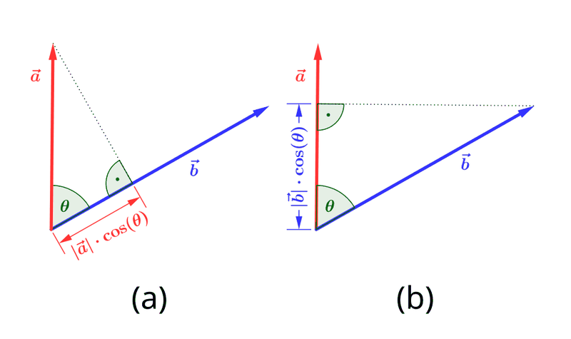

# 11 - Prodotti scalari, norma, ortogonalità (Algebra e Geometria)

**Fonte**: Buzano-Radeschi, Lezioni 19-21 (`Lezioni_19-21.pdf`). In questo blocco il campo è sempre $K=\mathbb{R}$ (servono positività e radici quadrate). Esempi 19.4-21.8 verificati.

## Mappa

---

- [1. Definizioni](#1-definizioni)
- [2. Matrici simmetriche](#2-matrici-simmetriche)
- [3. Forme quadratiche](#3-forme-quadratiche)
- [4. Norma, disuguaglianze, distanza, angolo (g definito positivo)](#4-norma-disuguaglianze-distanza-angolo-g-definito-positivo)
- [5. Ortogonalità e proiezioni](#5-ortogonalità-e-proiezioni)
- [Cose da saper fare all'esame](#cose-da-saper-fare-allesame)
- [Dubbi](#dubbi)

## 1. Definizioni

Finora gli spazi vettoriali avevano solo somma e scalari: non c'era modo di parlare di lunghezze o angoli. Il prodotto scalare aggiunge esattamente questa struttura. Su uno spazio $V$ reale è una funzione $\langle\cdot,\cdot\rangle: V\times V\to\mathbb{R}$ che soddisfa:
1. $\langle v+v',w\rangle=\langle v,w\rangle+\langle v',w\rangle$;
2. $\langle\lambda v,w\rangle=\lambda\langle v,w\rangle$;
3. $\langle v,w\rangle=\langle w,v\rangle$ (simmetria).

La simmetria trasferisce al secondo fattore la linearità del primo, quindi il prodotto è bilineare, e in particolare $\langle v,0\rangle=0$.

Due proprietà descrivono quanto il prodotto è "buono":
- è **degenere** se esiste $v\ne 0$ con $\langle v,w\rangle=0$ per ogni $w$;
- è **definito positivo** se $\langle v,v\rangle\gt 0$ per ogni $v\ne 0$.

Un prodotto definito positivo è sempre non degenere (Prop 19.3: se $v$ fosse degenere si avrebbe $\langle v,v\rangle=0$). Il prototipo è il prodotto **euclideo su $\mathbb{R}^n$**, $\langle x,y\rangle = {}^tx\cdot y = x_1y_1+\dots+x_ny_n$, definito positivo perché $\langle x,x\rangle=\sum x_i^2\gt 0$ se $x\ne 0$.

**Esempi (19.4)** su $\mathbb{R}_2[x]$:
- $\langle p,q\rangle=p(0)q(0)+p(1)q(1)+p(2)q(2)$ è definito positivo: $\langle p,p\rangle=0$ forza $p$ ad avere 3 radici, ma ha grado $\le 2$, quindi $p=0$.
- $\langle p,q\rangle=p(0)q(0)+p(1)q(1)$ è degenere: $p=x(1-x)$ è ortogonale a tutti.
- $\langle p,q\rangle=p(0)q(0)+p(1)q(1)-p(2)q(2)$ è non degenere ma non definito positivo: per $p=x-1$ si ha $\langle p,p\rangle=1+0-1=0$.

## 2. Matrici simmetriche

Nel caso di $\mathbb{R}^n$ i prodotti scalari sono tutti descritti da matrici simmetriche. Se $S\in M(n,\mathbb{R})$ è simmetrica (${}^tS=S$), allora $\boldsymbol{g_S(x,y)={}^tx\,S\,y}$ è un prodotto scalare: la simmetria discende dal fatto che ${}^txSy$ è un numero, dunque uguale alla sua trasposta ${}^ty\,{}^tS\,x = {}^tySx$. Esplicitamente $g_S(x,y)=\sum_{ij}x_iS_{ij}y_j$ e $\boldsymbol{S_{ij}=g_S(e_i,e_j)}$; con $S=I$ si ritrova il prodotto euclideo. Per esempio $S=\begin{pmatrix}2&1\\1&1\end{pmatrix}$ dà $g_S(x,y)=2x_1y_1+x_1y_2+x_2y_1+x_2y_2$, che è definito positivo ($\det=1\gt 0$ e $S_{11}\gt 0$).

Viceversa, dato un prodotto $g$ e una base $B=\lbrace v_1..v_n\rbrace$, la **matrice associata** è $S=[g]_B$ con $\boldsymbol{S_{ij}=g(v_i,v_j)}$, e per ogni $v,w$ vale $\boldsymbol{g(v,w)={}^t[v]_B\cdot S\cdot[w]_B}$. Per l'euclideo di $\mathbb{R}^2$ e la base $\lbrace(1,0),(1,1)\rbrace$ si ottiene $S=\begin{pmatrix}1&1\\1&2\end{pmatrix}$.

Cambiando base la matrice si trasforma in modo diverso da quello degli endomorfismi (file 09). Se $B'$ è la nuova base e $M$ è la matrice che ha per colonne le coordinate dei vettori di $B'$ rispetto a $B$ (cioè $[\text{id}]_{B'}^{B}$), allora $\boldsymbol{S'={}^tM\,S\,M}$. Per esempio con $M=\begin{pmatrix}1&1\\0&1\end{pmatrix}$ e $S=I$ si ha $S'={}^tMM=\begin{pmatrix}1&1\\1&2\end{pmatrix}$ ✓.

Questa relazione si chiama **congruenza**: $S$ e $S'$ simmetriche sono congruenti se $S'={}^tMSM$ con $M$ invertibile; è una relazione di equivalenza ma **non** va confusa con la similitudine, dove al posto di ${}^tM$ compare $M^{-1}$. La congruenza non conserva il determinante ($\text{diag}(1,1)$ e $\text{diag}(2,1)$ sono congruenti tramite $M=\text{diag}(\sqrt{2},1)$ ma non sono simili), però ne conserva il **segno** (Prop 20.5: $\det S'=(\det M)^2\det S$).

## 3. Forme quadratiche

Una **forma quadratica** è un polinomio omogeneo di grado 2 in $x_1..x_n$, e ogni forma quadratica si scrive come $\boldsymbol{q(x)=g_S(x,x)={}^txSx}$ per un'unica matrice simmetrica $S$. La costruzione è semplice: i termini quadratici $x_i^2$ stanno sulla diagonale, mentre il coefficiente di $x_ix_j$ ($i\lt j$) si divide a metà fra le due posizioni, $S_{ij}=S_{ji}=\text{coeff}/2$. Per esempio $x_1^2+4x_1x_2-x_2^2+4x_3^2$ corrisponde a $S=\begin{pmatrix}1&2&0\\2&-1&0\\0&0&4\end{pmatrix}$. Il prodotto $g_S$ è definito positivo $\iff q_S(x)\gt 0$ per ogni $x\ne 0$. Il segno di $q$ e la classificazione tramite autovalori di $S$ e criterio di Sylvester sono rinviati al file 14.

## 4. Norma, disuguaglianze, distanza, angolo (g definito positivo)

Quando il prodotto è definito positivo si può misurare la lunghezza: la **norma** è $\lVert v\rVert=\sqrt{\langle v,v\rangle}$. Nel caso euclideo è $\lVert x\rVert=\sqrt{x_1^2+\dots+x_n^2}$, mentre per $S=\begin{pmatrix}2&1\\1&1\end{pmatrix}$ è $\lVert x\rVert=\sqrt{2x_1^2+x_2^2+2x_1x_2}$.

 
<i>Figura: il prodotto scalare come lunghezza della proiezione per il modulo. Da Wikimedia Commons (crediti in img/CREDITI.md).</i>

La **Prop 20.10** raccoglie le proprietà fondamentali:
1. $\lVert v\rVert\gt 0$ se $v\ne 0$ e $\lVert 0\rVert=0$;
2. $\lVert\lambda v\rVert=\lvert\lambda\rvert\lVert v\rVert$;
3. $\boldsymbol{\lvert\langle v,w\rangle\rvert\le\lVert v\rVert\lVert w\rVert}$ (Cauchy-Schwarz);
4. $\boldsymbol{\lVert v+w\rVert\le\lVert v\rVert+\lVert w\rVert}$ (disuguaglianza triangolare).

Per dimostrare (3) si parte dal fatto che per ogni $a,b$ vale

$$
0\le\lVert av+bw\rVert^2=a^2\lVert v\rVert^2+b^2\lVert w\rVert^2+2ab\langle v,w\rangle
$$

scegliendo $a=\lVert w\rVert^2$ e $b=-\langle v,w\rangle$ si ottiene $0\le\lVert w\rVert^4\lVert v\rVert^2-\langle v,w\rangle^2\lVert w\rVert^2$, e dividendo per $\lVert w\rVert^2$ si ha $\langle v,w\rangle^2\le\lVert v\rVert^2\lVert w\rVert^2$. La (4) segue da $\lVert v+w\rVert^2=\lVert v\rVert^2+\lVert w\rVert^2+2\langle v,w\rangle\le(\lVert v\rVert+\lVert w\rVert)^2$ per la (3).

La **distanza** fra punti è $d(P,Q)=\lVert PQ\rVert=\lVert Q-P\rVert$ (il vettore $PQ$ è $Q-P$): è positiva se $P\ne Q$, simmetrica, e soddisfa la **disuguaglianza triangolare** $d(P,R)\le d(P,Q)+d(Q,R)$. L'**angolo** fra $v,w\ne 0$ è il $\theta\in[0,\pi]$ con $\boldsymbol{\cos\theta=\dfrac{\langle v,w\rangle}{\lVert v\rVert\lVert w\rVert}}$, ben definito proprio grazie a Cauchy-Schwarz (che garantisce che il rapporto stia in $[-1,1]$); l'angolo è acuto, retto o ottuso a seconda che $\langle v,w\rangle$ sia $\gt 0$, $=0$ o $\lt 0$.

## 5. Ortogonalità e proiezioni

Due vettori sono **ortogonali** ($v\perp w$) se $\langle v,w\rangle=0$; nel prodotto euclideo $e_i\perp e_j$ per $i\ne j$, e i vettori ortogonali ad $(a,b)\ne 0$ in $\mathbb{R}^2$ sono $\text{Span}(-b,a)$. Il **complemento ortogonale** di un sottospazio $W$ è $W^\perp=\lbrace v\mid\langle v,w\rangle=0\ \forall w\in W\rbrace$, anch'esso un sottospazio (Prop 21.5); con un prodotto definito positivo si ha $V=W\oplus W^\perp$, quindi $\dim W+\dim W^\perp=\dim V$.

L'operazione geometrica fondamentale è la **proiezione ortogonale** su una direzione. Dato $w\ne 0$, lo spazio si spezza come $V=\text{Span}(w)\oplus\text{Span}(w)^\perp$ e la componente di $v$ lungo $w$ si trova imponendo $\langle v-kw,w\rangle=0$, da cui

$$
p_w(v)=\frac{\langle v,w\rangle}{\langle w,w\rangle}\,w=\frac{\langle v,w\rangle}{\lVert w\rVert^2}\,w
$$

Il coefficiente $k=\langle v,w\rangle/\langle w,w\rangle$ si chiama **coefficiente di Fourier**. Esempi da quiz: la proiezione di $v=(-1,3,4)$ lungo $w=(1,2,0)$ ha $\langle v,w\rangle=5$ e $\lVert w\rVert^2=5$, quindi $p=1\cdot w=w$; lungo $w=(2,4,0)$ si ha $\langle v,w\rangle=10$, $\lVert w\rVert^2=20$ e dunque $\tfrac12 w=(1,2,0)$. La proiezione di $(1,-1,1)$ sul piano $x+y+z=0$ si ottiene togliendo la componente lungo la normale $n=(1,1,1)$: $v-\dfrac{\langle v,n\rangle}{\lVert n\rVert^2}n = (1,-1,1)-\tfrac13(1,1,1)=(\tfrac23,-\tfrac43,\tfrac23)$.

Le basi migliori sono quelle ortogonali. Se $\lbrace v_1..v_n\rbrace$ è una **base ortogonale** ($\langle v_i,v_j\rangle=0$ per $i\ne j$), ogni vettore è somma delle sue proiezioni, $\boldsymbol{v=\sum\dfrac{\langle v,v_i\rangle}{\langle v_i,v_i\rangle}\,v_i}$: le coordinate sono i coefficienti di Fourier, e si ottengono facendo il prodotto scalare con $v_i$. Una base ortonormale è ortogonale con tutte le norme uguali a 1.

Per ottenere una base ortogonale da una qualsiasi serve il procedimento di **Gram-Schmidt**: da $v_1..v_k$ indipendenti si costruiscono $w_1..w_k$ ortogonali ponendo $w_1=v_1$ e

$$
w_i=v_i-\sum_{j\lt i}\frac{\langle v_i,w_j\rangle}{\langle w_j,w_j\rangle}\,w_j
$$

cioè togliendo a ogni vettore le proiezioni sui precedenti. Dividendo ciascun $w_i$ per la sua norma si ha una base ortonormale, e inoltre $\text{Span}(w_1..w_i)=\text{Span}(v_1..v_i)$ per ogni $i$.

**Esempio svolto** (21.8): $v_1=(1,1,0)$, $v_2=(0,1,1)$, $v_3=(1,0,1)$ in $\mathbb{R}^3$ euclideo.
$w_1=(1,1,0)$. $w_2=v_2-\dfrac{\langle v_2,w_1\rangle}{\langle w_1,w_1\rangle}w_1=(0,1,1)-\tfrac12(1,1,0)=(-\tfrac12,\tfrac12,1)$. $w_3=v_3-\tfrac12w_1-\dfrac{\langle v_3,w_2\rangle}{\langle w_2,w_2\rangle}w_2$, con $\langle v_3,w_2\rangle=\tfrac12$, $\langle w_2,w_2\rangle=\tfrac32$ $\Rightarrow$ coefficiente $\tfrac13$: $w_3=(1,0,1)-(\tfrac12,\tfrac12,0)-\tfrac13(-\tfrac12,\tfrac12,1)=\boldsymbol{(\tfrac23,-\tfrac23,\tfrac23)}$. Controllo: $w_1\cdot w_2=-\tfrac12+\tfrac12=0$; $w_1\cdot w_3=\tfrac23-\tfrac23=0$; $w_2\cdot w_3=-\tfrac13-\tfrac13+\tfrac23=0$ ✓.

---

## Esercizi svolti collegati

Gram-Schmidt con un prodotto $g_S$, proiezione ortogonale e angolo rispetto a $g_S$ sono nel Problema 12 e nel quiz; Esempio 4 in [17-esami-ag-2024-2025.md](17-esami-ag-2024-2025.md) e Esempio 1 per la base ortonormale di un autospazio.

## Cose da saper fare all'esame
- Verificare gli assiomi di prodotto scalare (bilinearità, simmetria), decidere degenere / definito positivo (da $\langle v,v\rangle$, da matrice: pivot positivi, autovalori $\gt 0$).
- Scrivere la matrice di un prodotto scalare in una base e cambiarla (${}^tMSM$); scrivere la forma quadratica da $S$ e viceversa.
- Calcolare norma, distanza, angolo, proiezione ortogonale, $W^\perp$ (risolvendo $\langle v,w_i\rangle=0$), coordinate in base ortogonale.
- Applicare Gram-Schmidt e normalizzare; trovare base ortonormale di un piano.
- Dimostrare: Cauchy-Schwarz, triangolare, $W^\perp$ sottospazio, formula della proiezione, formula di Fourier, definito positivo $\Rightarrow$ non degenere, det delle matrici congruenti ha stesso segno.

## Dubbi
- La classificazione delle forme quadratiche (definita/semidefinita/indefinita) tramite autovalori o minori: nelle lezioni Buzano non c'è un criterio esplicito (solo definizione); è nel materiale Manno (Cartesio sugli autovalori): file 14 [DA VERIFICARE se in programma].
- Per la dimensione $\dim W+\dim W^\perp=\dim V$ non c'è dimostrazione nelle lezioni Buzano estratte (l'enunciato per sottospazi di $\mathbb{R}^n$ è in Slide MANNO, Lezione24_Alg.pdf, lasciato per esercizio): è citata solo la decomposizione $V=U\oplus U^\perp$ per $U=\text{Span}(w)$.