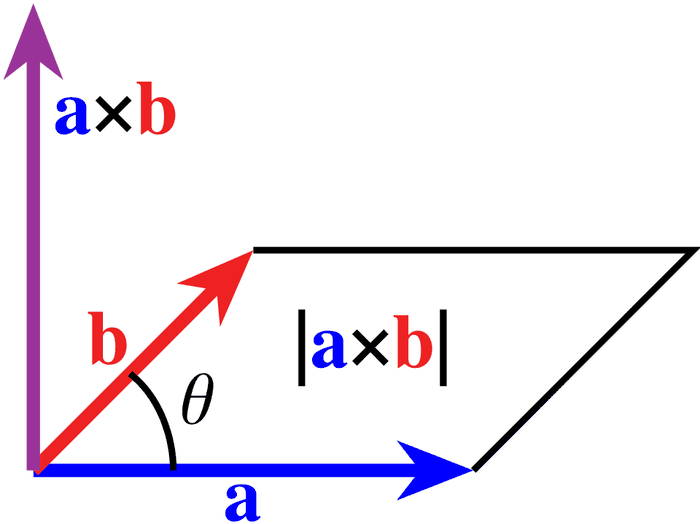

# 12 - Geometria analitica: isometrie, prodotto vettoriale, rette e piani (Algebra e Geometria)

**Fonte**: Buzano-Radeschi, Lezioni 22-24 (`Lezioni_22-24.pdf`: Lo Spazio Euclideo I-II-III), quiz dei compiti 2023-06 e 2023-07. Sempre prodotto scalare euclideo su $\mathbb{R}^n$. Il testo estratto ha segni e entrate persi in alcuni esempi: dove ho ricostruito è scritto "ricostruito"; i calcoli miei sono marcati [INT] e verificati al computer.

## Mappa

---

- [1. Isometrie e matrici ortogonali](#1-isometrie-e-matrici-ortogonali)
- [2. Prodotto vettoriale in R³](#2-prodotto-vettoriale-in-r³)
- [3. Forma cartesiana e forma parametrica](#3-forma-cartesiana-e-forma-parametrica)
- [4. Intersezioni](#4-intersezioni)
- [5. Posizioni reciproche di rette e piani in R³ [INT, metodo standard]](#5-posizioni-reciproche-di-rette-e-piani-in-r³-int-metodo-standard)
- [Cose da saper fare all'esame](#cose-da-saper-fare-allesame)
- [Dubbi](#dubbi)

## 1. Isometrie e matrici ortogonali

Il capitolo sullo spazio euclideo comincia chiedendosi quali trasformazioni lineari conservano la geometria, cioè lunghezze e angoli. Una **isometria** è un isomorfismo $T: V\to W$ fra spazi con prodotto scalare tale che $\langle v,w\rangle=\langle T(v),T(w)\rangle$ per ogni $v,w$ (Def 22.5); basta controllarlo sui vettori di una base (Prop 22.6, perché per bilinearità i prodotti $\langle v,w\rangle$ dipendono solo dai $\langle v_i,v_j\rangle$). Se i prodotti sono definiti positivi, essere isometria equivale a conservare la norma e anche a conservare la distanza (Prop 22.7). In termini di matrici, se $S$ e $S'$ sono le matrici dei prodotti e $A=[T]$, allora $T$ è isometria $\iff \boldsymbol{S={}^tA\,S'\,A}$ (Prop 22.8): è la stessa formula di congruenza vista nel file 11, perché la colonna $i$ di $A$ contiene le coordinate di $T(v_i)$.

Il caso che interessa è $\mathbb{R}^n$ euclideo con $S=S'=I$: $L_A$ è un'isometria $\iff \boldsymbol{{}^tA\cdot A=I}$ (Cor 22.9), cioè $A$ è una **matrice ortogonale** (Def 22.10). Dire ${}^tAA=I$ vuol dire che le colonne di $A$ formano una base ortonormale, e che $A^{-1}={}^tA$ (un'inversa gratis, che ritroveremo nel teorema spettrale, file 14). Dalla relazione segue (${}^tAA=I$ e Binet) $\det A=\pm 1$.

Nel piano le matrici ortogonali $2\times 2$ si classificano subito (Prop 22.11): la prima colonna è un vettore unitario $(\cos\theta,\sin\theta)$ e la seconda deve essere ortogonale e unitaria, quindi può essere solo $\pm(-\sin\theta,\cos\theta)$. Si ottengono due famiglie:
- le **rotazioni** $\text{Rot}_\theta=\begin{pmatrix}\cos\theta&-\sin\theta\\ \sin\theta&\cos\theta\end{pmatrix}$: rotazione antioraria di angolo $\theta$ attorno all'origine, $\det=+1$;
- le **riflessioni** $\text{Rif}_\theta=\begin{pmatrix}\cos\theta&\sin\theta\\ \sin\theta&-\cos\theta\end{pmatrix}$: riflessione ortogonale rispetto alla retta per l'origine che forma l'angolo $\theta/2$ con l'asse $x$, $\det=-1$.

I segni delle matrici nell'estrazione sono persi: la forma qui riportata è quella standard, coerente con le proposizioni 22.2 e 22.4 [ricostruito]. La dimostrazione che $\text{Rot}_\theta$ ruota davvero passa per le coordinate polari: $(\rho\cos\varphi,\rho\sin\varphi)$ va in $(\rho\cos(\theta+\varphi),\rho\sin(\theta+\varphi))$ grazie alle formule di addizione. Corollario 22.12: **le isometrie di $\mathbb{R}^2$ sono rotazioni e riflessioni**. Una riflessione si legge bene in una base adattata: se $v_1\in r$ e $v_2\perp r$, nella base $(v_1,v_2)$ la matrice è $\text{diag}(1,-1)$.

In $\mathbb{R}^3$ (Teo 22.13, senza dimostrazione) ogni isometria è una rotazione attorno a un asse $r$ oppure un'antirotazione, cioè una rotazione composta con la riflessione rispetto al piano $r^\perp$.

## 2. Prodotto vettoriale in R³

<table>
<tr>
<td valign="top">

Per capire perché serve, pensate a come trovare un vettore ortogonale a due vettori dati: si può risolvere un sistema, ma il prodotto vettoriale dà la risposta in forma chiusa. Per $v=(v_1,v_2,v_3)$ e $w=(w_1,w_2,w_3)$ si pone

$\boldsymbol{v\times w = (v_2w_3-v_3w_2,\ v_3w_1-v_1w_3,\ v_1w_2-v_2w_1)}$

(Def 22.14). Per ricordarlo si usa il determinante formale con la prima colonna $v$, la seconda $w$ e la terza $e_1,e_2,e_3$: $v\times w = \det\begin{pmatrix}v_1&w_1&e_1\\v_2&w_2&e_2\\v_3&w_3&e_3\end{pmatrix}$ (regola mnemonica, non è davvero una matrice) $= \det\begin{pmatrix}v_2&w_2\\v_3&w_3\end{pmatrix}e_1 - \det\begin{pmatrix}v_1&w_1\\v_3&w_3\end{pmatrix}e_2 + \det\begin{pmatrix}v_1&w_1\\v_2&w_2\end{pmatrix}e_3$. Le tre componenti sono i minori $2\times 2$ della matrice $(v\mid w)$ (a meno del segno alterno sulla seconda).

</td>
<td valign="top" align="center">

 Figura: a×b è ortogonale ad a e b e ha per modulo l'area del parallelogramma. Da Wikimedia Commons (crediti in <code>img/CREDITI.md</code>).

</td>
</tr>
</table>

Le proprietà da sapere, con la dimostrazione che il docente può chiedere:
- **$v\times w$ è ortogonale sia a $v$ che a $w$** (Prop 22.15). Basta calcolare $\langle v\times w,v\rangle$ = sviluppo di Laplace sull'ultima colonna del determinante con due colonne uguali $(v,w,v)$ $=0$; analogamente per $w$.
- **$v\times w=0 \iff v$ e $w$ sono dipendenti** (Prop 22.16): il vettore è nullo $\iff$ i tre minori $2\times 2$ sono nulli $\iff \text{rk}(v\mid w)\le 1$. Se $v,w$ sono indipendenti, la terna $(v,w,v\times w)$ è una base di $\mathbb{R}^3$ (Cor 22.17).
- $\boldsymbol{\lVert v\times w\rVert^2+\langle v,w\rangle^2 = \lVert v\rVert^2\lVert w\rVert^2}$ (identità di Lagrange, Prop 23.1, si prova sviluppando i quadrati in coordinate). Da qui, con $\langle v,w\rangle=\lVert v\rVert\lVert w\rVert\cos\theta$, si ottiene $\boldsymbol{\lVert v\times w\rVert = \lVert v\rVert\lVert w\rVert\sin\theta}$ = area del parallelogramma di lati $v,w$ (Cor 23.3 e Prop 23.2, base per altezza).
- La terna $(v,w,v\times w)$ è una **base positiva**: $\det(v\mid w\mid v\times w) = d_1^2+d_2^2+d_3^2 \gt 0$ (Prop 23.4, sviluppo sull'ultima colonna). È la "regola della mano destra". Quindi $v\times w$ si può definire geometricamente come l'unico vettore ortogonale a $v$ e $w$, di lunghezza pari all'area del parallelogramma e orientato positivamente.
- Il prodotto è **antisimmetrico** ($v\times w = -w\times v$) e **bilineare**, ma **non associativo**: $(e_1\times e_2)\times e_2 = e_3\times e_2 = -e_1$ mentre $e_1\times(e_2\times e_2)=0$. Nel testo estratto il segno è perso: con la definizione si ha $e_3\times e_2=-e_1$ [ricostruito].

**Esempio [INT]**: $v=(1,2,-1)$, $w=(2,0,3)$: $v\times w = (2\cdot 3-(-1)\cdot 0,\ (-1)\cdot 2-1\cdot 3,\ 1\cdot 0-2\cdot 2) = \mathbf{(6,-5,-4)}$. Controlli: $\langle v\times w,v\rangle=6-10+4=0$ ✓, $\langle v\times w,w\rangle=12-12=0$ ✓; $\lVert v\times w\rVert^2=77$ e $\lVert v\rVert^2\lVert w\rVert^2-\langle v,w\rangle^2=6\cdot 13-1=77$ ✓ (Lagrange); l'area del parallelogramma è $\sqrt{77}$.

## 3. Forma cartesiana e forma parametrica

Un sottospazio di $\mathbb{R}^n$ può essere descritto in due modi, complementari come il "dove sono" e il "come lo costruisco". In **forma cartesiana** (implicita) è il luogo degli zeri di un sistema lineare omogeneo; in **forma parametrica** (esplicita) è generato da alcuni vettori. Per esempio il piano $z=0$ in $\mathbb{R}^3$ è cartesiano con l'equazione $z=0$ e parametrico come $\text{Span}(e_1,e_2)=\lbrace(t,s,0)\rbrace$. La forma parametrica mostra subito com'è fatto un punto del sottospazio; la cartesiana permette di verificare con una sostituzione se un punto vi appartiene.

Lo stesso discorso vale per i sottospazi **affini**, che sono ciò che incontriamo in geometria (rette e piani non passanti per l'origine). Un sottospazio affine è $S = x + W = \lbrace x+v \mid v\in W\rbrace$, con $W$ sottospazio vettoriale detto **giacitura** $\text{giac}(S)$ e $x$ un punto qualsiasi di $S$; $\dim S = \dim W$. Le soluzioni di un sistema lineare $Ax=b$ sono vuote oppure un sottospazio affine, con giacitura il nucleo di $A$ e, per Rouché-Capelli, $\dim = n-\text{rk} A$ quando $\text{rk} A=\text{rk}(A\mid b)$. Due scritture $x+W$ e $x'+W'$ descrivono lo stesso insieme $\iff W=W'$ e $x-x'\in W$ (Prop 23.5): per esempio $(1,0)+\text{Span}(1,1)$ e $(0,-1)+\text{Span}(1,1)$ sono la stessa retta $y=x-1$ (Esempio 23.6).

In $\mathbb{R}^3$ i sottospazi affini sono punti, rette, piani e tutto lo spazio. Un **piano** è dato da un'equazione $ax+by+cz=d$ oppure da $P_0+t\,v_1+s\,v_2$ con $v_1,v_2$ indipendenti; una **retta** da un sistema di due equazioni indipendenti oppure da $P_0+t\,v$. Si passa dalla cartesiana alla parametrica risolvendo il sistema con Gauss-Jordan (le incognite libere diventano i parametri). Per i piani il passaggio inverso è immediato grazie al prodotto vettoriale: se $\pi=P_0+t\,v_1+s\,v_2$, il vettore $\boldsymbol{n=v_1\times v_2=(a,b,c)}$ è ortogonale alla giacitura, quindi $\pi$ ha equazione $ax+by+cz=d$, con $d$ fissato imponendo $P_0\in\pi$. Per una retta data da due piani $a_1x+b_1y+c_1z=d_1$, $a_2x+b_2y+c_2z=d_2$ la direzione è il prodotto vettoriale delle due normali.

**Esempio (23.8, ricostruito)**: $\pi = (1,2,-3) + t(1,0,1) + s(2,-1,0)$. Si ha $(1,0,1)\times(2,-1,0)=(1,2,-1)$, quindi $\pi: x+2y-z=d$; da $P_0=(1,2,-3)$ si ottiene $d=1+4+3=\mathbf{8}$, cioè $\pi: x+2y-z=8$.

**Esempio [INT]**: piano per $A=(1,0,0)$, $B=(0,1,0)$, $C=(0,0,1)$. Giacitura generata da $B-A=(-1,1,0)$ e $C-A=(-1,0,1)$; $(-1,1,0)\times(-1,0,1)=(1,1,1)$; $d=1$ da $A$: $\mathbf{x+y+z=1}$.

## 4. Intersezioni

I sottospazi vettoriali si intersecano sempre almeno nell'origine, quelli affini possono non incontrarsi. Se $S\cap S'\ne\emptyset$ (e si dicono **incidenti**) e $x$ è un punto comune, allora $S\cap S' = x+(W\cap W')$: l'intersezione, quando non è vuota, è ancora un sottospazio affine, con giacitura l'intersezione delle giaciture. Per calcolarla il metodo dipende dalle forme:
- entrambi cartesiani: si mettono insieme le equazioni in un unico sistema (Esempio 23.9: i piani $x+y=1$ e $x-y+z=3$ danno una retta);
- uno cartesiano e uno parametrico: si sostituisce il punto generico del parametrico nelle equazioni del cartesiano e si risolve nei parametri;
- entrambi parametrici: si uguaglia il punto generico di uno a quello dell'altro e si risolve il sistema nei parametri (è il procedimento più laborioso).

Un criterio sufficiente (Prop 23.10): se $\boldsymbol{\text{giac}(S)+\text{giac}(S')=\mathbb{R}^n}$, allora $S$ e $S'$ sono incidenti, perché $P-Q$ (differenza di due punti) si scrive come combinazione dei generatori delle due giaciture e questa combinazione dà una soluzione. Per esempio due piani non paralleli in $\mathbb{R}^3$ (giaciture di dim 2 distinte, somma $\mathbb{R}^3$) si intersecano sempre in una retta.

## 5. Posizioni reciproche di rette e piani in R³ [INT, metodo standard]

Le fonti danno le formule per intersezioni e distanze; il quadro delle posizioni reciproche, che compare nei quiz dei compiti, si ricava con gli stessi strumenti (rango, determinante, prodotto vettoriale). Il ragionamento è sempre lo stesso: confrontare le giaciture e poi dire se i sottospazi hanno un punto in comune.

**Retta $r=P+t\,v$ e retta $s=Q+u\,w$.**
- se $v\times w=0$ (direzioni dipendenti) le rette sono **parallele**: coincidenti se $Q-P\in\text{Span}(v)$, altrimenti parallele distinte;
- se $v\times w\ne 0$ le direzioni sono indipendenti; guardando il determinante $\det(v\mid w\mid Q-P)$: se è nullo i tre vettori sono complanari e le rette si **incontrano in un punto** (incidenti); se è non nullo le rette sono **sghembe**, cioè non parallele e non incidenti, e distano $\lvert\det(v\mid w\mid Q-P)\rvert/\lVert v\times w\rVert$ (file 13).
- Rette ortogonali: $\langle v,w\rangle=0$ (due rette sghembe possono essere ortogonali).

**Retta $r=P+t\,v$ e piano $\pi: ax+by+cz=d$** ($n=(a,b,c)$). Si calcola $\langle v,n\rangle$: se è $\ne 0$ la retta incontra $\pi$ in un punto; se è $=0$ la retta è parallela a $\pi$, e vi è contenuta se un suo punto soddisfa l'equazione. Retta ortogonale al piano $\iff v\parallel n$.

**Piano $\pi_1$ e piano $\pi_2$** con normali $n_1,n_2$: se $n_1\times n_2\ne 0$ si incontrano in una retta di direzione $n_1\times n_2$; se $n_1\times n_2=0$ sono paralleli, coincidenti se le equazioni sono proporzionali (compreso il termine noto).

**Esempi dai quiz (verificati [INT]).**
- Compito 14/07/2023, Q1: $r$: $x-y=2$, $y+z=0$; $s$: $(t,-t,-t)$. La direzione di $r$ è $(1,-1,0)\times(0,1,1)=(-1,-1,1)$, quella di $s$ è $(1,-1,-1)$: non parallele (il prodotto vettoriale è $(2,0,2)\ne 0$) e non ortogonali ($\langle v,w\rangle=-1$). Un punto di $r$ è $(2,0,0)$ e dell'origine su $s$: $\det(v\mid w\mid Q-P)$ con $Q-P=(-2,0,0)$ vale $-4\ne 0$ $\Rightarrow$ **sghembe**. Risposta (c), che nel PDF risulta anche segnata corretta.
- Compito 28/06/2023, Q1: $r$: $x-z=0$, $x-y+4=0$; $s$: $(t,-t+2,2t+1)$. La direzione di $r$ è $(1,0,-1)\times(1,-1,0)=(-1,-1,-1)$; $s$ ha direzione $(1,-1,2)$: non parallele, non ortogonali ($\langle v,w\rangle=-2$); il determinante con $P=(0,4,0)$ su $r$ e $Q=(0,2,1)$ su $s$ vale 0 $\Rightarrow$ **si intersecano in un punto**: uguagliando si trova $t=1$ per $r$ e $u=-1$ per $s$, punto $(-1,3,-1)$. Risposta (d) fra quelle elencate; la chiave del compito non è nel testo estratto.

---

## Esercizi svolti collegati

Retta come intersezione di due piani, incidenza con un terzo piano e retta perpendicolare a un piano sono svolte (Esempio 3) in [17-esami-ag-2024-2025.md](17-esami-ag-2024-2025.md); le intersezioni retta-retta e retta-piano sono nel quiz.

## Cose da saper fare all'esame
- Riconoscere se una matrice è ortogonale (${}^tAA=I$), scrivere rotazioni e riflessioni di $\mathbb{R}^2$, dire che le isometrie di $\mathbb{R}^2$ sono rotazioni e riflessioni ($\det=\pm 1$).
- Calcolare $v\times w$, usarlo per un vettore ortogonale a due vettori, per l'area di parallelogrammi e triangoli (metà dell'area), per l'equazione del piano per tre punti.
- Passare da cartesiana a parametrica (Gauss) e da parametrica a cartesiana ($v_1\times v_2$ per i piani).
- Determinare intersezioni e posizione reciproca di rette e piani (parallele, incidenti, sghembe, retta parallela o contenuta in un piano).
- Dimostrare: $v\times w\perp v,w$; $v\times w=0\iff$ dipendenti; identità di Lagrange; area $=\lVert v\times w\rVert$; Prop 22.6 e 22.8; il criterio $\text{giac}+\text{giac}'=\mathbb{R}^n \Rightarrow$ incidenti.

## Dubbi
- Convenzioni di segno di $\text{Rif}_\theta$ e $\text{Rot}_\theta$ ricostruite (le matrici nell'estrazione hanno i segni persi).
- Le posizioni reciproche (sez. 5) non sono trattate esplicitamente nelle lezioni: metodo [INT] coerente con le Prop 23.10 e 24.14; confrontare con quello usato dal docente.
- Esempio 23.9 (retta e piano) e 24.15 (rette sghembe) hanno numeri illeggibili: usare i miei esempi del file 13.