# 01 – Introduzione alle reti

Fonte: Drive › Terzo anno › Reti e Sicurezza delle Reti › Slide Deck - Reti › "01 - Introduzione alle Reti" (Kurose-Ross, *Computer Networking: A Top-Down Approach*, 8a ed., cap. 1, 80 slide). `[INT]` = integrazione o calcolo mio, non presente nelle slide: da ricontrollare. `[DA VERIFICARE]` = punto ambiguo o poco leggibile nell'estrazione del PDF.

## Mappa degli argomenti

Il capitolo parte da cosa sia Internet e da cosa sia un protocollo, poi percorre la rete dall'esterno verso l'interno (bordo, accesso, nucleo), ne misura le prestazioni, ne mostra le debolezze di sicurezza e chiude con l'organizzazione a livelli e un po' di storia.

- [Internet e protocolli](#internet-e-protocolli)
- [Il bordo della rete: accesso e mezzi fisici](#il-bordo-della-rete-accesso-e-mezzi-fisici)
- [Il nucleo della rete: forwarding, routing, packet e circuit switching](#il-nucleo-della-rete-forwarding-routing-packet-e-circuit-switching)
- [La struttura di Internet](#la-struttura-di-internet)
- [Ritardo, perdita e throughput](#ritardo-perdita-e-throughput)
- [Sicurezza di rete](#sicurezza-di-rete)
- [Livelli di protocollo e incapsulamento](#livelli-di-protocollo-e-incapsulamento)
- [Storia di Internet](#storia-di-internet)
- [Cose da saper fare all'esame](#cose-da-saper-fare-allesame)
- [Dubbi](#dubbi)

## Internet e protocolli

**Definizione.** Internet è una "rete di reti": un insieme di ISP interconnessi che permette a miliardi di dispositivi (gli *host* o *end system*, che fanno girare le applicazioni ai bordi della rete) di scambiarsi pacchetti attraverso *packet switch* (router e switch) collegati da link di vari mezzi (fibra, rame, radio, satellite), ciascuno con una velocità di trasmissione detta *bandwidth*.

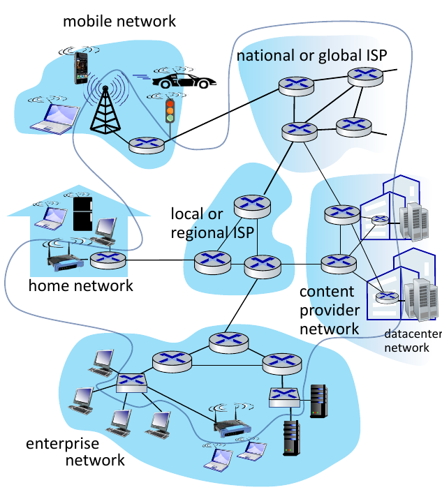

*Figura: Internet come insieme di reti interconnesse da router (slide 1-3).*

**Intuizione.** Si può descrivere Internet in due modi complementari: dall'interno, come un insieme di componenti hardware e software (hosts, router, link), e dall'esterno, come un'infrastruttura che offre servizi alle applicazioni distribuite (Web, streaming, posta, giochi, social). In questa seconda vista Internet espone un'interfaccia di programmazione, dei "ganci" a cui le applicazioni si attaccano per usare il trasporto, in modo analogo a come il servizio postale offre diverse opzioni di consegna.

Un **protocollo** definisce il formato e l'ordine dei messaggi scambiati fra entità di rete e le azioni da compiere quando un messaggio viene trasmesso o ricevuto o quando succede un altro evento. Tutta l'attività di comunicazione in Internet è governata da protocolli (HTTP, TCP, IP, WiFi, Ethernet, Skype...). L'analogia con i protocolli umani è quella di una conversazione: "che ore sono?" e "sono le 2", oppure, tra computer, la richiesta di una connessione TCP, la risposta, e infine un `GET` HTTP per un file. Gli standard di Internet sono documentati negli **RFC** (Request for Comments) e prodotti dall'**IETF** (Internet Engineering Task Force).

## Il bordo della rete: accesso e mezzi fisici

Il **network edge** comprende gli host (client e server, i server spesso in data center); le **reti di accesso** e i mezzi fisici collegano gli end system al primo router (*edge router*). Il capitolo distingue accesso residenziale, istituzionale (scuole, aziende) e mobile (WiFi, 4G/5G).

Nell'accesso **via cavo** (HFC, *hybrid fiber coax*) dati e TV viaggiano su frequenze diverse sulla stessa rete di distribuzione condivisa, grazie al **FDM** (*frequency division multiplexing*): ogni canale occupa una banda di frequenza diversa. Le abitazioni condividono l'accesso fino al *cable headend*, dove un CMTS (cable modem termination system) le collega all'ISP. La banda è **asimmetrica**: da 40 Mbps a 1,2 Gbps in downstream e 30-100 Mbps in upstream.

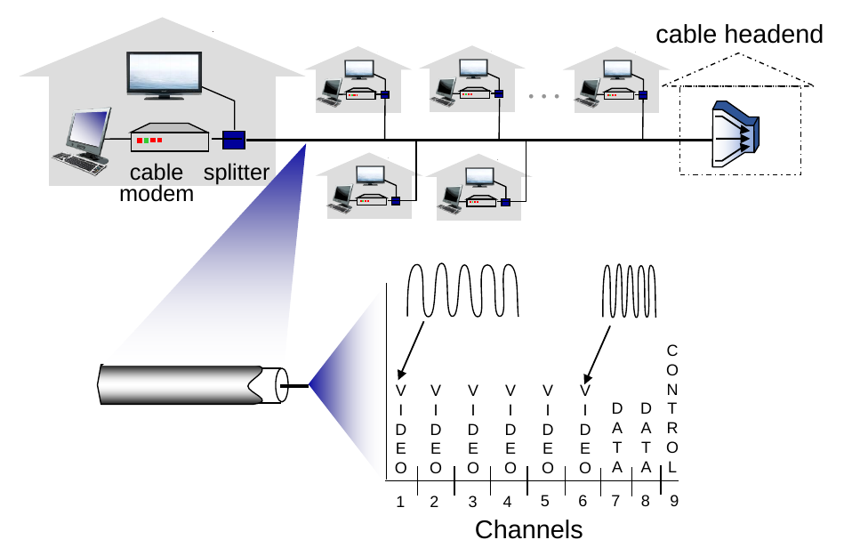

*Figura: accesso via cavo, con FDM su canali di frequenza diversi (slide 1-14).*

Nel **DSL**, invece, si riusa la linea telefonica verso la centrale (dove c'è il DSLAM): voce e dati sono su frequenze diverse, ma la linea è *dedicata* e non condivisa, con 24-52 Mbps in downstream e 3,5-16 Mbps in upstream.

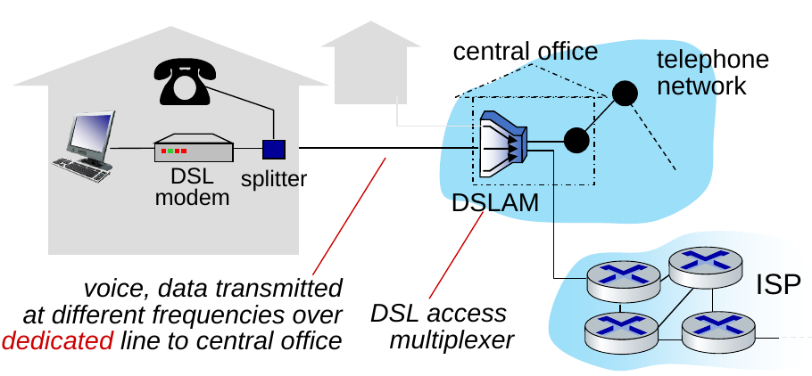

*Figura: accesso DSL (slide 1-16).*

Nella rete di casa modem, router, firewall, NAT e access point WiFi sono spesso un unico apparato; il cablato Ethernet arriva a 1 Gbps e il WiFi a 54-450 Mbps. Nelle reti aziendali si trovano Ethernet a 100 Mbps, 1 Gbps o 10 Gbps insieme a WiFi, con switch e router. Nei data center link da decine a centinaia di Gbps collegano centinaia o migliaia di server fra loro e a Internet. L'accesso wireless condiviso passa da una base station (*access point*): le WLAN (802.11b/g/n, 11, 54 o 450 Mbps) coprono circa 30 m, le reti cellulari 4G/5G coprono decine di km con decine di Mbps.

Quando un host deve spedire un messaggio applicativo lo spezza in **pacchetti** da L bit e li immette nel link di accesso a velocità R (*link transmission rate*, o capacità, o bandwidth del link). Il tempo per spingere un pacchetto sul link è il **ritardo di trasmissione** `L/R`.

I **mezzi fisici** si dividono in guidati (il segnale si propaga in un mezzo solido) e non guidati (si propaga libero nell'aria). Fra i guidati:

| Mezzo | Caratteristiche |
|---|---|
| Doppino intrecciato (TP) | due fili di rame isolati; Cat 5: 100 Mbps e 1 Gbps Ethernet; Cat 6: 10 Gbps |
| Cavo coassiale | due conduttori di rame concentrici, bidirezionale, *broadband* (più canali di frequenza), centinaia di Mbps per canale |
| Fibra ottica | impulsi di luce, ciascuno un bit; punto-punto ad alta velocità (decine-centinaia di Gbps); basso tasso di errore (ripetitori molto distanziati) e immunità al rumore elettromagnetico |

<table>
<tr>
<td align="center">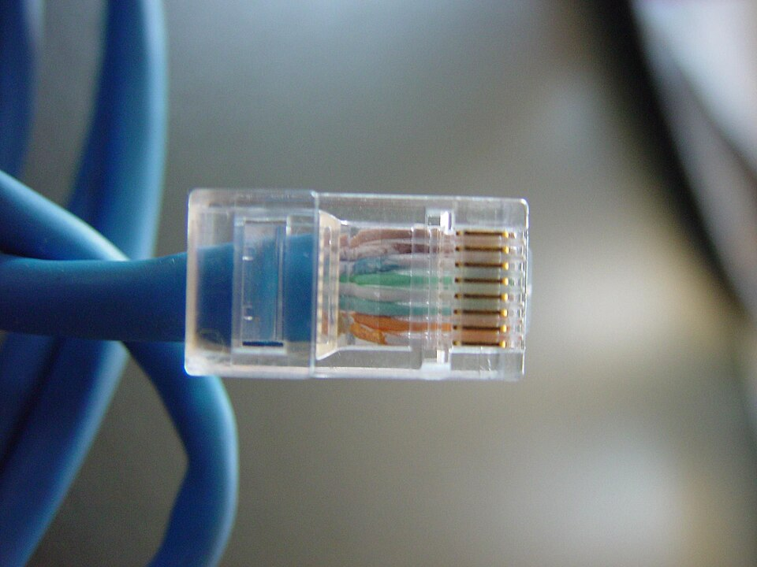 Doppino intrecciato (UTP) con connettore RJ45</td>
<td align="center">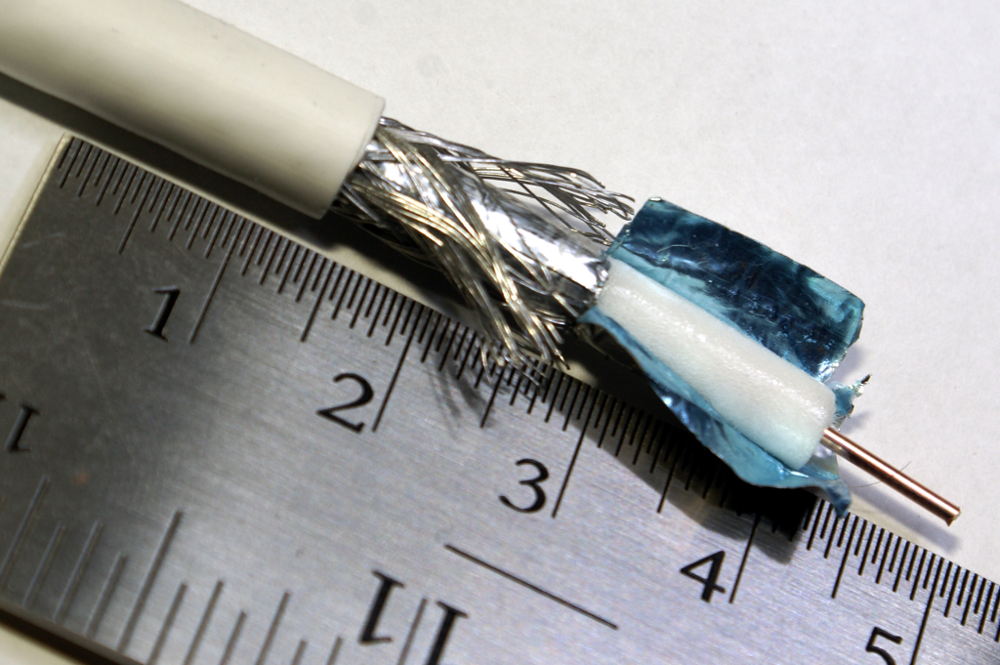 Cavo coassiale (RG-6): conduttore centrale, dielettrico, schermo</td>
<td align="center">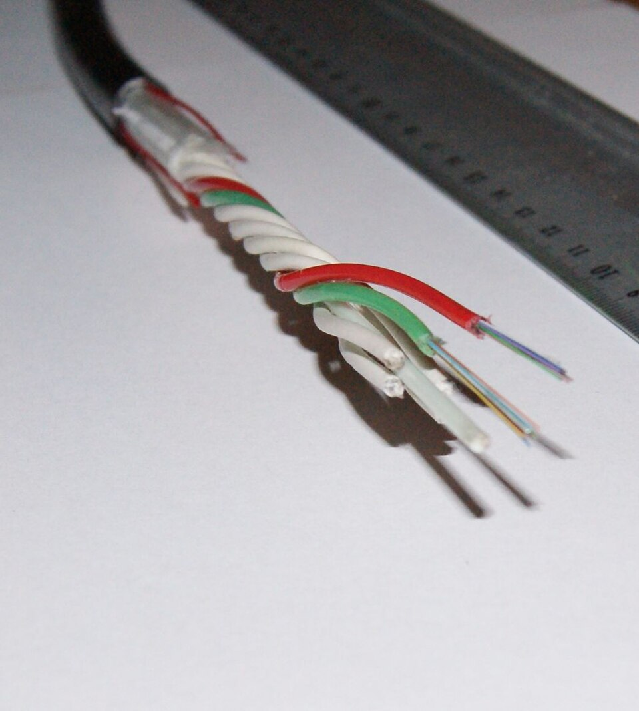 Cavo in fibra ottica aperto</td>
</tr>
</table>

*Figura: i tre mezzi guidati. Foto da Wikimedia Commons (crediti in [`img/CREDITI.md`](img/CREDITI.md)).*

Le trasmissioni **radio** non hanno un filo fisico: il segnale è in bande dello spettro elettromagnetico, in broadcast e half-duplex, e soffre di riflessioni, ostacoli e interferenze. I tipi sono WLAN (decine-centinaia di Mbps su decine di metri), cellulare (decine di Mbps su circa 10 km con 4G), Bluetooth (sostituisce i cavi, brevi distanze e velocità limitate), microonde terrestri (punto-punto, canali da 45 Mbps) e satellite (fino a meno di 100 Mbps in downlink con Starlink; circa 270 ms di ritardo end-to-end per i geostazionari).

## Il nucleo della rete: forwarding, routing, packet e circuit switching

Il **network core** è una maglia di router interconnessi. Con il **packet switching** gli host spezzano i messaggi applicativi in pacchetti e la rete li inoltra di router in router lungo il percorso dalla sorgente alla destinazione. Per questo ogni router ha due funzioni distinte: il **forwarding** (detto anche *switching*) è un'azione *locale*, che sposta un pacchetto dal link d'ingresso al link d'uscita appropriato guardando l'indirizzo di destinazione nell'header e consultando la *forwarding table*; il **routing** è un'azione *globale* che determina i percorsi sorgente-destinazione, calcolati dagli algoritmi di routing, e riempie le forwarding table.

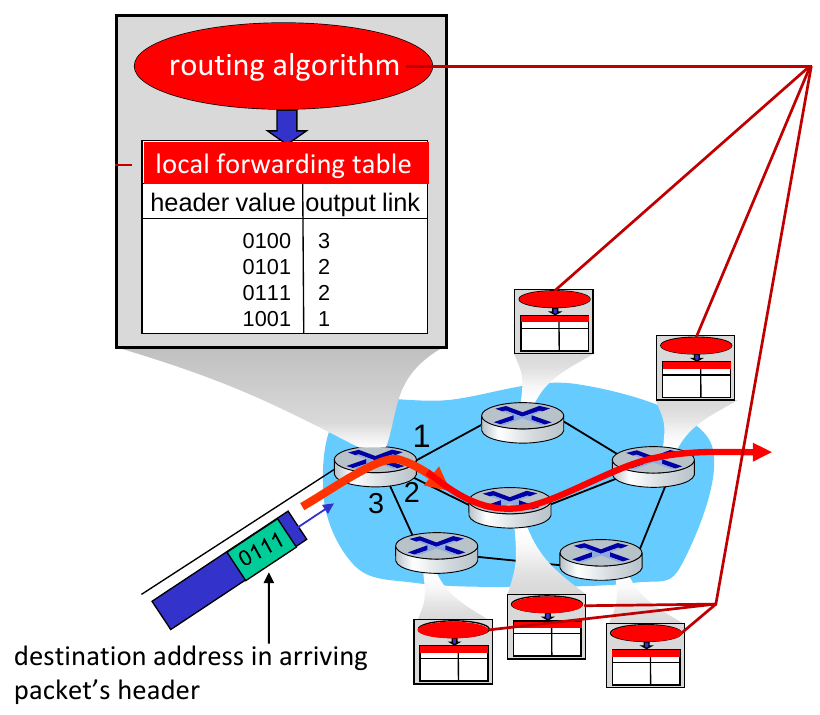

*Figura: la forwarding table locale (header value → output link) è riempita dall'algoritmo di routing (slide 1-27).*

Il router lavora in modalità **store-and-forward**: l'intero pacchetto deve essere arrivato prima che possa iniziare la trasmissione sul link successivo. *Esempio svolto dalle slide*: con L = 10 kbit e R = 100 Mbps, il ritardo di trasmissione a un salto è 10 000 / 100 000 000 s = 0,1 ms. `[INT]` Con N link in serie (N-1 router) dello stesso rate e un solo pacchetto, il ritardo end-to-end di sola trasmissione è `N·L/R`.

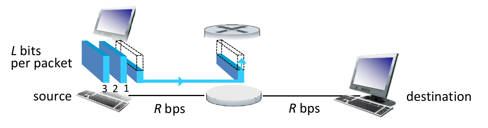

*Figura: store-and-forward, il router riceve l'intero pacchetto prima di ritrasmetterlo (slide 1-30).*

Quando il tasso di arrivo dei bit su un link supera la sua velocità per un certo periodo, i pacchetti si **accodano** nel buffer del link d'uscita; se il buffer (di capacità finita) si riempie, i pacchetti in arrivo vengono **scartati** (*packet loss*).

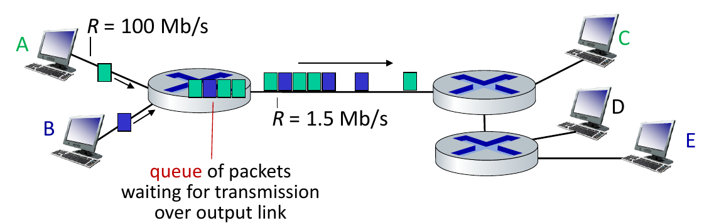

*Figura: accodamento, con link d'ingresso a 100 Mb/s e link d'uscita a 1,5 Mb/s (slide 1-31).*

L'alternativa è il **circuit switching**: le risorse end-to-end vengono riservate alla "chiamata" fra sorgente e destinazione. Ogni link ha un certo numero di circuiti e la chiamata ne ottiene uno per link. Le risorse sono dedicate, quindi le prestazioni sono garantite come in un circuito, ma un circuito inutilizzato resta sprecato; è il modello della telefonia tradizionale.

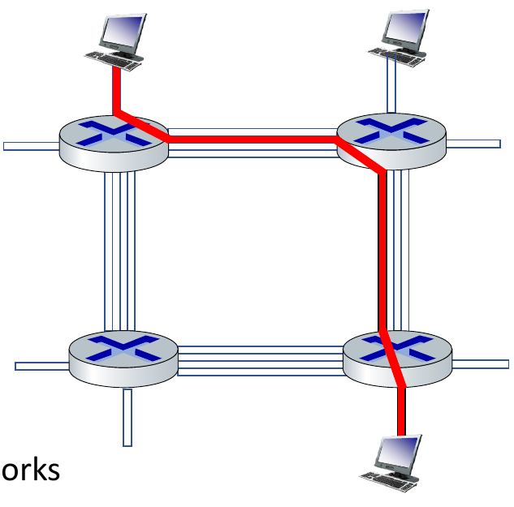

*Figura: la chiamata ottiene il 2° circuito del link in alto e il 1° del link a destra (slide 1-33).*

I circuiti si ottengono dividendo il link con **FDM** (bande di frequenza strette assegnate a ogni chiamata, che trasmette al massimo rate di quella banda) oppure con **TDM** (il tempo è diviso in slot, ogni chiamata ha uno o più slot periodici e trasmette al massimo rate di una banda larga ma solo nei suoi slot).

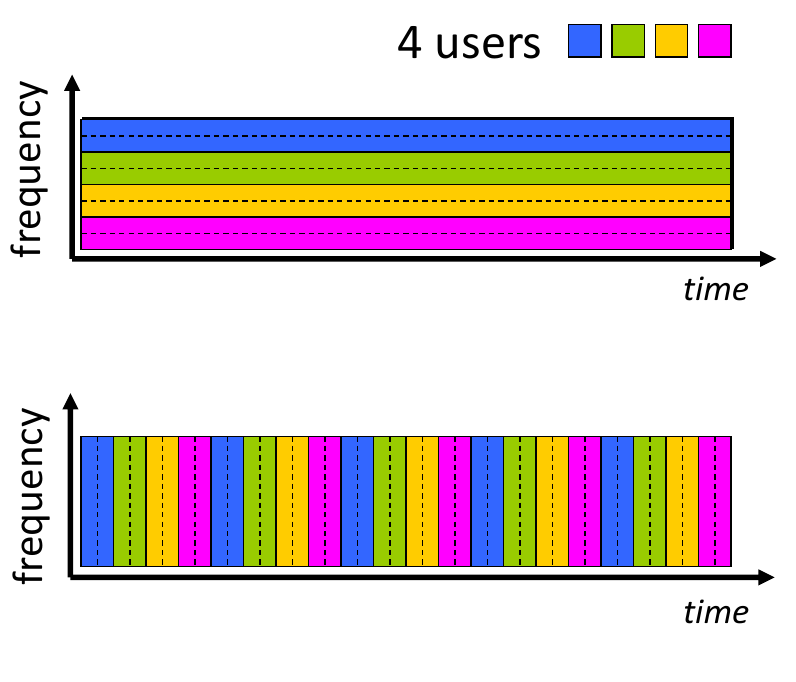

*Figura: FDM (sopra) e TDM (sotto) con 4 utenti (slide 1-34).*

Il confronto tra le due tecniche è quantitativo. Link da 1 Gbps, ogni utente trasmette a 100 Mbps quando è attivo ed è attivo il 10% del tempo. Con il circuit switching si riservano 100 Mbps per utente, quindi gli utenti serviti sono **10**. Con il packet switching, con **35 utenti** la probabilità che più di 10 siano attivi contemporaneamente è inferiore a **0,0004**: si servono più utenti con rischio di congestione trascurabile. Il packet switching è quindi ottimo per dati a raffica (*bursty*), perché condivide le risorse ed è più semplice (nessun setup di chiamata). Il suo costo è la possibile congestione, con ritardo e perdita da overflow dei buffer, che richiede protocolli per il trasferimento affidabile e il controllo di congestione. Le slide lasciano aperta la domanda su come ottenere un comportamento "circuit-like" con il packet switching (risposta: "è complicato", seguiranno varie tecniche).

## La struttura di Internet

Gli host si collegano a Internet tramite *access ISP*, che a loro volta devono essere interconnessi, perché due host qualsiasi devono poter scambiarsi pacchetti. La struttura attuale si spiega con una costruzione per passi, guidata da economia e politiche nazionali:

1. collegare ogni access ISP a tutti gli altri non scala, perché richiede O(N²) connessioni;
2. si può allora collegare ciascun access ISP a un unico ISP globale di transito, con un accordo economico cliente-fornitore;
3. se l'ISP globale è un buon affare nascono concorrenti (ISP A, B, C), che devono interconnettersi tra loro tramite **IXP** (*Internet exchange point*) e **peering link**;
4. nascono **ISP regionali** che raccolgono le reti di accesso e le collegano agli ISP superiori;
5. i **content provider** (Google, Microsoft, Akamai) costruiscono reti private che portano i contenuti vicino agli utenti, spesso bypassando tier-1 e ISP regionali.

Al centro sta un piccolo numero di grandi reti ben connesse: gli ISP **tier-1** commerciali con copertura nazionale e internazionale (Level 3, Sprint, AT&T, NTT) e le reti dei content provider.

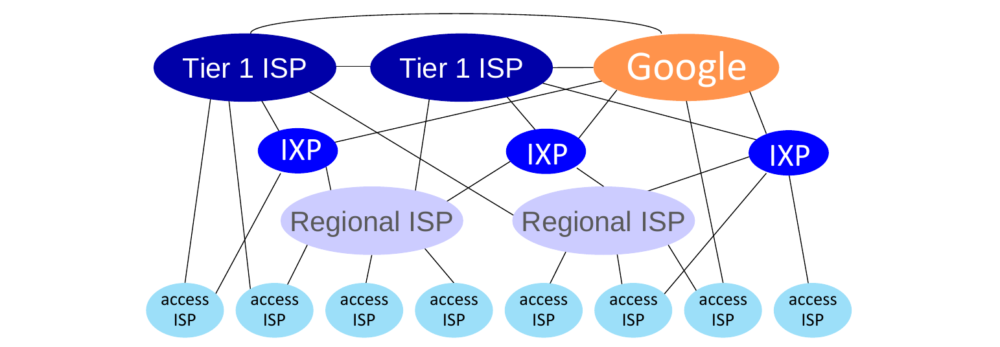

*Figura: struttura attuale di Internet (slide 1-45).*

## Ritardo, perdita e throughput

Un pacchetto subisce ritardo a ogni nodo, e il **ritardo nodale** è la somma di quattro componenti:

`d_nodal = d_proc + d_queue + d_trans + d_prop`

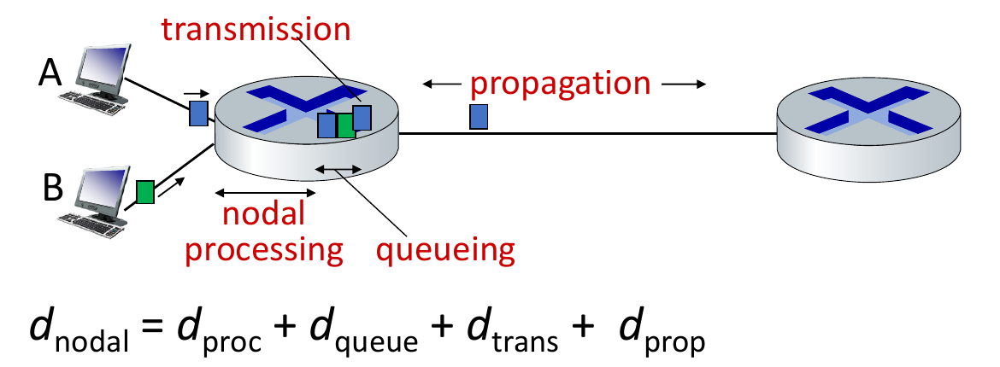

*Figura: le quattro componenti del ritardo nodale (slide 1-48).*

| Componente | Significato | Formula/ordine di grandezza |
|---|---|---|
| `d_proc` | elaborazione: controllo errori sui bit, scelta del link d'uscita | tipicamente < microsecondi |
| `d_queue` | attesa nel buffer d'uscita | dipende dalla congestione |
| `d_trans` | spingere tutti i bit sul link | `L/R` (L bit, R bps) |
| `d_prop` | propagazione nel mezzo | `d/s` (d = lunghezza del link, s ≈ 2·10⁸ m/s) |

La differenza concettuale più importante è tra `d_trans` e `d_prop`: la trasmissione dipende dalla lunghezza del pacchetto e dalla velocità del link, la propagazione dalla lunghezza fisica del link e dalla velocità del segnale.

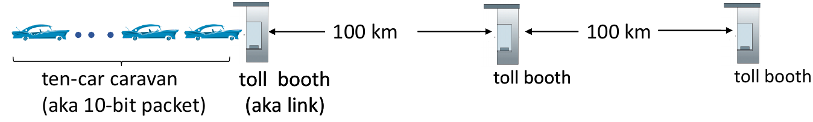

*Figura: l'analogia della carovana (slide 1-50).*

*Analogia della carovana (esempio svolto dalle slide).* Un'auto è un bit, una carovana di 10 auto è un pacchetto, un casello è un link. Il casello serve un'auto in 12 s, quindi spingere la carovana sull'autostrada costa 12 · 10 = 120 s; le auto "propagano" a 100 km/h su 100 km, quindi l'ultima auto impiega 1 ora a raggiungere il secondo casello. La carovana è tutta in fila davanti al secondo casello dopo **62 minuti**. Se le auto viaggiano a 1000 km/h e il casello impiega 1 minuto per auto, la prima auto arriva al secondo casello dopo 7 minuti, quando tre auto sono ancora al primo: i primi bit possono arrivare al nodo successivo prima che il pacchetto sia stato trasmesso per intero (a differenza di quanto avviene con store-and-forward, dove il router non inizia a ritrasmettere fino all'arrivo dell'ultimo bit).

**Ritardo di accodamento.** Sia `a` il tasso medio di arrivo dei pacchetti (pacchetti/s), `L` la lunghezza in bit, `R` la velocità del link: l'**intensità di traffico** è `La/R`. Se `La/R` è vicino a 0 il ritardo medio di coda è piccolo, se tende a 1 diventa grande, se `La/R > 1` arriva più lavoro di quello che si riesce a servire e il ritardo medio diventa infinito.

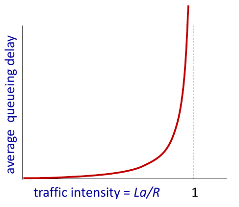

*Figura: il ritardo di coda cresce in modo esplosivo quando `La/R` si avvicina a 1 (slide 1-52).*

**Traceroute** misura ritardo e percorso verso una destinazione. Per ogni router `i` sul cammino invia tre pacchetti con TTL `i`; il router `i` scarta il pacchetto e rimanda un messaggio al mittente, che misura il tempo fra invio e risposta. Un asterisco `*` indica nessuna risposta (probe perso o router che non risponde).

La **perdita** avviene quando un pacchetto trova pieno il buffer che precede il link; il pacchetto può essere ritrasmesso dal nodo precedente, dall'end system sorgente o non essere ritrasmesso affatto.

Il **throughput** è la velocità (bit/unità di tempo) a cui i bit vengono trasferiti dal mittente al destinatario, istantaneo se misurato in un dato momento e medio se su un periodo lungo. Se un server con rate `Rs` è collegato a un client con rate `Rc` il throughput medio end-to-end è `min(Rs, Rc)`, e il link che ne fissa il valore è detto **bottleneck link**. In uno scenario con 10 connessioni che condividono equamente un link di backbone da `R` bps, il throughput per connessione è `min(Rc, Rs, R/10)`, anche se in pratica il collo di bottiglia è spesso `Rc` o `Rs`.

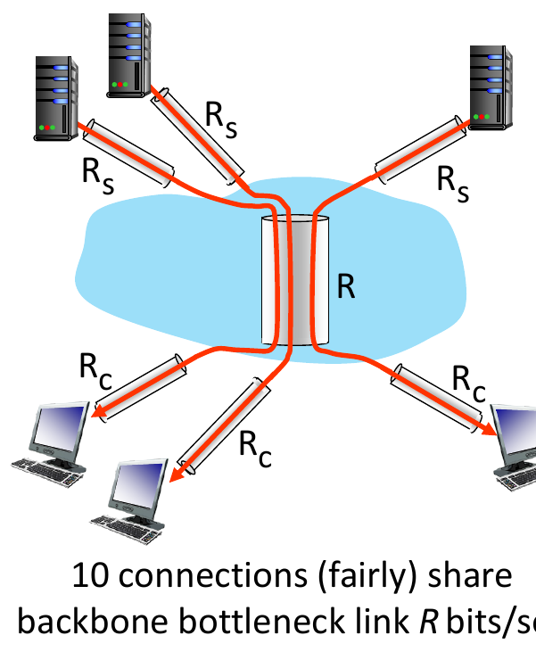

*Figura: dieci connessioni (qui ne sono disegnate tre) condividono equamente il link di backbone R (slide 1-58).*

## Sicurezza di rete

Internet non è nata pensando alla sicurezza: l'idea originale era "un gruppo di utenti che si fidano gli uni degli altri collegati a una rete trasparente", e chi progetta i protocolli oggi "rincorre". Bisogna pensare a come i malintenzionati possono attaccare le reti, a come difendersi e a come progettare architetture immuni agli attacchi; la sicurezza riguarda tutti i livelli.

Tre attacchi sono presentati nel capitolo:

1. **Packet sniffing**: su mezzi broadcast (Ethernet condivisa, wireless) un'interfaccia in modalità promiscua legge e registra tutti i pacchetti che passano, password comprese. Wireshark, usato nei laboratori, è un packet sniffer.
2. **IP spoofing**: iniezione di pacchetti con indirizzo sorgente falso.
3. **Denial of Service (DoS)**: l'attaccante rende una risorsa (server, banda) indisponibile al traffico legittimo sommergendola di traffico fasullo. Le fasi sono: scegliere il bersaglio, violare host sparsi nella rete (botnet) e inviare pacchetti al bersaglio da quegli host.

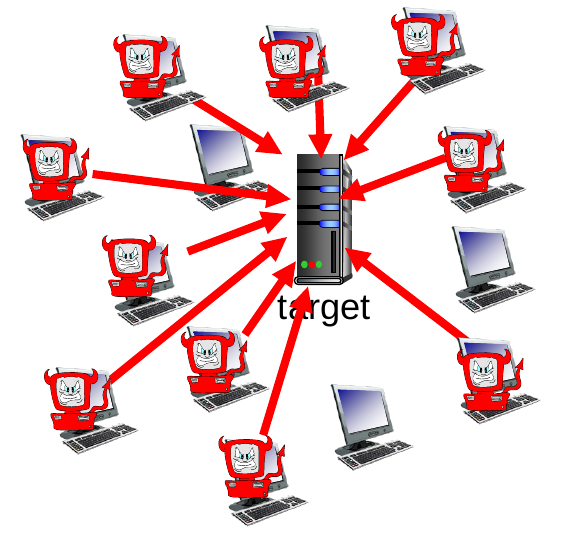

*Figura: attacco DoS distribuito con una botnet (slide 1-63).*

Le linee di difesa sono: **autenticazione** (provare di essere chi si dichiara; le reti cellulari hanno una identità hardware con la SIM, la rete Internet tradizionale no), **confidenzialità** (cifratura), **controlli di integrità** (firme digitali, per prevenire o rilevare manomissioni), **restrizioni di accesso** (VPN con password) e **firewall**, cioè middlebox nel nucleo e nell'accesso che filtrano di default i pacchetti in ingresso limitando mittenti, destinatari e applicazioni. Va aggiunta la capacità di rilevare e reagire ad attacchi DoS.

## Livelli di protocollo e incapsulamento

Una rete ha molti pezzi (host, router, link, applicazioni, protocolli, hardware e software): per orientarsi si usa la **stratificazione** (*layering*), come nell'esempio del viaggio aereo con servizi di biglietteria, bagagli, gate, pista, instradamento. Ogni livello implementa un servizio con azioni interne e usa il servizio del livello sotto. I vantaggi sono due: una struttura esplicita permette di individuare i pezzi e le loro relazioni (un modello di riferimento per la discussione) e la modularità semplifica manutenzione e aggiornamento, perché cambiare l'implementazione di un livello è trasparente al resto del sistema.

Lo stack Internet ha cinque livelli:

1. **applicazione**: supporta le applicazioni di rete (HTTP, IMAP, SMTP, DNS);
2. **trasporto**: trasferimento dati processo-processo (TCP, UDP);
3. **rete**: instradamento dei *datagrammi* da sorgente a destinazione (IP, protocolli di routing);
4. **link**: trasferimento dati fra elementi di rete vicini (Ethernet, 802.11 WiFi, PPP);
5. **fisico**: i bit "sul filo".

Nell'**incapsulamento** ogni livello, alla sorgente, prende l'unità del livello superiore e vi aggiunge un proprio header per implementare il suo servizio: il messaggio applicativo `M` diventa un **segmento** `[Ht | M]` al livello trasporto, un **datagramma** `[Hn | Ht | M]` al livello rete e un **frame** `[Hl | Hn | Ht | M]` al livello link (l'analogia delle matrioske). In una visione end-to-end gli host implementano tutti e cinque i livelli, un **router** solo i livelli fino a quello di rete e uno **switch** solo fino al livello link; alla destinazione gli header vengono tolti livello per livello.

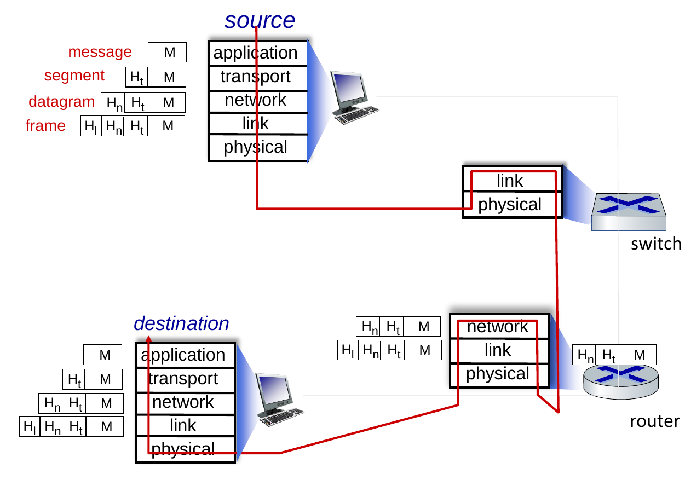

*Figura: incapsulamento end-to-end (slide 1-76).*

## Storia di Internet

La storia della rete si divide in tre fasi. Fra il **1961 e il 1972** nascono i principi del packet switching: Kleinrock mostra con la teoria delle code l'efficacia del packet switching (1961), Baran ne propone l'uso in reti militari (1964), ARPAnet viene concepita nel 1967 e il primo nodo funziona nel 1969; nel 1972 c'è la demo pubblica, compare NCP (primo protocollo host-host) insieme al primo programma di e-mail, e la rete ha 15 nodi.

Fra il **1972 e il 1980** si lavora sull'internetworking e nascono reti nuove e proprietarie: ALOHAnet (rete satellitare alle Hawaii, 1970), l'architettura di Cerf e Kahn per interconnettere reti (1974), Ethernet allo Xerox PARC (1976), le architetture proprietarie di fine anni '70 (DECnet, SNA, XNA), fino ai 200 nodi di ARPAnet nel 1979. I principi di Cerf e Kahn, che definiscono l'architettura di Internet di oggi, sono minimalismo e autonomia (nessun cambiamento interno richiesto per interconnettere le reti), modello di servizio **best-effort**, routing **stateless** e controllo **decentralizzato**.

Fra il **1980 e il 1990** si ha la proliferazione di reti e protocolli: TCP/IP (1983), SMTP (1982), DNS (1983, traduzione nome-indirizzo IP), FTP (1985), controllo di congestione TCP (1988), nuove reti nazionali (CSnet, BITnet, NSFnet, Minitel), con circa 100 000 host collegati in una confederazione di reti.

## Cose da saper fare all'esame

Per gli esercizi ci si aspetta di saper:

1. calcolare il ritardo di trasmissione `L/R`, il ritardo di propagazione `d/s` e il ritardo nodale su un percorso a più salti, distinguendo i quattro contributi;
2. risolvere problemi in stile "carovana" (quando arriva il primo bit, quando l'ultimo);
3. calcolare l'intensità di traffico `La/R` e dire qualitativamente com'è il ritardo di coda;
4. calcolare il throughput end-to-end come minimo fra i link, anche con link condiviso da più connessioni (`R/N`);
5. confrontare packet switching e circuit switching con il conto sul numero di utenti.

Per la teoria bisogna saper spiegare:

- cos'è un protocollo e la differenza fra forwarding e routing;
- store-and-forward e perché un pacchetto può essere perso;
- FDM contro TDM;
- la costruzione per passi della struttura di Internet (IXP, peering, tier-1, content provider);
- i cinque livelli con un protocollo per livello e come funziona l'incapsulamento, con i nomi segmento, datagramma e frame;
- i tre attacchi del capitolo e le contromisure.

## Dubbi

- `[DA VERIFICARE]` La slide su traceroute chiede perché i ritardi misurati dopo il tratto transoceanico sembrino *diminuire* in alcuni salti: la risposta non è nel testo estratto. `[INT]` Probabilmente le misure variano per il ritardo di accodamento, che cambia da un probe all'altro, da confermare con il docente.
- `[DA VERIFICARE]` Alcune slide (accesso DSL/cable, struttura di Internet, carovana, incapsulamento) hanno testo estratto in disordine; i valori numerici riportati sopra sono stati ricomposti dalle slide e vanno ricontrollati sul PDF.
- La slide sul packet switching lascia aperta la domanda "come ottenere un comportamento circuit-like con il packet switching": è rinviata a capitoli successivi.
