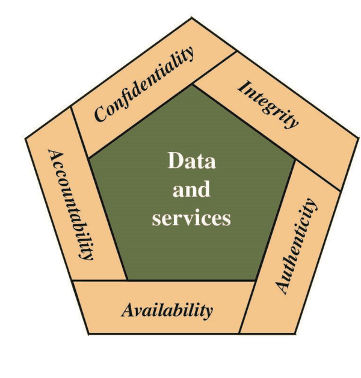
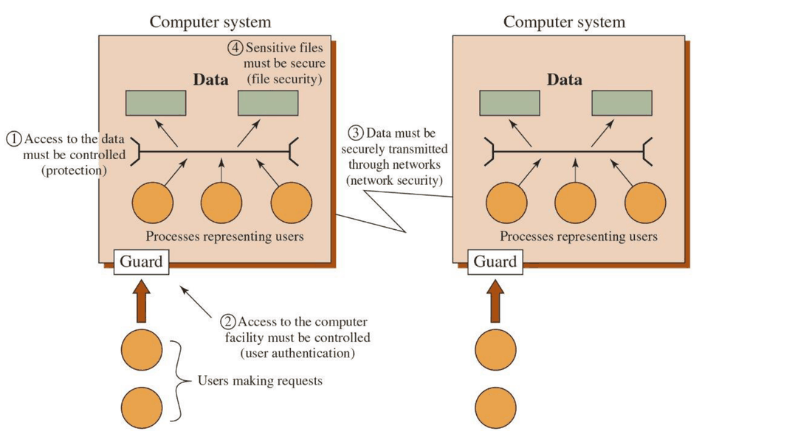
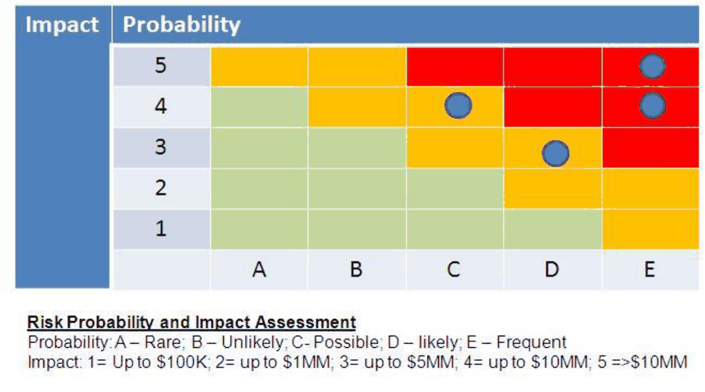
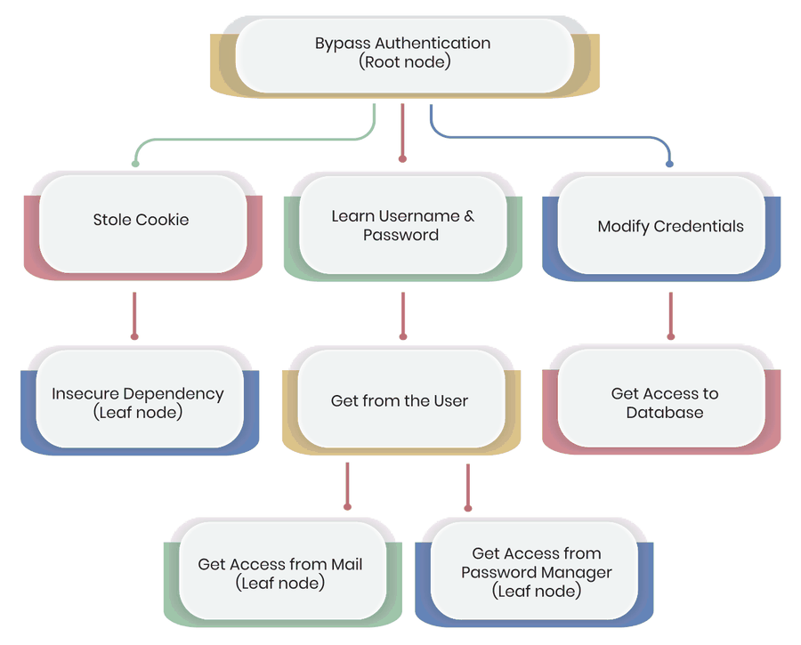
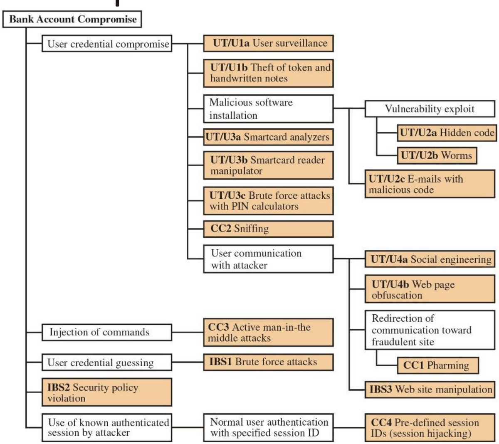

# 03 – Principi di sicurezza informatica

Fonte: Drive › Terzo anno › Reti e Sicurezza delle Reti › Slide Deck - Sicurezza › "01 - Secutiry Principles" (così nel titolo del file). Libro di riferimento del corso: Stallings-Brown, *Computer Security: Principles and Practice*, 5a ed. (esiste la traduzione italiana del 2022, con numerazione dei capitoli diversa). `[INT]` = integrazione o calcolo mio, non presente nelle slide: da ricontrollare. `[DA VERIFICARE]` = punto ambiguo o poco leggibile nell'estrazione del PDF.

## Mappa degli argomenti

La lezione è l'introduzione del corso. Prima fissa il vocabolario (triade CIA, obiettivi estesi, minaccia, vulnerabilità, rischio, attacco, avversari), poi classifica le conseguenze degli attacchi e le vulnerabilità dei quattro tipi di asset, e infine passa a requisiti, controlli, strategia di difesa a strati e sfide aperte.

- [Programma del corso e perché la sicurezza conta](#programma-del-corso-e-perché-la-sicurezza-conta)
- [La triade CIA e gli obiettivi estesi](#la-triade-cia-e-gli-obiettivi-estesi)
- [Terminologia e avversari](#terminologia-e-avversari)
- [Conseguenze degli attacchi](#conseguenze-degli-attacchi)
- [Asset e relative vulnerabilità](#asset-e-relative-vulnerabilità)
- [Requisiti e controlli di sicurezza](#requisiti-e-controlli-di-sicurezza)
- [Difesa in profondità e matrice del rischio](#difesa-in-profondità-e-matrice-del-rischio)
- [Attack tree](#attack-tree)
- [Sfide attuali](#sfide-attuali)
- [Takeaways](#takeaways)
- [Cose da saper fare all'esame](#cose-da-saper-fare-allesame)
- [Dubbi](#dubbi)

## Programma del corso e perché la sicurezza conta

Il corso di sicurezza è "orizzontale": tocca molti argomenti senza approfondirli, e l'approfondimento è rimandato a *Cybersecurity* (secondo semestre e laurea magistrale). I capitoli del libro coperti (numerazione dell'edizione inglese) sono: 1 Overview, 2 Cryptographic Tools, 3 User Authentication, 4 Access Control, 6 Malicious Software, 7 Denial-of-Service Attacks, 11 Software Security, 12 Operating Systems Security, 13 Cloud and IoT Security, 16 Physical and Infrastructure Security, 22 Internet Security Protocols and Standards, 24 Wireless Network Security. I temi anticipati per le prossime lezioni sono fondamenti crittografici (cifratura, hashing, firme digitali), autenticazione e controllo degli accessi, sicurezza di rete (protocolli sicuri) e sicurezza applicativa (pratiche di codifica e valutazione delle vulnerabilità).

La **computer security** protegge asset digitali, dati e sistemi da attacchi malevoli e accessi non autorizzati, e fa sì che i sistemi informativi funzionino correttamente e in modo affidabile come previsto dai progettisti. Riguarda organizzazioni, governi e singoli individui e combina soluzioni tecniche, politiche e consapevolezza delle persone per gestire il rischio informatico. Oggi conta per quattro ragioni: le violazioni di dati costano denaro e danneggiano la reputazione delle aziende; gli attacchi alle infrastrutture critiche (reti elettriche, ospedali, trasporti) possono minacciare la sicurezza pubblica; il furto di dati personali porta a frodi di identità, perdite finanziarie e violazioni della privacy; e il ransomware può fermare per settimane o mesi l'intera attività di un'azienda. In ambito normativo le slide citano la direttiva **NIS-2** con i settori coinvolti: energia, trasporti, banche, sanità, acqua potabile e reflua, infrastrutture digitali e altri.

## La triade CIA e gli obiettivi estesi

La base di ogni strategia e politica di sicurezza è la triade **CIA**, che si ricorda con i tre obiettivi *Confidentiality*, *Integrity* e *Availability*. Ognuno ha un proprio modo di essere violato e di essere difeso.

| Obiettivo | Cosa garantisce | Come lo si ottiene | Esempi di violazione |
|---|---|---|---|
| **Confidentiality** | l'informazione è accessibile solo a individui o sistemi autorizzati; protegge cartelle cliniche, transazioni finanziarie, comunicazioni personali, segreti, proprietà intellettuale, informazioni governative classificate | cifratura, controllo degli accessi, canali di comunicazione sicuri | numeri di carte di credito rubati, email riservate trapelate, database di clienti esposti |
| **Integrity** | i dati restano accurati, completi e non alterati in memoria e in transito, sia da corruzioni accidentali sia da modifiche malevole; include l'affidabilità del sistema e l'assenza di modifiche non autorizzate al software | meccanismi di rilevamento: checksum, firme digitali, sistemi di controllo di versione | dati modificati senza autorizzazione |
| **Availability** | gli utenti autorizzati possono accedere a sistemi e dati quando servono | infrastruttura robusta, ridondanza, piani di disaster recovery, protezione dai DoS; si misura con percentuali di uptime e **SLA** (service level agreement) | attacchi denial-of-service, downtime dei sistemi |

<table>
<tr>
<td valign="top">

Alla triade le slide aggiungono quattro **obiettivi estesi**:

1. **Authenticity**: verificare l'identità di utenti, sistemi e sorgenti di dati, per prevenire l'impersonificazione;
2. **Accountability**: mantenere log dettagliati e audit trail per tracciare le azioni degli utenti e gli eventi del sistema;
3. **Non-repudiation**: impedire che le parti neghino di aver partecipato a una transazione o comunicazione;
4. **Authorization**: controllare che cosa un utente autenticato può accedere e modificare.

</td>
<td valign="top" align="center">

 Figura: obiettivi di sicurezza attorno a dati e servizi (slide 10).

</td>
</tr>
</table>

## Terminologia e avversari

Il vocabolario di base distingue quattro concetti legati fra loro. Una **threat** (minaccia) è qualunque circostanza o evento con il potenziale di avere un impatto negativo sulle operazioni di un'organizzazione. Una **vulnerability** è una debolezza in sistemi, procedure o controlli che potrebbe essere sfruttata. Il **risk** (rischio) è una misura che combina la probabilità che la minaccia si realizzi con l'impatto potenziale sugli asset. Un **attack** è un'attività malevola che tenta di raccogliere, interrompere, negare, degradare o distruggere informazioni. A questi si aggiungono i ruoli, dalla terminologia del libro: l'**asset** (applicazioni, sistemi, impianti fisici, equipaggiamenti o gruppi logici da proteggere), l'**adversary** (individuo, gruppo, organizzazione o governo che svolge attività dannose contro i sistemi), l'**owner** (chi dà valore agli asset e vuole minimizzare il rischio con le contromisure) e la **countermeasure** (dispositivo o tecnica che riduce l'efficacia operativa delle minacce).

Gli avversari si distinguono per competenza e motivazione:

1. **script kiddies**: attaccanti poco esperti che usano strumenti ed exploit pronti per attacchi opportunistici;
2. **AI-kiddies**: gli script kiddies "automatici", cioè che sfruttano strumenti di intelligenza artificiale;
3. **cybercriminals**: motivati dal guadagno economico tramite frodi e furti;
4. **nation-state actors**: gruppi sponsorizzati da governi, con capacità avanzate per spionaggio e guerra;
5. **insider threats**: dipendenti attuali o ex con accesso legittimo che abusano dei propri privilegi.

## Conseguenze degli attacchi

Le slide classificano le conseguenze di un attacco in quattro famiglie, ciascuna con minacce specifiche. Il modo di ricordarle è chiedersi che cosa ottiene l'attaccante: informazioni (disclosure), la fiducia della vittima (deception), l'interruzione del servizio (disruption) o il controllo del sistema (usurpation).

| Conseguenza | Minaccia | Significato |
|---|---|---|
| **Unauthorized disclosure** | Exposure | dati sensibili rilasciati direttamente a entità non autorizzate |
| | Interception | accesso diretto non autorizzato a dati in transito fra sorgenti autorizzate |
| | Inference | accesso *indiretto* ai dati sensibili analizzando pattern di comunicazione e metadati |
| | Intrusion | accesso ai dati sensibili aggirando le protezioni del sistema |
| **Deception** | Masquerade | accesso al sistema spacciandosi per un utente o dispositivo autorizzato |
| | Falsification | dati falsi che fanno credere vere informazioni sbagliate a entità autorizzate |
| | Repudiation | un'entità nega falsamente la responsabilità delle proprie azioni, rendendo difficile l'accountability |
| **Disruption** | Corruption | alterazioni indesiderate del funzionamento che cambiano le funzionalità o degradano le prestazioni |
| | Obstruction | interruzione della fornitura dei servizi ostacolando il normale funzionamento |
| **Usurpation** | Misappropriation | un'entità non autorizzata assume il controllo logico o fisico delle risorse |
| | Misuse | componenti del sistema che svolgono funzioni dannose per la sicurezza |

Esempi di disruption sono denial-of-service, infezioni malware e sabotaggio fisico. L'usurpation include i privilegi non autorizzati per eseguire codice malevolo o accedere a risorse riservate e porta alla compromissione completa dell'integrità del sistema, con la possibilità di ulteriori attività malevole.

## Asset e relative vulnerabilità

Le slide dividono gli asset di computer e reti in quattro tipi: **hardware** (server, workstation, dispositivi mobili, infrastruttura di rete), **software** (programmi, applicazioni, sistemi operativi, firmware), **dati** (database, file, documenti, ogni forma di contenuto digitale) e **comunicazione** (traffico di rete, messaggi e dati trasmessi fra sistemi e utenti). Per ciascuno si descrive come la CIA può essere violata.

| Asset | Availability | Confidentiality | Integrity |
|---|---|---|---|
| **Hardware** | furto o distruzione dell'equipaggiamento che nega il servizio agli utenti | dispositivi di memorizzazione non cifrati che possono essere rubati e letti | manomissione dei componenti (es. sostituzione di sensori) |
| **Software** | cancellazione o corruzione dei programmi, che nega l'accesso agli utenti legittimi | copia non autorizzata di software proprietario e proprietà intellettuale | modifica malevola di programmi funzionanti per causare guasti o comportamenti non voluti |
| **Dati** | cancellazione o corruzione dei file che impedisce l'accesso | lettura non autorizzata di dati sensibili e attacchi di inferenza statistica | modifica di file esistenti o creazione (*fabrication*) di record falsi |
| **Comunicazione** | distruzione o cancellazione di messaggi, o rete resa non disponibile | intercettazione dei messaggi e analisi dei pattern di traffico per ricavare informazioni | modifica, ritardo, riordino, duplicazione di messaggi o fabbricazione di messaggi falsi |

Le contromisure indicate per tipo di asset sono: per l'hardware controlli di sicurezza fisica e cifratura; per il software controlli di accesso, controllo della qualità del codice, firma del codice e verifiche periodiche di integrità; per i dati cifratura, sistemi di backup e controllo degli accessi; per la comunicazione comunicazioni cifrate, autenticazione e sistemi di rilevamento delle intrusioni (IDS). `[DA VERIFICARE]` La slide sull'hardware ha il testo estratto in disordine: la tabella sopra è ricomposta dai frammenti e va ricontrollata sul PDF.

## Requisiti e controlli di sicurezza

Le slide elencano due gruppi di famiglie di requisiti, che nel libro corrispondono ai requisiti minimi di sicurezza per i sistemi informativi.

Il primo gruppo contiene i requisiti organizzativi: **access control** (limitare l'accesso al sistema agli utenti autorizzati e controllare le azioni permesse), **awareness and training** (il personale deve conoscere i rischi e le proprie responsabilità), **audit and accountability** (creare e conservare registrazioni dettagliate per monitoraggio e indagini) e **certification and assessment** (valutare periodicamente i controlli e attuare azioni correttive).

Il secondo gruppo contiene i controlli essenziali: **identification and authentication** (verificare l'identità di utenti, processi e dispositivi prima di concedere l'accesso), **risk assessment** (analizzare periodicamente le minacce a operazioni e asset), **configuration management** (stabilire e mantenere configurazioni di base sicure per tutti i sistemi) e **incident response** (sviluppare la capacità di preparazione, rilevamento, analisi, contenimento e recupero).

 
<i>Figura: ambito della computer security, cioè accesso ai dati, accesso al sistema, sicurezza dei dati e della rete (slide 15).</i>

## Difesa in profondità e matrice del rischio

La strategia di **defense in depth** si basa su quattro idee: più livelli di sicurezza sovrapposti, che creano meccanismi di protezione ridondanti; la **riduzione della superficie di attacco** (*attack surface*), cioè dei possibili punti di ingresso; nessun **single point of failure**, in modo che la compromissione di un controllo non porti al fallimento totale; e una gestione equilibrata del rischio che combina misure **preventive, detective e correttive**.

La **matrice del rischio** incrocia due dimensioni, l'ampiezza della superficie di attacco e la profondità delle difese:

| Superficie di attacco | Difese profonde | Difese superficiali |
|---|---|---|
| Piccola | rischio **basso** (sicurezza ottimale) | rischio **medio** |
| Grande | rischio **medio** | rischio **alto** (massima vulnerabilità) |

Le organizzazioni devono valutare la propria posizione e investire in contromisure di conseguenza.

 
<i>Figura: matrice probabilità-impatto, con legenda delle scale (slide 29).</i>

## Attack tree

L'**attack tree** è uno strumento di analisi per modellare sistematicamente le minacce: serve a identificare le vulnerabilità, pianificare le contromisure e progettare l'architettura di sicurezza. L'esempio del libro riportato nelle slide è il sistema di autenticazione di una banca, in cui ogni passo dell'attacco ha la sua contromisura. `[DA VERIFICARE]` La figura dell'albero non è leggibile nell'estrazione del PDF: guardare l'esempio sul libro (cap. 1) o sulle slide.

<table>
<tr>
<td align="center"> Attack tree generico (slide 30).</td>
<td align="center"> Esempio del libro: account bancario (slide 31).</td>
</tr>
</table>

## Sfide attuali

Le difficoltà di realizzazione sono quattro: il compromesso **usabilità contro sicurezza** (misure forti spesso rendono i sistemi più difficili da usare), la **minaccia in evoluzione** (nuovi metodi di attacco emergono più in fretta delle difese), i **vincoli di risorse** (budget e personale limitati vanno ripartiti fra esigenze concorrenti) e il **fattore umano** (gli utenti sono spesso l'anello debole). Una nota a margine nelle slide chiede se un sistema su carta sia sicuro al 100%, rimandando agli attacchi fisici: nessun supporto è immune.

Le sfide correnti sono: la **sicurezza del cloud** (rischi dell'infrastruttura condivisa e perdita del controllo fisico), le **minacce ai dispositivi mobili** (le politiche BYOD, *bring your own device*, aprono nuovi vettori di attacco e rischi di perdita di dati), l'**Internet of Things** (miliardi di dispositivi connessi con funzioni di sicurezza minime) e gli **attacchi potenziati dall'IA** (il machine learning permette attacchi più sofisticati e automatizzati, cioè gli AI-kiddies). Le slide elencano infine alcuni percorsi professionali: security analyst (monitora i sistemi, indaga gli incidenti, attua protezioni), penetration tester (esegue attacchi autorizzati per trovare vulnerabilità), security architect (progetta sistemi sicuri e strategie), incident response (guida la risposta d'emergenza a violazioni e attacchi).

## Takeaways

1. **Gestione del rischio**: la sicurezza consiste nel portare il rischio a livelli accettabili, non nell'eliminare tutte le minacce.
2. **Difesa a strati**: più controlli sovrapposti proteggono meglio di una soluzione singola.
3. **Elemento umano**: le persone sono spesso l'anello più debole ma anche la risorsa più forte dei sistemi di sicurezza.
4. **Continuità**: le misure di sicurezza devono adattarsi di continuo alle nuove minacce e tecnologie.

## Cose da saper fare all'esame

Per la teoria bisogna saper:

- definire confidentiality, integrity e availability con un esempio di violazione e un meccanismo di protezione ciascuno, e citare gli obiettivi estesi (authenticity, accountability, non-repudiation, authorization);
- distinguere threat, vulnerability, risk e attack, e dire chi sono asset, adversary, owner e countermeasure;
- classificare un attacco in una delle quattro conseguenze (disclosure, deception, disruption, usurpation) e nominare la minaccia specifica (per esempio masquerade o inference);
- fare, per un tipo di asset (hardware, software, dati, comunicazione), un esempio di attacco alla CIA e la contromisura;
- spiegare la defense in depth e usare la matrice superficie di attacco contro profondità delle difese per classificare il rischio;
- spiegare a cosa serve un attack tree.

`[INT]` Un tipo di domanda probabile è quella di classificazione su un caso breve ("un'email aziendale viene letta da un esterno", "un attaccante analizza solo la dimensione dei pacchetti"): vanno assegnate la proprietà violata della CIA e la conseguenza (nel secondo caso, inference, perché l'attaccante ricava informazioni dai metadati senza leggere il contenuto).

## Dubbi

- `[DA VERIFICARE]` Nelle slide il titolo del file è "Secutiry Principles" (refuso) e due slide (hardware, attack tree) hanno il testo o la figura illeggibili nell'estrazione.
- `[DA VERIFICARE]` Non è chiaro quali dei 12 capitoli indicati siano trattati a lezione in dettaglio e con quale profondità: chiedere al docente e verificare con le prossime slide.
- Il file caricato su Drive è solo la prima lezione della parte di sicurezza (in "Slide Deck - Sicurezza" non c'è altro): crittografia, autenticazione, controllo degli accessi e il resto saranno aggiunti quando escono le slide.
- Modalità e peso delle due parti d'esame (reti e sicurezza): non indicate nel materiale.
