# 02 – La base dello sviluppo client-side: UI con HTML e CSS

Fonte: Drive › Terzo anno › Tecnologie Web › Slide Deck - Lab › "01 - UIs con HTML e CSS" (nel PDF è il deck "2 – La base dello sviluppo client-side: UIs con HTML e CSS", Picardi).

## Mappa degli argomenti

- [Il browser come ambiente di esecuzione](#il-browser-come-ambiente-di-esecuzione)
- [HTML: un linguaggio di annotazione](#html-un-linguaggio-di-annotazione)
- [CSS: Cascading Style Sheets](#css-cascading-style-sheets)
- [Layout](#layout)
- [Strumenti per CSS](#strumenti-per-css)
- [Cose da saper fare all'esame](#cose-da-saper-fare-allesame)
- [Dubbi](#dubbi)

## Il browser come ambiente di esecuzione

Il lato client di una web app è fatto di una o più pagine HTML, ognuna con uno o più fogli di stile CSS e zero o più moduli JavaScript. Una pagina senza JavaScript è passiva e da sola non è un'applicazione, ma in un'applicazione a più pagine alcune possono tranquillamente essere di sola lettura. Il browser vede ogni pagina come a sé stante: la mostra ed esegue dentro una scatola chiusa (**sandbox**) creata apposta al caricamento. Se la pagina viene ricaricata la sandbox viene distrutta e se ne crea una nuova, quindi la memoria dell'applicazione va persa. Un rimedio parziale sono gli storage locali del browser, condivisibili fra pagine con la stessa *origine* (cioè lo stesso server), ma con parecchi limiti. Se l'app ha più pagine, spetta al lato server gestire il flusso di informazioni da una all'altra o fra più caricamenti della stessa.

Quando il browser riceve HTML + CSS + JS, con HTML e CSS inizializza la **vista** (la finestra che l'utente vede) e il **DOM** (Document Object Model), la struttura dati in memoria che rappresenta la pagina. L'HTML definisce la struttura logica e la semantica (quante sezioni, quali sono menu e quali articoli, ruolo del testo, media, elementi di input, link). I CSS definiscono l'aspetto (font, colori, dimensioni, collocazione). Il DOM nasce da questi due ma durante la sua vita può essere modificato, e muore alla chiusura o ricarica della pagina.

<p align="center">
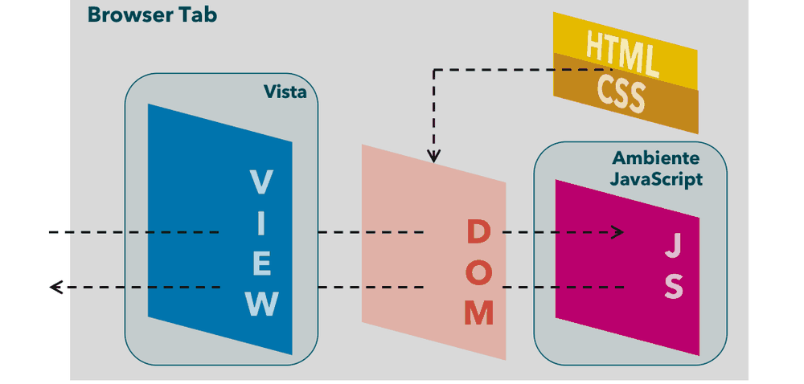<br>
<sub><i>Figura: vista, DOM e ambiente JavaScript nella scheda del browser (slide 2).</i></sub>
</p>


## HTML: un linguaggio di annotazione

HTML descrive struttura e aspetto di un documento multimediale e ipertestuale usando testo semplice (UTF-8) e le URL dei file degli altri media. Non è un linguaggio di programmazione perché non istruisce algoritmicamente un agente di calcolo: è di *markup*, parte da un testo e lo suddivide in elementi che lo strutturano logicamente. Ogni elemento ha un **tipo**, un **contenuto** (testo e/o altri elementi; alcuni tipi non hanno contenuto) e **attributi** opzionali che dipendono dal tipo. La specifica formale dice quali tipi esistono, che significato hanno, che contenuto ci si aspetta e quali attributi ammettono. Il documento è un albero di elementi e il browser lo usa per organizzare la visualizzazione; il "significato inteso" dei tipi conta, anche se con i CSS l'aspetto si può cambiare completamente.

La sintassi di un elemento è `<XYZ> contenuto </XYZ>`: tag di apertura con il nome del tipo tra parentesi angolari, contenuto, tag di chiusura uguale all'apertura ma con `/` prima del nome. Gli **attributi** stanno dentro il tag di apertura: `<XYZ attrib=val>`. Gli attributi non previsti dalla specifica vengono ignorati dal browser, ma funzioni JavaScript associate all'elemento possono sfruttare attributi custom, che per convenzione hanno nome della forma `data-*`.

<p align="center">
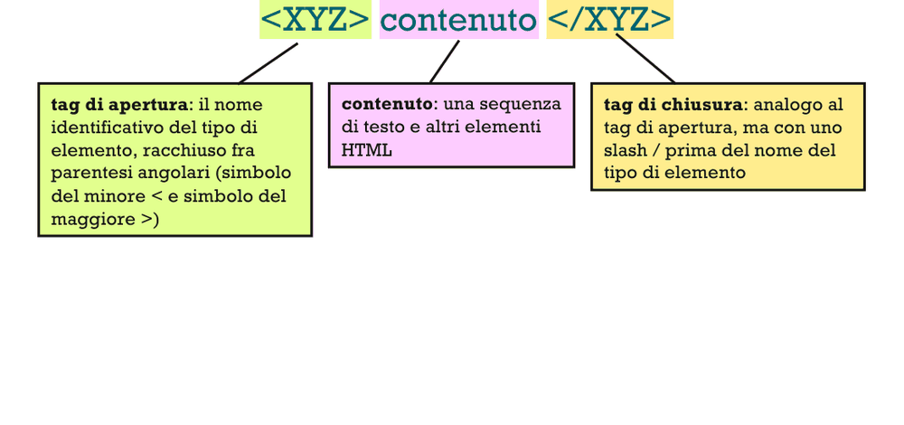<br>
<sub><i>Figura: sintassi di un elemento HTML (slide 10).</i></sub>
</p>


<p align="center">
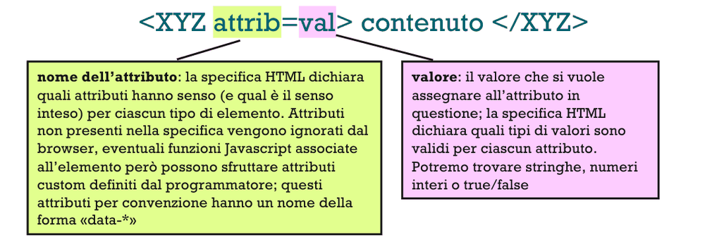 contenuto </XYZ>, con la spiegazione di nome dell'attributo e di valore"><br>
<sub><i>Figura: gli attributi di un elemento (slide 11).</i></sub>
</p>


La struttura di un documento è fissa:

```html
<!DOCTYPE html>
<html lang="en">
  <head> ... </head>
  <body> ... </body>
</html>
```

Il `DOCTYPE` è un preambolo che dichiara la versione della specifica (esiste per retrocompatibilità e di fatto è sempre uguale). Il `head` contiene meta-informazioni sul documento usate dal browser ma non visualizzate; il `body` è il contenuto visualizzato.

<p align="center">
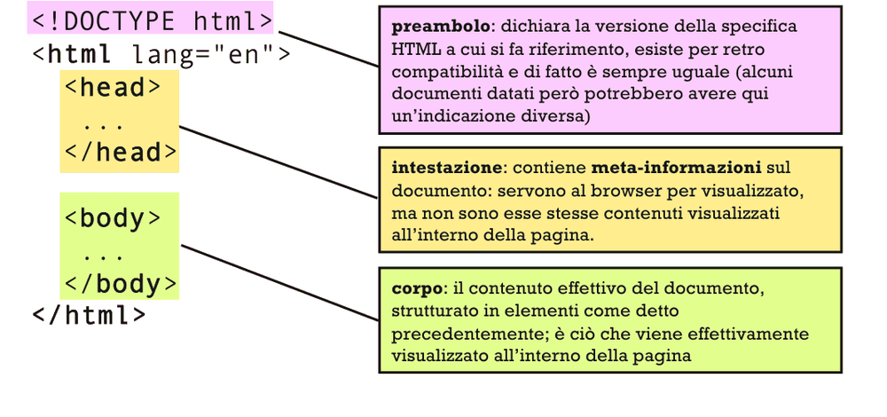<br>
<sub><i>Figura: struttura di un documento HTML (slide 12).</i></sub>
</p>


### Tipi di elementi e contenuto

I tipi principali sono:
- `HTML`: il documento; `HEAD` e `BODY` lo dividono in intestazione e corpo;
- `SECTION`: divide in sezioni;
- `DIV`: suddivisione generica senza semantica;
- `NAV`: area di navigazione;
- `ARTICLE`: testo da leggere (utile per distinguerlo in una UI complessa dove molti elementi sono widget e non materiale di lettura);
- `H1`...`H6`: titoli di importanza decrescente;
- `P`: paragrafo;
- `IMG`: immagine (richiede la URL come attributo, perché l'immagine è un file indipendente sul server);
- `EM`: testo enfatizzato (corsivo di default);
- `STRONG`: testo molto enfatizzato (grassetto di default).

Alcuni elementi hanno contenuto testuale (`H1`, `EM`), altri sotto-elementi (`SECTION` contiene due `DIV`), alcuni nessun contenuto (`IMG`), altri un misto (`P` può contenere testo, un `EM`, altro testo). Si può mettere qualsiasi elemento dentro un altro? "Sì e no": il browser cerca di visualizzare comunque, ma non tutto ha senso. In prima approssimazione gli elementi sono **a blocco** (definiscono un riquadro) oppure **in linea** (seguono il fluire del testo). In un documento ben fatto gli elementi a blocco stanno solo dentro altri elementi a blocco: un blocco dentro un elemento in linea provoca comportamenti imprevisti. Se si usa HTML per progettare UI conviene una visualizzazione ben strutturata, prevedibile e indipendente dalle "strategie compensative" del browser.

### Collegamenti ipertestuali

Si usa l'elemento `A` (anchor), che può contenere sia elementi in linea sia a blocco. La destinazione sta nell'attributo `href`, che deve essere una URL valida. Può essere:
- **esterna**: dominio e path completi, dominio diverso dal documento corrente;
- **assoluta**: stesso dominio, path completo dalla radice del dominio, che parte con `/`;
- **relativa**: stesso dominio, path relativo al documento attuale.

Il contenuto di `A` è l'*hotspot*, cioè ciò su cui cliccare.

### Testo, tabelle, multimedia

Per il testo: elementi a blocco `P`, `H1`–`H6`, `UL` (lista puntata, con `LI`; l'attributo `type` sceglie `circle`, `disc`, `square`), `OL` (lista numerata, con `LI`; `type` può essere `a`, `A`, `i`, `I`, `1` e `start` fissa il numero di partenza); in linea `EM`, `STRONG` e `SPAN` (testo da distinguere in qualche modo, con aspetto deciso poi dai CSS: di default il browser non lo distingue).

Le **tabelle** servono per presentare dati con righe e colonne, **non** per disporre i contenuti nella pagina (per quello ci sono gli elementi strutturali con i CSS). `TABLE` contiene righe `TR`, che contengono celle `TD`; `colspan` e `rowspan` (interi > 0, default 1) fanno spaziare la cella su più colonne/righe (la somma dei colspan dovrebbe essere costante per riga); `TH` è una cella di intestazione, con `scope` uguale a `row` o `col`; `THEAD`, `TBODY`, `TFOOT` raggruppano le righe in testata, corpo e piede.

`IMG` è un elemento in linea con `src` (URL esterna, assoluta o relativa) e `width`/`height`; è bene specificarli così il browser imposta la pagina senza aspettare il caricamento. Attenzione però: l'immagine viene comunque scaricata nella dimensione originale e solo poi ridimensionata, quindi se l'obiettivo è risparmiare traffico non basta cambiare gli attributi, serve tenere sul server più versioni a dimensioni diverse e usare l'URL di quella giusta. `AUDIO` mostra un player incorporato (`src`, `autoplay`, `controls`), `VIDEO` è analogo con `width`/`height`, con le stesse considerazioni delle immagini.

### Elementi strutturali

Ci sono due usi tipici: "redazionale" (documento, articolo, blog: poca interazione, si legge e si naviga) e "applicativo" (la pagina è l'interfaccia di un'applicazione o di un e-commerce: l'utente sceglie, carica, fornisce informazioni). Gli elementi strutturali sono:
- `DIV`: la suddivisione senza semantica, indispensabile per dare un layout diverso da quello di default;
- `SECTION`: divide in sezioni indipendenti;
- `ARTICLE`: marca un articolo presentabile anche da solo;
- `NAV`: un menu;
- `HEADER`: l'intestazione visibile di pagina o sezione (da non confondere con `HEAD`, che è la meta-intestazione);
- `FOOTER`: il piè di pagina (contatti, cookie...).

### Form

L'HTML puro permette di inserire moduli con cui l'utente invia dati al web server (ha senso solo se il server ha un'app server-side che li riceve; altrimenti i dati si perdono). Qui si parla solo di form gestiti dal browser: più avanti si vedranno quelli gestiti da JavaScript. Un `FORM` contiene elementi di input. Gli attributi decidono il comportamento: `action` è la URL a cui mandare i dati, `method` è GET o POST. Con GET i dati finiscono come query string nella URL; con POST nel body con `Content-Type: application/x-www-form-urlencoded`. In entrambi i casi la forma è `nome1=valore1&nome2=valore2&...`, dove i nomi vengono dagli input e i valori dall'utente.

La maggior parte degli input usa il tag `INPUT` con attributo `type`, e **tutti** richiedono l'attributo `name` (è il nome del campo nella richiesta):
- `type="text"`: casella di testo (`size`, `value`, `placeholder`: il placeholder è un segnaposto che scompare quando si digita e non conta come valore);
- `type="checkbox"`: ha `value` (inviato se spuntata) e `checked`;
- `type="radio"`: è a gruppi; tutti i radio dello stesso gruppo hanno lo stesso `name`, uno solo è selezionabile, `value` è ciò che viene riportato, `checked` indica quello iniziale;
- `LABEL for="id"`: etichetta associata a un input con quell'`id` (essenziale per checkbox e radio, omettibile per le textbox con placeholder chiaro);
- `SELECT name="..."`: menu a tendina con elementi `OPTION value="..."`; il `name` sta sul `SELECT`, il `value` sulle `OPTION`.

Un form in HTML puro deve avere un pulsante `<input type="submit" value="...">` che provoca l'invio (non fornisce un dato, fa partire l'azione) e può avere un `type="reset"` che riporta gli input allo stato iniziale.

## CSS: Cascading Style Sheets

Lo stile è descritto da **regole** raccolte in file `.css`. Una regola ha un **selettore**, che filtra gli elementi a cui si applica (il più semplice è il nome di un tipo HTML), e un **blocco di dichiarazioni** tra graffe; ogni dichiarazione è `proprietà: valore;`.

```css
h1 {
  background-color: darkslategrey;
  color: bisque;
  padding: 10px;
  font-family: sans-serif;
}
```

<p align="center">
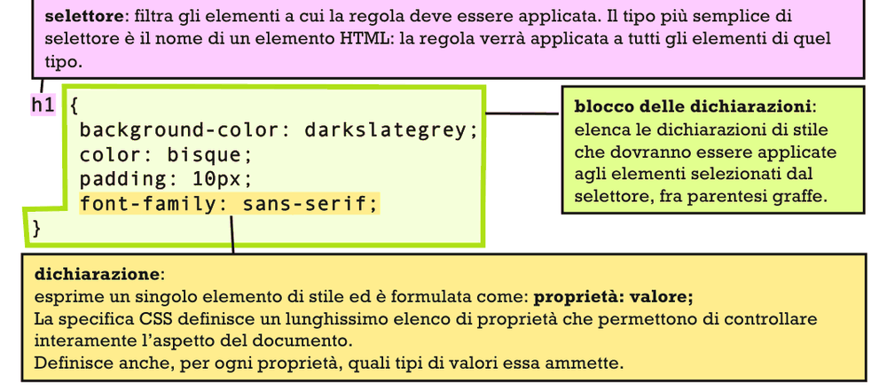<br>
<sub><i>Figura: anatomia di una regola di stile (slide 25).</i></sub>
</p>


Gli stili si associano all'HTML in tre modi:
- foglio **esterno**: file separato, collegato nel `head` con `<link rel="stylesheet" href="styles/style.css">`;
- **interno**: regole dentro un elemento `<style>` nel `head`;
- **in linea**: attributo `style` su un singolo elemento, es. `<h1 style="color: red; font-size: 15pt;">`.

### Cascata, specificità, ereditarietà

Se a un elemento si applicano regole in conflitto (stessa proprietà, valori diversi) decidono due criteri. La **specificità** misura quanto precisamente il selettore individua l'elemento (le slide rimandano il calcolo preciso a dopo: vedi l'integrazione qui sotto): vince la regola più specifica, e in assoluto le dichiarazioni più specifiche sono quelle *in linea*. A parità di specificità vale la **cascata**: conta l'ordine in cui il browser riceve le regole, vince l'ultima; quindi contano l'ordine dei fogli esterni, gli interni sono considerati dopo gli esterni e le dichiarazioni in linea per ultime. C'è poi l'**ereditarietà**: alcune proprietà sono ereditate di default dal genitore, o il loro valore è calcolato da quello del genitore. Non influenza l'algoritmo di scelta ma influenza il risultato ed è la prima cosa da ricordare quando un CSS "non si comporta come vorremmo".

<p align="center">
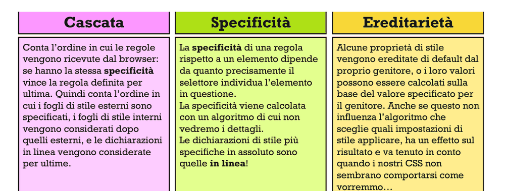<br>
<sub><i>Figura: cascata, specificità, ereditarietà (slide 28).</i></sub>
</p>


### Integrazione: come si calcola la specificità e cosa si eredita

*Da fonti esterne (MDN, W3C CSS Cascade), non dalle slide: le slide rimandano questi dettagli a dopo.* Quando più dichiarazioni colpiscono la stessa proprietà dello stesso elemento, il browser le confronta in quest'ordine:
1. **importanza**: una dichiarazione `!important` batte una normale (da usare il meno possibile);
2. **specificità** del selettore, che è un peso a tre numeri **ID–CLASSE–TIPO**: il primo conta gli id, il secondo classi, attributi e pseudoclassi, il terzo tag e pseudo-elementi. I tre numeri si confrontano **da sinistra a destra, non si sommano**: un solo id (1-0-0) batte qualsiasi numero di classi, e `#a` batte `.x .y .z` (0-3-0). Il selettore universale `*` e i combinatori (spazio, `>`, `~`, `+`) valgono zero. Lo stile in linea (attributo `style`) vince su qualunque selettore dei fogli, ed è battuto solo da `!important`;
3. **ordine**: se anche la specificità è pari, vince la dichiarazione scritta per ultima, che è il criterio della cascata descritto sopra.

Sull'**ereditarietà**: ogni proprietà è definita come ereditata o no. Se un elemento non ha alcun valore dichiarato e la proprietà è ereditata, prende il valore calcolato del genitore; altrimenti prende il valore iniziale. In genere ereditano le proprietà del testo (`color`, `font-*`, `line-height`, `text-align`, `visibility`) e non quelle del box (`margin`, `padding`, `border`, `background`, `display`, `width`); per sapere se una proprietà eredita si guarda la riga "Inherited" nella sua pagina di riferimento MDN (l'elenco qui sopra è indicativo). Le parole chiave `inherit` (forza l'ereditarietà), `initial` (valore iniziale) e `unset` (come `inherit` o `initial` a seconda della proprietà) permettono di scegliere esplicitamente.

### Proprietà e valori

Famiglie molto usate: proprietà tipografiche (`font-size`, `font-family`, `font-weight`, `font-style`, `text-decoration`, `line-height`, `color`) e proprietà grafiche del riquadro (box) di un elemento (`width`, `height`, `max-/min-width/height`, `padding`, `margin`, `border`, `border-radius`, `background-color`, `position`, `top`, `left`, `bottom`, `right`). Quanto si può davvero controllare dimensioni e posizione dipende dal display, perché alcune modalità dispongono i riquadri con un algoritmo e ignorano in tutto o in parte le nostre indicazioni.

I **valori** sono di tre tipi:
- costanti predefinite (come un enumerato: `bold`, `red`, `solid`, `auto`);
- valori metrici, numero più unità, che possono essere assolute (`px`, `mm`, `in`, `pt`) o relative (`rem` è proporzionale alla dimensione dell'elemento radice `html`, `%` a quella dell'elemento contenitore, `vw` alla larghezza del viewport);
- colori in RGB o RGBα (`#dfff76`, `rgb(255,0,106)`, `rgba(255,0,106,0.1)`).

Alcune proprietà sono **scorciatoie** che ne impostano più di una. `margin: 5px 10px 0 20px;` imposta top, right, bottom, left; con un solo valore vale per tutti e quattro; con due valori il primo è verticale (top e bottom) e il secondo orizzontale (left e right).

### Selettori

Sono la parte più potente di CSS: funzionano come query sul documento HTML. Si dividono in semplici, compositi e complessi.

I **selettori semplici** sono:
- per *tag*: `img`;
- per *classe*: `.articolo`, da `<div class="articolo">`; la classe è una stringa libera che etichetta gli elementi per raggrupparli, ed è il tipo più usato;
- per *id*: `#utente`; l'id è univoco, e si usa meno proprio perché è difficile garantirlo;
- per *attributo*: `[type="text"]`, `[href*="example"]` per "contiene"; la forma è `[attr]` per presenza o `[attr OP "val"]`;
- per *pseudoclasse*: `:hover`, `:first-child`; raggruppamenti definiti dal browser in base allo stato, dinamico o statico;
- *universale*: `*`.

<p align="center">
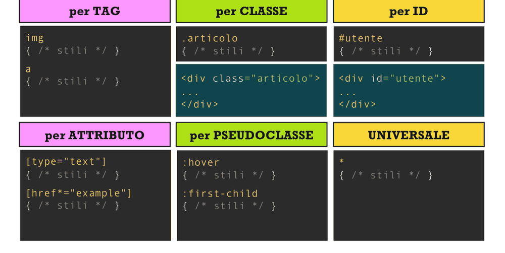<br>
<sub><i>Figura: i selettori semplici (slide 33).</i></sub>
</p>


I **selettori compositi** si ottengono per giustapposizione, senza spazi, di selettori semplici, con significato di **AND**: `div.importante` (DIV di classe importante), `label[name="anno"]`, `.elenco.attivo` (classi `elenco` e `attivo` insieme), `input[type="button"]:hover`. Vincoli: al più un selettore per tag oppure l'universale (che si può omettere), e se c'è deve stare per primo. L'ordine non cambia il significato ma può cambiare la specificità.

<p align="center">
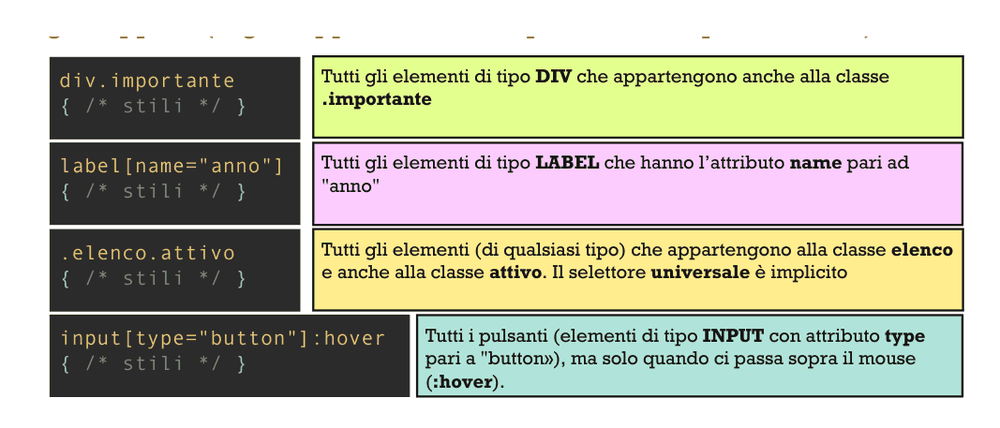<br>
<sub><i>Figura: selettori compositi (slide 34).</i></sub>
</p>


I **selettori complessi** hanno la forma `S comb A` e selezionano gli elementi `A` che sono nella relazione `comb` con un elemento che rispetta `S`. I combinatori sono quattro:

| Combinatore | Relazione | Esempio |
|---|---|---|
| spazio | discendente | `.articolo h1` (H1 dentro un elemento di classe articolo) |
| `>` | figlio diretto | `ul.menu > li` |
| `~` | fratello successivo (anche non consecutivo, stesso genitore) | `.introduzione ~ div` |
| `+` | prossimo fratello (subito dopo, stesso genitore) | `h1 + p` |

Infine si può applicare una regola a una **lista di selettori** separati da virgola, con significato di **OR**: `h2, .capitolo > h1, input[type="text"]:hover { ... }`.

## Layout

Il layout è la disposizione degli elementi sulla pagina e lo decide il browser in base a due fattori. Primo, la **struttura dell'HTML**: gli elementi sono "scatole cinesi", ognuno posizionato (anche graficamente) dentro il riquadro del genitore; è anche un albero, fondamentale poi per manipolarlo da codice. (Tramite CSS si può derogare, ma il corso non lo tratta.) Secondo, il **display** di ogni elemento, che ha due componenti: *display-inside* (come l'elemento dispone i propri contenuti) e *display-outside* (come l'elemento preferirebbe essere disposto nel proprio contenitore). Ogni tipo di elemento ha dei default, modificabili. La proprietà `display` li esprime insieme (prima outside, poi inside: `display: inline flow;`) oppure uno solo (`display: block;` imposta l'outside; `display: flex;` imposta l'inside e lascia l'outside di default, che per un `P` è `block`).

<p align="center">
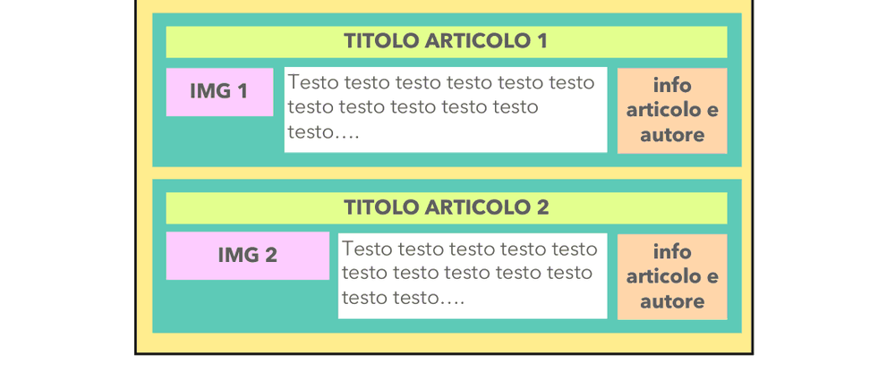<br>
<sub><i>Figura: disposizione degli elementi di una pagina di articoli (slide 43).</i></sub>
</p>


<p align="center">
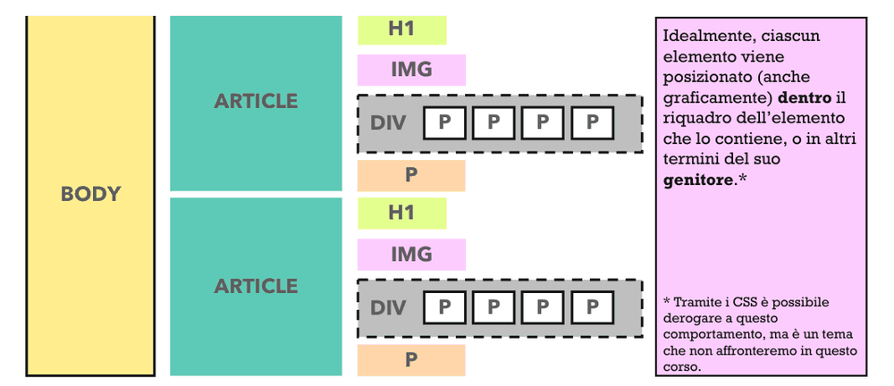<br>
<sub><i>Figura: il layout dipende dalla struttura dell'HTML, a scatole cinesi (slide 45).</i></sub>
</p>


### `flow` (default)

Dispone gli elementi come in un articolo di rivista o un documento di testo, ed è il display-inside di default di quasi tutto, quindi raramente va scritto. Qui conta il display-outside dei contenuti. Un elemento `block` occupa tutto il contenitore in larghezza e in altezza quanto serve (come un paragrafo). Un elemento `inline` è come una sequenza di testo che scorre su più righe da sinistra a destra, e due inline consecutivi proseguono l'uno dove finisce l'altro. Si può portare un elemento fuori dal flusso, costringendo le righe a girarci attorno, con `float: left` o `float: right`. Il valore `flow-root` ha senso su un elemento inline: si dispone inline nel contenitore ma si comporta come un unico grosso carattere (come un'immagine nel mezzo di un paragrafo non fluttuante).

<p align="center">
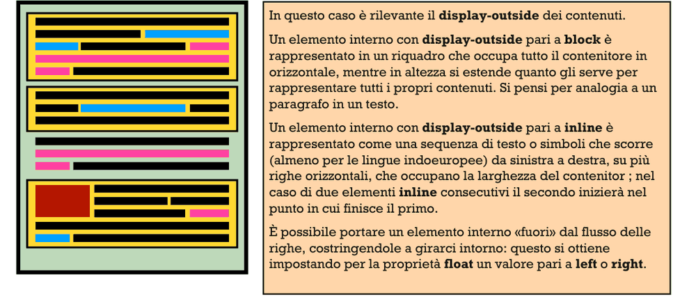<br>
<sub><i>Figura: display-inside flow, blocchi e linee (slide 49).</i></sub>
</p>


### `flex`

Dispone i contenuti come sequenza di riquadri in riga o in colonna, adattandone le dimensioni. Si imposta con `display: flex;` (outside implicitamente block) o con `inline flex`. **Ignora il display-outside dei figli**: a ciascuno assegna un riquadro, la cui dimensione dipende da ciò che contiene e dalle proprietà di allineamento ed elasticità. Per una guida completa le slide rimandano a css-tricks.com (A Guide to Flexbox). Le proprietà principali:

- `flex-direction`: `row`, `row-reverse`, `column`, `column-reverse`.
- `justify-content` (asse principale): `flex-start`, `flex-end`, `center`, `space-between` (spazio in eccesso tra gli elementi), `space-around` (spazio in eccesso equamente distribuito).
- `align-items` (asse trasversale): `flex-start`, `flex-end`, `center`, `stretch` (allunga gli elementi a riempire), `baseline` (allinea alla linea di base del testo).
- `flex-wrap`: con `nowrap` gli elementi sbordano, con wrap vanno a capo.
- `flex-grow` (sui figli, valore ≥ 0, default 0): se e in che proporzione l'elemento è disposto ad allargarsi per occupare lo spazio disponibile.
- `flex-shrink` (sui figli, valore ≥ 0): se e in che proporzione è disposto a restringersi per non eccedere lo spazio.

<p align="center">
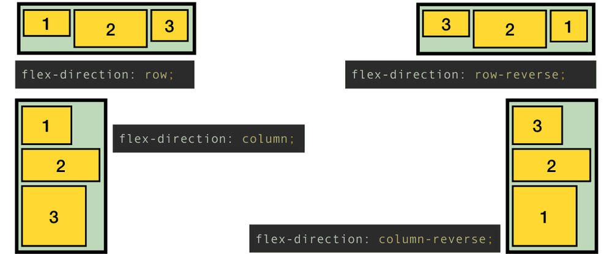<br>
<sub><i>Figura: flex-direction (slide 54).</i></sub>
</p>


<p align="center">
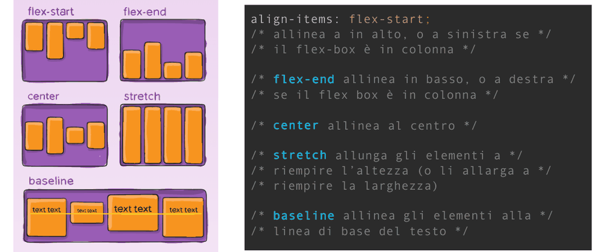<br>
<sub><i>Figura: align-items nel display flex (slide 57).</i></sub>
</p>


### `grid`

Definisce una griglia incrociando righe e colonne; ogni elemento occupa una o più celle contigue. Si imposta con `display: grid;` e, come flex, ignora il display-outside dei figli. La griglia si configura con `grid-template-rows` e `grid-template-columns`, che elencano altezze delle righe e larghezze delle colonne, per esempio `grid-template-rows: 50px 1fr 2fr; grid-template-columns: repeat(4, 1fr) 10vw;`, dove `fr` (frazione) esprime dimensioni proporzionali. Spetta a ciascun elemento figlio dichiarare quali celle occupa con `grid-row-start`, `grid-row-end`, `grid-column-start`, `grid-column-end`, anche con `span` (es. `grid-row-start: 2; grid-row-end: span 3;`). Altre proprietà permettono l'allineamento reciproco e dentro l'area (guida: css-tricks.com, Complete Guide to Grid).

<p align="center">
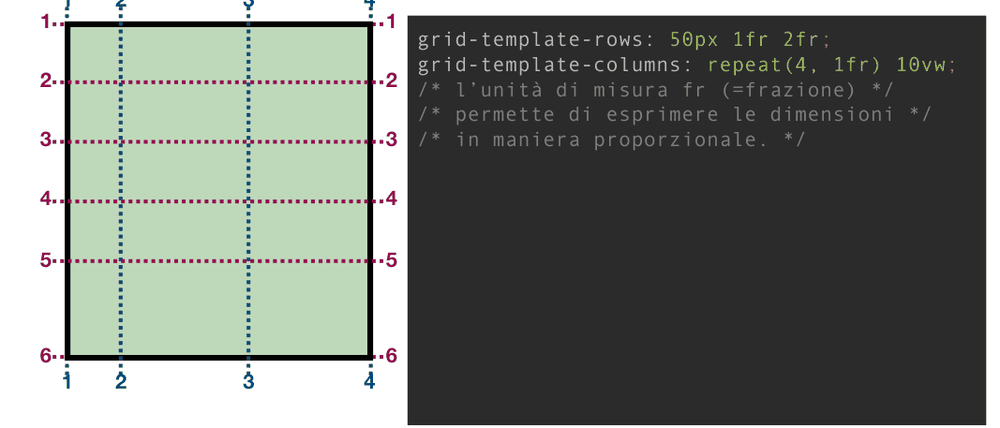<br>
<sub><i>Figura: linee e celle della griglia (slide 61).</i></sub>
</p>


<p align="center">
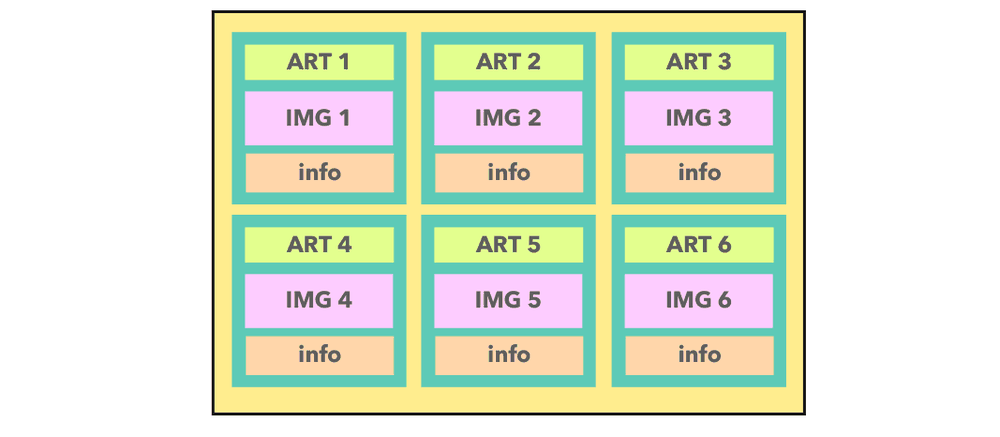<br>
<sub><i>Figura: sei articoli disposti con display grid (slide 60).</i></sub>
</p>


### `none`

`display: none;` toglie l'elemento dalla visualizzazione (A B C con B nascosto diventa A C).

## Strumenti per CSS

**SCSS/SASS**: SCSS è un linguaggio per scrivere regole di stile in modo più evoluto, SASS è il pre-processore che lo traduce in `.css` (il browser capisce solo CSS). Permette di definire costanti riutilizzabili, includere un foglio in altri, annidare una regola dentro un'altra (generando la composizione dei selettori).

**Bootstrap** (v5.3): CSS + JavaScript con stili e comportamenti di default per i componenti comuni di una UI (bottoni, menu a tendina, finestre modali). Uno stile predefinito è una classe CSS, quindi usarlo significa conoscere le classi e metterle nel proprio HTML. Pro: evita di scrivere il codice per gli elementi più comuni e semplifica le UI *responsive* (che si adattano a tablet, smartphone, computer). Contro: le UI sembrano tutte fatte con lo stampino, e la personalizzazione oltre colori e font non è semplice. Dettagli nel file 04.

**Tailwind**: rovescia il rapporto tra HTML e CSS. Tradizionalmente l'HTML descrive i contenuti con classi semantiche e i CSS dipendono da quella struttura. In Tailwind i CSS definiscono classi generiche "di utilità" (`bg-white`, `font-semibold`), ciascuna con un'impostazione grafica precisa, ed è l'HTML a dipendere dal CSS. Il CSS diventa molto riusabile, ma l'HTML è più verboso e ripetitivo (svantaggio attenuato usando framework a componenti, che si vedranno più avanti).

## Cose da saper fare all'esame

- Scrivere a mano un documento HTML con struttura corretta, link (esterno/assoluto/relativo), tabella con `colspan`/`rowspan` e un form completo con text, radio, checkbox, select, label, submit.
- Spiegare come un form manda i dati con GET e POST (query string vs body `x-www-form-urlencoded`) e perché `name` è obbligatorio.
- Dato un HTML e un CSS, dire quali elementi seleziona un selettore (composito/complesso, combinatori spazio, `>`, `~`, `+`) e quale regola vince per specificità/cascata/ereditarietà.
- Scrivere il CSS per un dato layout con flex o grid e capire che cosa fanno `justify-content`, `align-items`, `flex-grow`, `grid-template-*`, `fr`.
- Distinguere `block`/`inline`, `flow`/`flex`/`grid`, e dire cosa fa `float`.
- Elencare pro e contro di Bootstrap e Tailwind.

## Dubbi

- L'algoritmo di calcolo della specificità è solo annunciato nelle slide ("ne vedremo i dettagli"): ho aggiunto l'integrazione da MDN/W3C, da riconfrontare con ciò che spiegherà il docente.
- `flex-wrap: true` nelle slide è un errore: i valori validi sono `nowrap` (iniziale), `wrap`, `wrap-reverse` (MDN elenca anche un recente `balance`, fuori programma).
- Nel PDF molte slide di layout (flex, grid) sono figure: ho ricostruito il significato dai commenti nel codice, ma le immagini non erano leggibili.
