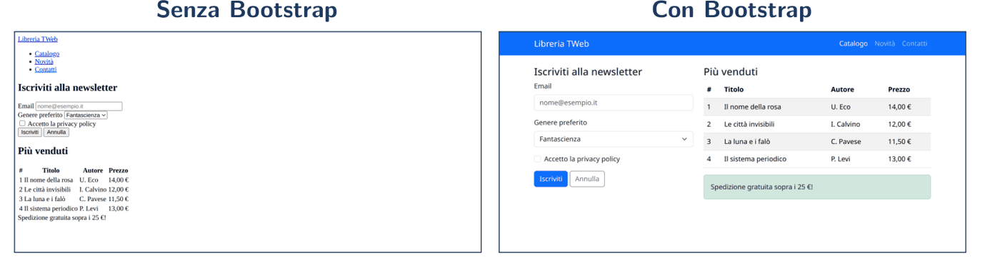
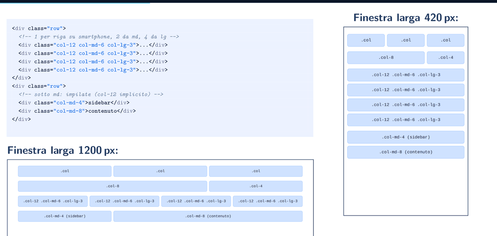
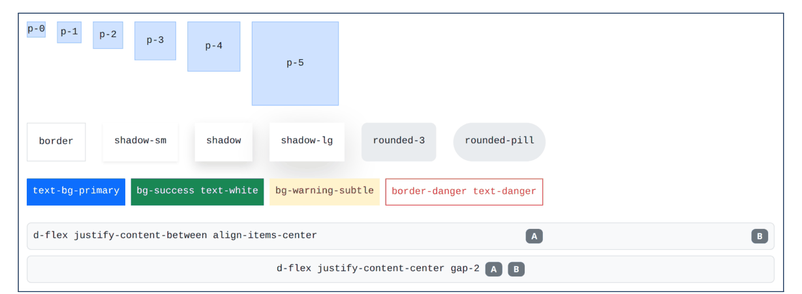
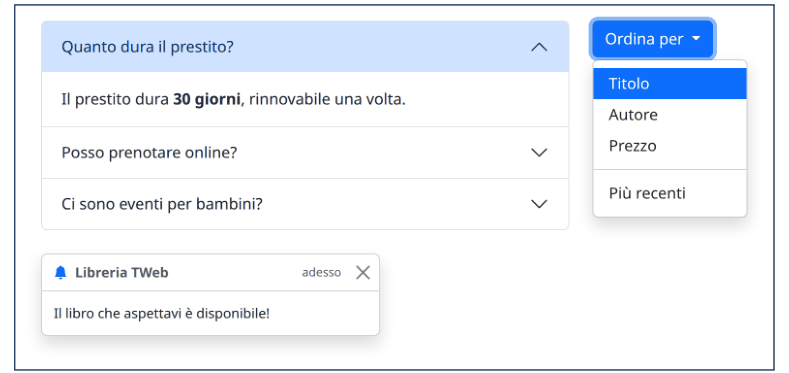
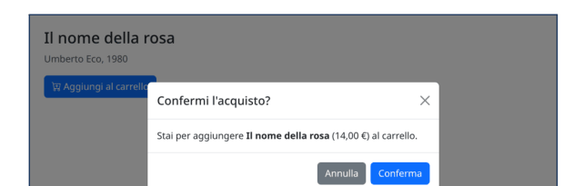
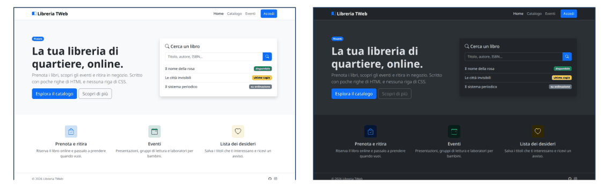
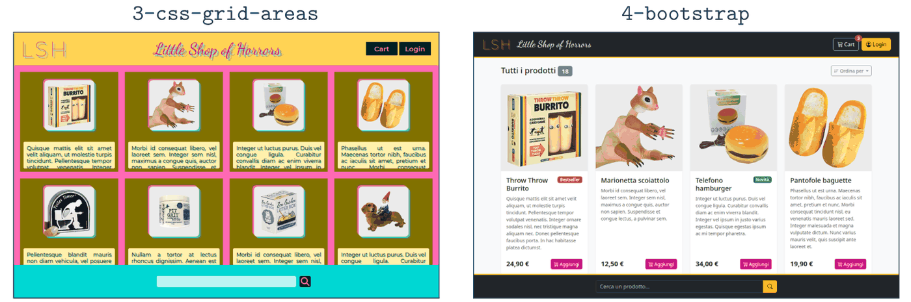

# 04 – Bootstrap: interfacce responsive con un framework CSS

Fonte: Drive › Terzo anno › Tecnologie Web › Slide Deck - Lab › "02 - Bootstrap" (Angelo Geninatti Cossatin, a.a. 2026-2027).

## Mappa degli argomenti

- [Cos'è Bootstrap e perché serve](#cosè-bootstrap-e-perché-serve)
- [Installazione](#installazione)
- [Layout: breakpoint, container, griglia](#layout-breakpoint-container-griglia)
- [Classi di utilità](#classi-di-utilità)
- [Componenti](#componenti)
- [Icone, dark mode, personalizzazione](#icone-dark-mode-personalizzazione)
- [Accessibilità, vantaggi e svantaggi](#accessibilità-vantaggi-e-svantaggi)
- [Cose da saper fare all'esame](#cose-da-saper-fare-allesame)
- [Dubbi](#dubbi)

## Cos'è Bootstrap e perché serve

Bootstrap è un **framework front-end**: un insieme di fogli di stile CSS e di codice JavaScript pronti all'uso. Nato nel 2011 dentro Twitter (Mark Otto e Jacob Thornton) per uniformare le interfacce interne, oggi è open source (licenza MIT) e tra i framework CSS più usati. Si usa la versione 5.3; dalla versione 5 non dipende più da jQuery (JavaScript "puro"). L'idea in una frase: Bootstrap definisce centinaia di classi CSS già pronte, e noi invece di scrivere le regole CSS a mano scriviamo l'HTML assegnando le classi giuste.

Perché un framework? Costruire il layout a mano con `display: flex` e `display: grid` funziona, ma in ogni progetto bisogna rifare da zero:
- stili "decenti" per bottoni, input, tabelle e menu;
- un layout che si adatti a smartphone, tablet e computer (**responsive**);
- la coerenza di colori, spaziature e bordi tra le pagine;
- i comportamenti interattivi ricorrenti (menu a tendina, finestre modali, pannelli che si aprono e chiudono).

Bootstrap risolve questi problemi una volta per tutte. L'esempio nelle slide: la stessa pagina HTML con le classi Bootstrap già scritte, con o senza la riga `<link>` del foglio di stile, cambia da spoglia a curata, con circa 90 righe di HTML e **zero righe di CSS** nostro; su smartphone le colonne si impilano da sole.

<p align="center">
<br>
<sub><i>Figura: stesso HTML senza e con Bootstrap (slide 5).</i></sub>
</p>


<p align="center">
<br>
<sub><i>Figura: la stessa pagina su desktop e su smartphone, circa 90 righe di HTML e nessuna riga di CSS (slide 6).</i></sub>
</p>


Contiene due parti:
- **CSS** (`bootstrap.min.css`): *Reboot*, che uniforma lo stile di base tra i browser; tipografia; layout con container, griglia e breakpoint; *utility*, classi che impostano una singola proprietà; componenti come bottoni, card, navbar, form, tabelle;
- **JavaScript** (`bootstrap.bundle.min.js`): fa funzionare modali, dropdown, accordion, carousel, tooltip; il bundle include **Popper**, la libreria che posiziona menu e tooltip.

**Bootstrap Icons** è una libreria separata con oltre 2000 icone vettoriali.

## Installazione

Il modo più semplice è la **CDN** (Content Delivery Network: insieme di server che distribuisce file statici): basta un `<link>` per il CSS nel `head` e uno `<script>` per il JS in fondo al `body` (serve solo per i componenti interattivi).

```html
<!DOCTYPE html>
<html lang="it">
<head>
  <meta charset="utf-8">
  <meta name="viewport" content="width=device-width, initial-scale=1">
  <!-- CSS di Bootstrap PRIMA dei nostri fogli di stile -->
  <link rel="stylesheet" href="https://cdn.jsdelivr.net/npm/bootstrap@5.3.8/dist/css/bootstrap.min.css">
  <link rel="stylesheet" href="style.css"> <!-- personalizzazioni -->
</head>
<body>
  <h1 class="text-primary">Ciao, Bootstrap!</h1>
  <script src="https://cdn.jsdelivr.net/npm/bootstrap@5.3.8/dist/js/bootstrap.bundle.min.js"></script>
</body>
</html>
```

*Integrazione da fonti esterne (non nelle slide):* la documentazione ufficiale di Bootstrap mette nei tag CDN anche `integrity="sha384-..."` e `crossorigin="anonymous"`. L'attributo `integrity` contiene l'hash atteso del file (**Subresource Integrity**): il browser calcola l'hash di ciò che scarica e lo esegue solo se coincide, così una CDN compromessa non può iniettare codice. `crossorigin="anonymous"` serve perché la verifica per risorse di un altro dominio richiede una richiesta in modalità CORS. L'hash cambia a ogni versione, quindi va aggiornato insieme al numero di versione nell'URL (gli esempi qui sopra, semplificati, li omettono). Vedi anche il riquadro su SOP e CORS nel file 01.

Il **meta viewport** è indispensabile per il responsive: senza, il browser di uno smartphone finge di avere uno schermo largo circa 980 px e poi rimpicciolisce la pagina, quindi le regole responsive non scattano e il testo diventa minuscolo. Alternative alla CDN:
- **file locali**: si scaricano CSS e JS bundle nel progetto, funziona anche offline;
- **npm** (`npm install bootstrap`): tipico dei progetti con sistema di build, sarà usato con React;
- **sorgenti Sass**: permettono di ricompilare Bootstrap con propri colori e dimensioni.

## Layout: breakpoint, container, griglia

I **breakpoint** sono le dimensioni di schermo di riferimento: extra small (nessun infisso, da 0), `sm` da 576 px, `md` da 768, `lg` da 992, `xl` da 1200, `xxl` da 1400. Molte classi hanno una versione con l'infisso (`col-md-6`, `d-lg-none`, `mt-sm-3`). Il criterio è **mobile first**: una classe con infisso vale da quella larghezza *in su*, una senza infisso vale sempre. Si progetta prima per lo smartphone e poi si aggiungono le varianti per gli schermi più grandi. Sotto il cofano ogni classe con infisso è definita in una media query, per esempio `@media (min-width: 768px) { .col-md-6 { flex: 0 0 auto; width: 50%; } }`.

Il **container** è il contenitore più esterno: centra il contenuto e gli dà margini laterali:
- `.container` ha larghezza massima fissa che cresce a ogni breakpoint (540, 720, 960, 1140, 1320 px);
- `.container-fluid` è sempre al 100%;
- `.container-md` (e simili) è al 100% fino al breakpoint e poi si comporta come `.container`.

Mettere sia la navbar sia il `main` in un `.container` fa sì che lo sfondo della navbar occupi tutta la larghezza mentre il suo contenuto resta allineato con quello della pagina.

La **griglia a 12 colonne** ha sempre tre livelli, in quest'ordine: `.container` › `.row` › `.col-*`. Ogni riga è divisa in 12 parti (`col-4` = 4/12 = un terzo). Regole pratiche:
- dentro una `.row` vanno solo colonne;
- il contenuto va dentro le colonne;
- se la somma supera 12 le colonne in eccesso vanno a capo;
- `.col` senza numero divide lo spazio in parti uguali.

Colonne responsive: `col-12 col-md-6 col-lg-3` significa una per riga su smartphone, due da `md`, quattro da `lg`; `col-md-4` + `col-md-8` (sidebar + contenuto) sono impilate sotto `md`.

<p align="center">
<br>
<sub><i>Figura: colonne responsive a 420 px e 1200 px (slide 15).</i></sub>
</p>


Sotto il cofano la griglia è **flexbox**: `.row { display: flex; flex-wrap: wrap; ... }`, `.col { flex: 1 0 0; }`, `.col-4 { flex: 0 0 auto; width: 33.33%; }`. Lo spazio tra colonne (*gutter*) si ottiene con un padding sulle colonne, e un margine negativo sulla riga lo compensa ai bordi. Usare Bootstrap non significa "non usare CSS" ma usare regole scritte da altri; con gli strumenti per sviluppatori (F12) si vede cosa applica ogni classe.

Altri strumenti: `row-cols-{n}` sulla riga (n colonne per riga, anche responsive, es. `row-cols-md-3`), `g-{0..5}`, `gx-*`, `gy-*` (spazio tra colonne), `offset-md-3` (sposta di 3/12 a destra), `order-*` (cambia l'ordine), `col-auto` (largo quanto il contenuto), e sulla riga `align-items-center`, `justify-content-between`.

**E CSS Grid?** La griglia di Bootstrap è monodimensionale (flexbox): si ragiona per righe, ciascuna indipendente. Con `display: grid` si controllano righe e colonne insieme (un elemento può occupare più righe, si possono nominare le aree). Le due cose si combinano: Bootstrap per componenti, spaziature e colori, più una regola grid scritta a mano per un layout bidimensionale particolare (esempio: `.galleria { grid-template-columns: repeat(auto-fill, minmax(200px, 1fr)); }` su un `<div class="galleria d-grid gap-3">`). Bootstrap 5.3 include anche una griglia basata su CSS Grid (`.grid`, `.g-col-*`), disattivata di default e attivabile solo ricompilando Sass.

## Classi di utilità

Le **utility** sono classi che impostano (quasi sempre) una sola proprietà CSS e si combinano direttamente nell'HTML: è lo stesso approccio, portato all'estremo, di Tailwind CSS.

<p align="center">
<br>
<sub><i>Figura: esempi di classi di utilità (slide 20).</i></sub>
</p>


**Spaziature** (margin e padding), formato `{proprietà}{lato}-{breakpoint}-{misura}`: proprietà `m` (margin) o `p` (padding); lato `t` top, `b` bottom, `s` start (sinistra), `e` end (destra), `x` orizzontale, `y` verticale, nessuno = tutti i lati; misura da 0 a 5 oppure `auto`. Le misure corrispondono a 0, .25rem, .5rem, 1rem, 1.5rem, 3rem. Esempi: `mb-3` (margine sotto 1rem), `p-3 p-lg-5` (padding 1rem, 3rem da `lg`), `mx-auto` (centra un blocco orizzontalmente), `gap-2` su un `d-flex`. Misure sempre uguali in tutta la pagina danno coerenza visiva senza doverci pensare.

**Display e flexbox**: `d-none` (display: none), `d-flex`, `d-grid`, `flex-column`, `flex-wrap`, `justify-content-between`, `align-items-center`, `flex-grow-1`, `gap-3` (gap: 1rem). Sono le stesse proprietà di flexbox scritte come classi. Esempio: `<aside class="d-none d-md-block">` nascosto su smartphone e visibile da `md`; `d-flex flex-column flex-md-row justify-content-between align-items-center gap-3` in colonna su smartphone e in riga da `md`.

**Colori** (varianti `primary`, `secondary`, `success`, `danger`, `warning`, `info`, `light`, `dark`): `text-danger`, `bg-success`, `text-bg-primary` (sfondo + testo leggibile), `bg-primary-subtle` (versione chiara), `text-body-secondary`. **Bordi e ombre**: `border`, `border-top`, `border-danger`, `rounded`, `rounded-3`, `rounded-circle`, `rounded-pill`, `shadow-sm`/`shadow`/`shadow-lg`. **Dimensioni**: `w-25/50/75/100`, `h-100`. **Testo**: `text-center`, `text-md-start` (allineamento responsive), `fw-bold`, `fst-italic`, `text-uppercase`, `fs-1`..`fs-6`, `display-1`..`display-6` (titoli molto grandi), `lead` (paragrafo introduttivo), `h1`..`h6` come classi (`<h2 class="h4">` è un `h2` per la semantica ma appare come un `h4`).

## Componenti

Un **componente** è un elemento di interfaccia già disegnato. Per usarlo:
1. scrivere l'HTML con la struttura prevista (quali elementi dentro quali);
2. assegnare le classi previste.

Per esempio una card è un `.card` che contiene un `.card-body`, che contiene `.card-title` e `.card-text`. In pratica nessuno ricorda tutte le classi: si cerca il componente nella documentazione (getbootstrap.com/docs/5.3/components/), si copia l'esempio e lo si adatta.

- **Bottoni**: `.btn` + variante `btn-{colore}` o `btn-outline-{colore}`; dimensioni `btn-lg`, `btn-sm`; funziona su `<button>`, `<a>`, `<input>`. **Badge** `badge text-bg-warning`. **Alert** `alert alert-success` con `role="alert"`.
- **Card**: `card` (riquadro con bordo e angoli arrotondati), `card-img-top` (immagine a filo col bordo superiore), `card-body` (padding per il contenuto), `card-footer` (fascia in fondo, ad es. per azioni), `h-100` (tutte le card di una riga della stessa altezza).
- **Navbar**: `navbar navbar-expand-lg bg-dark` (con `data-bs-theme="dark"`) contiene un `.container` con `navbar-brand`, un bottone `navbar-toggler` (l'"hamburger", visibile solo sotto `lg`) con `data-bs-toggle="collapse" data-bs-target="#menu"`, e un `collapse navbar-collapse` con `navbar-nav` di `nav-item`/`nav-link`. Da `lg` in su il menu è sempre aperto; sotto `lg` si apre e chiude dal bottone, gestito dal JavaScript di Bootstrap via attributi `data-bs-*`.
- **Form**: `form-label`, `form-control` (campi di testo), `form-select` (menu), `form-check` (checkbox e radio; `form-switch` per l'interruttore), `input-group` (testo o bottoni attaccati al campo), `is-valid` / `is-invalid` + `invalid-feedback` per l'esito della validazione; con `row g-3` e `col-md-6` il form si dispone in griglia.
- **Tabelle**: `table` (obbligatoria) più varianti combinabili `table-striped`, `table-hover`, `table-bordered`, `table-sm`; `table-responsive` sul contenitore dà scorrimento orizzontale se non entra nello schermo.

### Componenti interattivi

Modali, collapse e accordion, dropdown, carousel, offcanvas, toast, tooltip richiedono JavaScript, ma **non lo si scrive**: basta includere `bootstrap.bundle.min.js`, che cerca nella pagina gli elementi con attributi `data-bs-*` e collega da solo gli eventi. `data-bs-toggle="modal"` (o `collapse`, `dropdown`...) dice quale componente attivare al click, `data-bs-target="#id"` su quale elemento, `data-bs-dismiss="modal"` chiude il componente che lo contiene. Gli attributi `data-*` sono attributi personalizzati ammessi da HTML: il browser li ignora, il codice JS li può leggere. In alternativa da JavaScript: `const finestra = new bootstrap.Modal('#conferma'); finestra.show();`.

<p align="center">
<br>
<sub><i>Figura: accordion, dropdown e toast (slide 34).</i></sub>
</p>


Esempio di **finestra modale**: un bottone con `data-bs-toggle="modal" data-bs-target="#conferma"` e un `div.modal.fade#conferma` che contiene `modal-dialog` › `modal-content` › `modal-header` (titolo `modal-title` + `btn-close` con `data-bs-dismiss="modal"` e `aria-label`), `modal-body`, `modal-footer` (bottoni Annulla/Conferma). La finestra è già nella pagina ma nascosta; il bottone la mostra, `btn-close` e "Annulla" la chiudono; `fade` dà l'animazione; il backdrop scuro è aggiunto in automatico. Altri: **Accordion** (pannelli aperti uno alla volta, per FAQ o filtri), **Dropdown** (menu a tendina posizionato da Popper), **Toast** (notifica temporanea).

<p align="center">
<br>
<sub><i>Figura: la finestra modale dell'esempio (slide 33).</i></sub>
</p>


## Icone, dark mode, personalizzazione

**Bootstrap Icons** (icons.getbootstrap.com): si include un foglio di stile e ogni icona è un `<i class="bi bi-cart-plus"></i>`. Le icone sono caratteri di un font, quindi si colorano e ridimensionano come il testo (`text-danger`, `fs-3`). Accessibilità: un'icona da sola non dice nulla a uno screen reader; se è l'unico contenuto di un bottone serve un testo alternativo, ad esempio `aria-label="Aggiungi al carrello"`.

**Modalità scura**: dalla 5.3 basta l'attributo `data-bs-theme="dark"`, sull'intera pagina (`<html>`) o su un singolo componente. Funziona perché tutti i colori di Bootstrap sono variabili CSS (`--bs-body-bg`, `--bs-body-color`...) che cambiano valore quando l'attributo è presente.

<p align="center">
<br>
<sub><i>Figura: modalità chiara e scura (slide 37).</i></sub>
</p>


**Personalizzare**, in tre modi di crescente profondità:
1. un nostro CSS **caricato dopo** Bootstrap (a parità di specificità vince la regola scritta per ultima, per la cascata);
2. **ridefinire le variabili CSS**, globali in `:root { --bs-body-font-family: ...; --bs-border-radius: .75rem; }` o per singolo componente (`.btn-primary { --bs-btn-bg: #7952b3; --bs-btn-border-color: ...; --bs-btn-hover-bg: ... }`);
3. **ricompilare i sorgenti Sass** cambiando variabili Sass (`$primary`, `$border-radius`, `$font-family-sans-serif`) e importando `bootstrap/scss/bootstrap`; è la soluzione più completa (il cambiamento si propaga a bottoni, alert, badge, link...) ma richiede un passo di compilazione.

## Accessibilità, vantaggi e svantaggi

Bootstrap **aiuta** ma non rende accessibile una pagina in automatico.
- **Fa**: colori di default con contrasto sufficiente, focus da tastiera ben visibile, componenti JS navigabili da tastiera (Esc chiude una modale), esempi della documentazione con attributi `aria-*`, classe `visually-hidden` (testo letto dagli screen reader ma non visibile).
- **Restano a noi**: HTML semantico (`nav`, `main`, `button` invece di un `div` cliccabile), `label` associate ai campi, testi alternativi per immagini e icone, controllo del contrasto quando cambiamo i colori, non usare il colore come unica informazione.

**Vantaggi**:
- velocità (interfaccia gradevole in poco tempo);
- responsive quasi senza sforzo;
- coerenza di colori/spaziature/componenti;
- test su tutti i browser moderni;
- ottima documentazione e comunità ampia;
- chi lo conosce può lavorare subito su progetti altrui.

**Svantaggi**:
- siti che si somigliano tutti ("aspetto Bootstrap");
- HTML pieno di classi e più lungo da leggere;
- si carica tutto il CSS anche se se ne usa poco;
- personalizzazioni profonde richiedono Sass;
- i passaggi di versione (3 → 4 → 5) hanno rinominato molte classi.

Saper scrivere CSS a mano resta indispensabile: per personalizzare, per capire cosa fa il framework e per i casi che non prevede.

Esempio del laboratorio, "prima e dopo": un negozio con layout a mano in circa 130 righe di CSS (griglia con aree `header`/`main`/`footer`, sempre 4 colonne anche su smartphone) diventa HTML con classi Bootstrap più circa 20 righe di CSS proprio (font del logo e colore dei bottoni), responsive e con menu, carrello e login interattivi. Corrispondenze: pagina `body` `d-flex flex-column vh-100` con `main` `flex-grow-1 overflow-auto`; griglia prodotti `row row-cols-1 row-cols-sm-2 row-cols-lg-3 row-cols-xl-4 g-4`; prodotto `card`, `card-img-top`, `card-body`, `card-footer`, `badge`; carrello/login `navbar navbar-expand-md` + `btn`; ricerca `input-group` + icona `bi-search`; nuovi: hamburger, dropdown, offcanvas (carrello), modal (login).

<p align="center">
<br>
<sub><i>Figura: lo stesso esercizio con CSS scritto a mano e con Bootstrap (slide 42).</i></sub>
</p>


## Cose da saper fare all'esame

- Dato un layout descritto a parole, scrivere l'HTML Bootstrap con `container` › `row` › `col-*` responsive (es. 1 colonna su smartphone, 2 da `md`, 4 da `lg`).
- Spiegare mobile first, il ruolo degli infissi dei breakpoint e perché serve il meta viewport.
- Usare le utility (spaziature `m/p`, `d-*`, flex, colori, testo) e leggerle in codice altrui.
- Costruire una card, una navbar con hamburger, un form con validazione, una modale con `data-bs-*`.
- Spiegare come funziona la griglia sotto il cofano (flexbox) e come personalizzare Bootstrap (CSS dopo, variabili CSS, Sass).
- Discutere vantaggi/svantaggi e limiti per l'accessibilità.

## Dubbi

- Le slide citano React e il build con npm come argomenti dei prossimi appuntamenti: da integrare quando arriva il materiale.
- Gli esercizi suggeriti (ispezionare con F12 `row-cols-lg-3` e `d-flex`, cambiare le variabili `--bs-btn-*` in `style-bootstrap.css`, aggiungere un carousel) si riferiscono a file di laboratorio (`3-css-grid-areas`, `4-bootstrap`) che non sono su Drive: non li ho visti.
